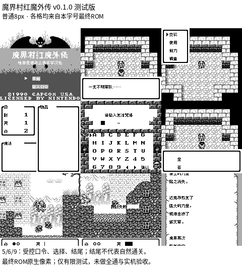

# 魔界村红魔外传

原输入：Gargoyle's Quest

原输入完整SHA256：`ad6f9fe97a40418279d3b834a64d9c6c52c0da209f430718f2bd02611892326f`。此处“原输入”保留改版、既有汉化或地区修订身份，不一律称干净零售ROM。

| 字号 | 当前版本 | 音频 | 输出完整SHA256 |
| --- | --- | --- | --- |
| 8px | v0.1.0 | unchanged | `23fdbcda6f1ed9cc66dac8f5822cafcc2e47795145bfd945bf22b6a0f300f090` |

## 源码与补丁

- 8px／v0.1.0／unchanged：源码包（完整性未独立确认）：[下载](https://github.com/shiyi1133/youxi-hanhua-releases/releases/download/source-migration-20261022-04/gargoyles-quest-current-scope-source-public-r01.zip)（ZIP SHA256 `4efc42b6bbc81ebb2ae91448a0abfa1a2223d6337d1c0b897d8c04ac14f9e93b`）；补丁：[下载](https://github.com/shiyi1133/youxi-hanhua-releases/releases/download/patch-migration-20261022/gargoyles-quest-current-patches.zip)（ZIP SHA256 `ee7b00933122e4ffaf96d7c10b0ae709456479529b432e66d1894458daedb3ed`）。
  该包已核对对应版本与字节安全；完整修改源码覆盖范围未独立确认。

补丁须直接应用于完整SHA一致的实际原输入；普通字、大字和音乐变体分别核对。公开源码归档不表示本轮重新构建或通过新的运行验收。原作、字体、已有翻译及工具依赖的权利与许可，依各包对应许可保留。

## 范围与验证边界

- 8px／v0.1.0：原生Fusion Pixel普通8px；10px探针未形成可交付目标。。
  原生8px汉化；保留原口令机制，不新增取名或电池存档。
  提供方自然初段行动/复活；商店、部分选择与结尾为受控入口。
  不认证全通、实机或J/V/I/A/S残留图像归属。

本次资料搬运未新增模拟器、实机或全通验收；未记录或未测试的范围不写成通过。问题单开放只表示尚未关闭，已关闭也不单独证明全部场景都修复。

[公开反馈及问题状态](feedback.md) · [报告BUG](https://github.com/shiyi1133/youxi-hanhua-releases/issues/new?template=bug_report.md)

## 对应版本截图

魔界村红魔外传 v0.1.0 8px；原生Fusion Pixel普通8px；10px探针未形成可交付目标。 5/6/9：受控口令、选择、结尾；结尾不代表自然通关。 最终ROM原生像素；仅有限测试，未做全通与实机验收。

图像SHA256：`4d5e035fd3d826acc6d5e1392e30418ecaa2a5024407e26c1c7d4bb397963e62`；绑定ROM SHA256：`23fdbcda6f1ed9cc66dac8f5822cafcc2e47795145bfd945bf22b6a0f300f090`。

