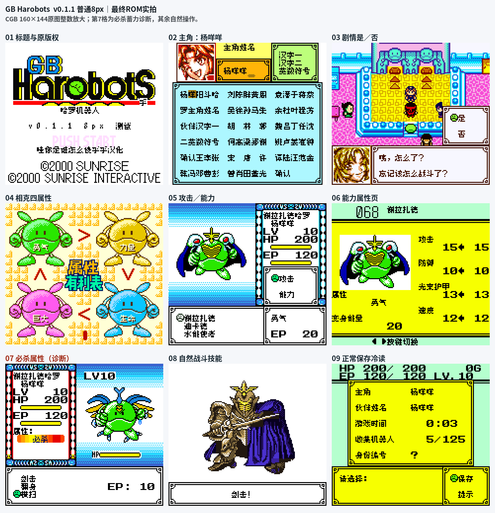

# GB哈罗机器人

原输入：GB Harobots

原输入完整SHA256：`859d69833e8d422440a4268d30bec4df238550b969cb3bc3b2f262136de63b6f`。此处“原输入”保留改版、既有汉化或地区修订身份，不一律称干净零售ROM。

| 字号 | 当前版本 | 音频 | 输出完整SHA256 |
| --- | --- | --- | --- |
| 8px | v0.1.1限定测试版 | unchanged | `b92433030951144351503f4f57abe9a5171f96c35486bd27d24baec9f97844e8` |

## 源码与补丁

- 8px／v0.1.1限定测试版／unchanged：源码包（完整性未独立确认）：[下载](https://github.com/shiyi1133/youxi-hanhua-releases/releases/download/source-migration-20261022-02a/gb-harobots-current-source-be0d106e294b-public-r01.zip)（ZIP SHA256 `3cf34cf34c6e24eaef0bf173ac5438d8a73af9fcfef96685c1fb6b60df41eef9`）；补丁：[下载](https://github.com/shiyi1133/youxi-hanhua-releases/releases/download/patch-migration-20261022/gb-harobots-current-patches.zip)（ZIP SHA256 `0deeb08463e5dca37621b7b046c4d068ca3b70d649fd9550002fef65a1f56a51`）。
  该包已核对对应版本与字节安全；完整修改源码覆盖范围未独立确认。

补丁须直接应用于完整SHA一致的实际原输入；普通字、大字和音乐变体分别核对。公开源码归档不表示本轮重新构建或通过新的运行验收。原作、字体、已有翻译及工具依赖的权利与许可，依各包对应许可保留。

## 范围与验证边界

- 8px／v0.1.1限定测试版：普通8px点阵汉化；原生英文/假名及未覆盖图形按实际版本保留。。
  修复是/否语义，并汉化属性图、两个弹窗项和必杀显示。
  是/否/B自然分支、属性图及两个弹窗、取名/自然战斗/存档冷启动由提供方验证。
  必杀字样通过自然第二战场景内受控蓄力值注入验证，九宫格第7格及相应对照是诊断，不冒充自然蓄满；最终ROM/存档未注入修改。
  标题继续/新游戏仍有日文；未全流程/实机/联机验收。
  本维护会话仅独立静态、BPS还原、文件校验和九宫格像素核验；未执行附件代码、未运行模拟器或复测游戏。
  提供方限定路线验证；维护独立核完整SHA、补丁和截图，未运行附包代码或游戏。
  未声明实机、全流程通关或全部旧存档兼容。

本次资料搬运未新增模拟器、实机或全通验收；未记录或未测试的范围不写成通过。问题单开放只表示尚未关闭，已关闭也不单独证明全部场景都修复。

[公开反馈及问题状态](feedback.md) · [报告BUG](https://github.com/shiyi1133/youxi-hanhua-releases/issues/new?template=bug_report.md)

## 对应版本截图

GB哈罗机器人 v0.1.1限定测试版 普通8px；提供方最终ROM画面，维护实际查看九宫格，不代表维护重跑游戏。

图像SHA256：`19e31ddfc7e2b9972396ebcafcb210c2ab58fc807a185ba8f0149e1167231395`；绑定ROM SHA256：`b92433030951144351503f4f57abe9a5171f96c35486bd27d24baec9f97844e8`。

