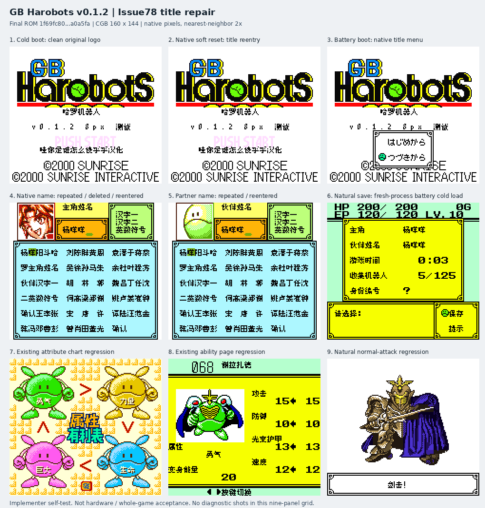

# GB哈罗机器人 v0.1.2（限定测试版）

[源码与补丁Release](https://github.com/shiyi1133/youxi-hanhua-releases/releases/tag/gb-harobots-v0.1.2) · [公开反馈](feedback.md) · [报告BUG](https://github.com/shiyi1133/youxi-hanhua-releases/issues/new?template=bug_report.md)

原游戏／实际输入：GB Harobots

原输入完整 SHA-256：`859d69833e8d422440a4268d30bec4df238550b969cb3bc3b2f262136de63b6f`（2097152字节）。

范围：普通8px限定修复Issue78标题Logo右下多余“乎”：排除原Logo保留行所引用图块，恢复$5C原字节；保留原英文Logo、下划线、版权、调色板、OAM和既有Issue52/53修复。

## 8px v0.1.2 / unchanged

字号范围：普通8px限定修复Issue78标题Logo右下多余“乎”：排除原Logo保留行所引用图块，恢复$5C原字节；保留原英文Logo、下划线、版权、调色板、OAM和既有Issue52/53修复。

目标完整 SHA-256：`1f69fc8098de07f9f3084df2407a463da0bd45f0fcf24350064274c8f7a0a5fa`（4194304字节）。

补丁：`GB-Harobots-v0.1.2-8px.bps`，SHA-256 `76e0ef17e4f45e1cad010898a654ecc8a5c62083989ba698d9d26ad3ef268e38`。

[源码（完整性未独立确认）](https://github.com/shiyi1133/youxi-hanhua-releases/releases/download/gb-harobots-v0.1.2/gb-harobots-v0.1.2-complete-source.zip) · [补丁包](https://github.com/shiyi1133/youxi-hanhua-releases/releases/download/gb-harobots-v0.1.2/gb-harobots-v0.1.2-patches.zip)

普通8px限定修复Issue78标题Logo右下多余“乎”：排除原Logo保留行所引用图块，恢复$5C原字节；保留原英文Logo、下划线、版权、调色板、OAM和既有Issue52/53修复。；提供方对应最终ROM图证，具体自然/诊断类别见原图标签及材料；非维护运行、全通或实机验收。

## 测试及限制

提供方自然范围：提供方报告的自然/正常按键流程，维护未重跑。

提供方诊断范围：提供方明确标注的受控消费者、解锁或边界测试，不能冒充自然到达。

保存边界：仅按具体版本材料，不推定所有旧存档兼容。

维护本轮独立核原输入、补丁逐字节还原、ZIP/CRC、Source安全与原图字节；未执行提供方源码、未重建或运行ROM，未宣称独立人员QA、实机或全流程验收。

- 未验证：维护仅独立核用户输入ZIP/ROM完整SHA、补丁逐字节还原、ZIP成员/CRC与源包静态材料；未执行提供者源码、重建工程或运行ROM。
- 未验证：运行、自然按键、受控诊断、保存/新进程冷读等范围以所附提供方报告分别为据，不冒充维护重跑、独立人员QA、玩家验收、实机或全流程通关。
- 未验证：使用前备份普通存档；不跨ROM版本/字号套用即时状态，旧电池兼容仅按提供方实际样本说明。
- 未验证：发布勘误：本Release早先ROM包及补丁包内README的一行范围摘要誊写有误，以此更正说明为准：普通8px限定修复Issue78标题Logo右下多余“乎”：排除原Logo保留行所引用图块，恢复$5C原字节；保留原英文Logo、下划线、版权、调色板、OAM和既有Issue52/53修复。 ROM及补丁字节和完整SHA256未变；保留原ZIP及回执，不替换资产、不另造游戏新版，也不扩大运行验收。
