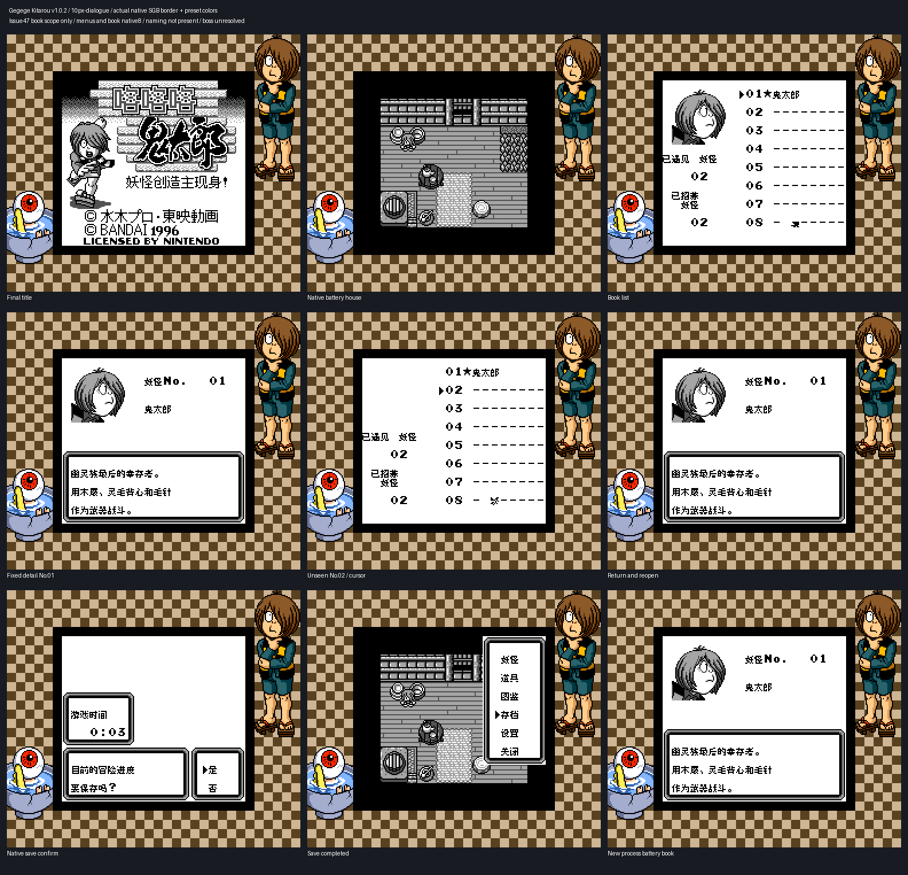

# 鬼太郎：妖怪创造主现身！

原输入：Gegege no Kitarou - Youkai Souzoushu Arawaru!

原输入完整SHA256：`e5df85b5aa7dd7ddf7f3f7660126e06a12ae7ae1886cf15e514776e81ef04ad7`。此处“原输入”保留改版、既有汉化或地区修订身份，不一律称干净零售ROM。

| 字号 | 当前版本 | 音频 | 输出完整SHA256 |
| --- | --- | --- | --- |
| 8px | v1.0.2 | unchanged | `587c4c0f6e6392d0f71b9fb0d657c396dc333a63063eb553b4280d3f365c3551` |
| 10px-dialogue | v1.0.2 | unchanged | `48817cd179761d95f279781c585a170085a8a58f1ca79e02c29717b0e03a5af7` |

## 源码与补丁

- 8px／v1.0.2／unchanged：完整修改源码：[下载](https://github.com/shiyi1133/youxi-hanhua-releases/releases/download/source-migration-20261022/gegege-kitarou-current-source-6ba9c87bdd93-public-r02.zip)（ZIP SHA256 `b8e5ce2fd15796c12f70eb4e9467ceb1ff67d3ecd6dfa3b8a62ab435863c32c3`）；补丁：[下载](https://github.com/shiyi1133/youxi-hanhua-releases/releases/download/patch-migration-20261022/gegege-kitarou-current-patches.zip)（ZIP SHA256 `7dbc99e9b5fd8e774c2982d5edb21a9bd0ce26983256418e39b9bf5d15bf8c4e`）。
- 10px-dialogue／v1.0.2／unchanged：完整修改源码：[下载](https://github.com/shiyi1133/youxi-hanhua-releases/releases/download/source-migration-20261022/gegege-kitarou-current-source-6ba9c87bdd93-public-r02.zip)（ZIP SHA256 `b8e5ce2fd15796c12f70eb4e9467ceb1ff67d3ecd6dfa3b8a62ab435863c32c3`）；补丁：[下载](https://github.com/shiyi1133/youxi-hanhua-releases/releases/download/patch-migration-20261022/gegege-kitarou-current-patches.zip)（ZIP SHA256 `7dbc99e9b5fd8e774c2982d5edb21a9bd0ce26983256418e39b9bf5d15bf8c4e`）。

补丁须直接应用于完整SHA一致的实际原输入；普通字、大字和音乐变体分别核对。公开源码归档不表示本轮重新构建或通过新的运行验收。原作、字体、已有翻译及工具依赖的权利与许可，依各包对应许可保留。

## 范围与验证边界

- 8px／v1.0.2：8px完整中文文本 / 240条选定剧情10px（639字形）；其它界面8px。
- 10px-dialogue／v1.0.2：8px完整中文文本 / 240条选定剧情10px（639字形）；其它界面8px。

本次资料搬运未新增模拟器、实机或全通验收；未记录或未测试的范围不写成通过。问题单开放只表示尚未关闭，已关闭也不单独证明全部场景都修复。

[公开反馈及问题状态](feedback.md) · [报告BUG](https://github.com/shiyi1133/youxi-hanhua-releases/issues/new?template=bug_report.md)

## 对应版本截图

v1.0.2最终ROM真实SGB边框/预设着色；图鉴原生8px、有界保存冷读；无取名，白藏主未验

图像SHA256：`bc7a4887f134fcb7801c7bb0de0b466c9704a18551f2f35fd6bfe23af08b47c9`；绑定ROM SHA256：`587c4c0f6e6392d0f71b9fb0d657c396dc333a63063eb553b4280d3f365c3551`。

v1.0.2最终ROM真实SGB边框/预设着色；图鉴原生8px、有界保存冷读；无取名，白藏主未验

图像SHA256：`93b4378a09842bee6ec70ea0ca67e4f85b1943a31d60953a75043caf4e1758d9`；绑定ROM SHA256：`48817cd179761d95f279781c585a170085a8a58f1ca79e02c29717b0e03a5af7`。

