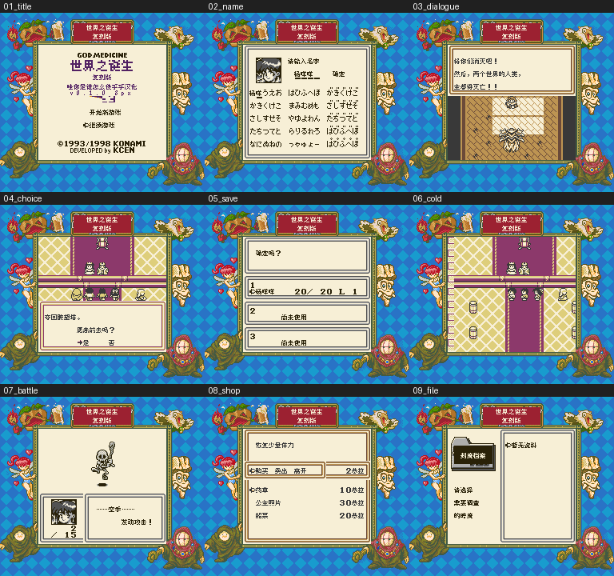

# 世界之诞生 复刻版

原输入：God Medicine - Fukkokuban

原输入完整SHA256：`185f092bbebd5fa29a82ffb7d18c8242f75d6f8fee968cf6dee00b32a879febb`。此处“原输入”保留改版、既有汉化或地区修订身份，不一律称干净零售ROM。

| 字号 | 当前版本 | 音频 | 输出完整SHA256 |
| --- | --- | --- | --- |
| 8px | v0.1.0 | unchanged | `c3bba6717ba87852d25d0478b89d8b041fe1ba59b6f7d74e90d41972e96be100` |

## 源码与补丁

- 8px／v0.1.0／unchanged：源码包（完整性未独立确认）：[下载](https://github.com/shiyi1133/youxi-hanhua-releases/releases/download/source-migration-20261022-02a/god-medicine-fukkokuban-current-source-a23152ea687b-public-r01.zip)（ZIP SHA256 `085e6c425dcc15da6c7f0f6ce388a041d904e88220b75f1c8f68722dc81002ff`）；补丁：[下载](https://github.com/shiyi1133/youxi-hanhua-releases/releases/download/patch-migration-20261022/god-medicine-fukkokuban-current-patches.zip)（ZIP SHA256 `d8623b47418a54c2549eb8a4161017216800b729c4bf3b4dc3a1fd8beea89f4c`）。
  该包已核对对应版本与字节安全；完整修改源码覆盖范围未独立确认。

补丁须直接应用于完整SHA一致的实际原输入；普通字、大字和音乐变体分别核对。公开源码归档不表示本轮重新构建或通过新的运行验收。原作、字体、已有翻译及工具依赖的权利与许可，依各包对应许可保留。

## 范围与验证边界

- 8px／v0.1.0：原生普通8px；不声明新增大字。。
  首次原生8px限定测试版；剧情/菜单/敌人招式及已识别图像消费者已作静态译文处理，中文取名、开场分支、普通保存与新进程冷读、首战和商店/药草等有提供者模拟器自测证据；未制作大字号。
  静态条目数量不代表自然到达或全流程；E7原终止语义可能使部分提取尾文不可达。全部结局、敌人/技能/商店/事件条件、最长F9变量、旅馆自然购买和实机未逐项验证。部分截图来自同ROM即时状态恢复，不能冒称全部自然连续流程。新增命名字码不保证日文原版存档显示。未确认原密码机制，不声称新增。实施者自测不是独立人员QA。

本次资料搬运未新增模拟器、实机或全通验收；未记录或未测试的范围不写成通过。问题单开放只表示尚未关闭，已关闭也不单独证明全部场景都修复。

[公开反馈及问题状态](feedback.md) · [报告BUG](https://github.com/shiyi1133/youxi-hanhua-releases/issues/new?template=bug_report.md)

## 对应版本截图

v0.1.0普通8px最终ROM原生SGB边框/预设色九宫格；提供者同ROM按键与电池/即时状态恢复分层证据，非实机或全流程通关。

图像SHA256：`0a32381a8af7d91102e1d6abd7c419f6135aed46a0c93e9bea18c2b9a9277e13`；绑定ROM SHA256：`c3bba6717ba87852d25d0478b89d8b041fe1ba59b6f7d74e90d41972e96be100`。

