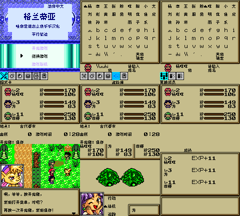

# 格兰蒂亚：平行旅途

原输入：Grandia: Parallel Trippers (user-provided English modified base)

原输入完整SHA256：`2bda2c70c23ae86851c2a4a7e4b4af26f6af5f8973e848147e7362d198842505`。此处“原输入”保留改版、既有汉化或地区修订身份，不一律称干净零售ROM。

| 字号 | 当前版本 | 音频 | 输出完整SHA256 |
| --- | --- | --- | --- |
| 8px | v0.1.3 | unchanged | `2ff32dbabb6f57bde0ff6e4a6723ba0e4689b5854c871c3133106ed2041e2685` |

## 源码与补丁

- 8px／v0.1.3／unchanged：源码包（完整性未独立确认）：[下载](https://github.com/shiyi1133/youxi-hanhua-releases/releases/download/source-migration-20261022-02a/grandia-parallel-trippers-current-source-41ab9b5b3aa7-public-r01.zip)（ZIP SHA256 `2d5a5f12f2e81a3587f8cf951080953b96efa8238218103c9f85dd67e5bf8a73`）；补丁：[下载](https://github.com/shiyi1133/youxi-hanhua-releases/releases/download/patch-migration-20261022/grandia-parallel-trippers-current-patches.zip)（ZIP SHA256 `a3853f09b3e75f39e4587d46a17627f488961bd61ddbd905a02d5043e08f7e0e`）。
  该包已核对对应版本与字节安全；完整修改源码覆盖范围未独立确认。

补丁须直接应用于完整SHA一致的实际原输入；普通字、大字和音乐变体分别核对。公开源码归档不表示本轮重新构建或通过新的运行验收。原作、字体、已有翻译及工具依赖的权利与许可，依各包对应许可保留。

## 范围与验证边界

- 8px／v0.1.3：Fusion Pixel普通8px；原生取名保留16px格距和24中文选字，非完整中文输入法；无10px/12px大字正文。原生CGB，非SGB。。
  角色六图标菜单空闲字槽扫描性能限定修复；继承原文字/取名，不扩全文验收。
  提供方同一实现者自测，维护未运行附包脚本、源码重建或游戏；不是独立人员QA。
  菜单时序为mGBA 0.10.5 CGB同普通电池存档、新进程冷读、42次方向输入的完整标签稳定帧数；前版32–63帧，本版8–12帧，原英文输入4帧。不是手机墙钟或实机测试；玩家文件完整SHA未知。
  当前690描述分派JSON仍绑定v0.1.1目标acaba252…，不认证v0.1.3重跑；当前1060字形/160占用/8边界/1279控制另有同SHA诊断或静态回执，不能当自然全流程。
  仅24个中文选字，保留原英文/数字标点/复合字形页及原生删除确认；其它未到达改名字段未验。
  仅具体原生姓名保存与新进程读取、指定旧v0.1.2普通电池档场景；不保证任意旧存档或旧即时状态兼容。
  自然商店购买、深层合成、联机、全部剧情结局、玩家手机模拟器及实机未测。
  原输入为用户英文改版，日本Rev0头与原全局校验不符保持原字节；不是零售英文版。本次不满足另一份日版4c439…重译待安排需求。

本次资料搬运未新增模拟器、实机或全通验收；未记录或未测试的范围不写成通过。问题单开放只表示尚未关闭，已关闭也不单独证明全部场景都修复。

[公开反馈及问题状态](feedback.md) · [报告BUG](https://github.com/shiyi1133/youxi-hanhua-releases/issues/new?template=bug_report.md)

## 对应版本截图

格兰蒂亚：平行旅途 v0.1.3 普通8px；提供方最终ROM原生CGB标题/键盘/原生命名/普通电池冷读菜单/资料库/队伍/剧情/战斗/结算真实九格，均无诊断写入；非SGB、实机或全流程。

图像SHA256：`2968b1a1f537ed18d8106627b2a688926e453509baa036995dc94c4160de890f`；绑定ROM SHA256：`2ff32dbabb6f57bde0ff6e4a6723ba0e4689b5854c871c3133106ed2041e2685`。

