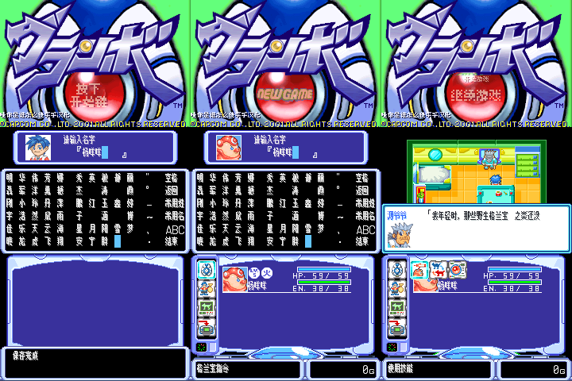

# 格兰宝

原输入：Guranbo (Japan)

原输入完整SHA256：`d11a31fa34801c24219df3d64876f9577ddfe30200ca65fe720e3ff8a9c8828b`。此处“原输入”保留改版、既有汉化或地区修订身份，不一律称干净零售ROM。

| 字号 | 当前版本 | 音频 | 输出完整SHA256 |
| --- | --- | --- | --- |
| native8x12-8ui | v0.1.4 | unchanged | `a15849054b7515b0ded6900666ae0b6576e37393c2e5fb31d91433376b6cf3bc` |

## 源码与补丁

- native8x12-8ui／v0.1.4／unchanged：源码包（完整性未独立确认）：[下载](https://github.com/shiyi1133/youxi-hanhua-releases/releases/download/source-migration-20261022-02a/guranbo-current-source-f2df75a3cd15-public-r01.zip)（ZIP SHA256 `bc7808050e8f66c8250ade5e6f3caf4f51a93c75e6f997db35910bf613fff1a4`）；补丁：[下载](https://github.com/shiyi1133/youxi-hanhua-releases/releases/download/patch-migration-20261022/guranbo-current-patches.zip)（ZIP SHA256 `caf82c69bbc2262627d14ca15795f733625b537790a7de88bf17d2a4c72c960f`）。
  该包已核对对应版本与字节安全；完整修改源码覆盖范围未独立确认。

补丁须直接应用于完整SHA一致的实际原输入；普通字、大字和音乐变体分别核对。公开源码归档不表示本轮重新构建或通过新的运行验收。原作、字体、已有翻译及工具依赖的权利与许可，依各包对应许可保留。

## 范围与验证边界

- native8x12-8ui／v0.1.4：MuzaiPixel原生8×12主字形位于8×16字格，紧凑战斗HUD保持Fusion Pixel8px；单普通测试版，无10px大字版。
  仅恢复原标题LOGO和背景艺术；左下保留最小8px汉化署名，主8×12/紧凑HUD8px、110字命名页、正文与存档布局沿用v0.1.3。标题NEW GAME/START BUTTON英文小图保留。
  完整通关
  实机
  联机
  全部历史存档导入未复测
  深层25格选项静态警告保留；不声称全部排版通过

本次资料搬运未新增模拟器、实机或全通验收；未记录或未测试的范围不写成通过。问题单开放只表示尚未关闭，已关闭也不单独证明全部场景都修复。

[公开反馈及问题状态](feedback.md) · [报告BUG](https://github.com/shiyi1133/youxi-hanhua-releases/issues/new?template=bug_report.md)

## 对应版本截图

格兰宝 v0.1.4 native8x12-8ui；MuzaiPixel原生8×12主字形位于8×16字格，紧凑战斗HUD保持Fusion Pixel8px；单普通测试版，无10px大字版；最终ROM真实九宫格（自然/诊断/续行边界按本说明）

图像SHA256：`29f1c065a6b2e99c9e4f08fda01404b4e55dd8710c30b032ee7f65a05da246bb`；绑定ROM SHA256：`a15849054b7515b0ded6900666ae0b6576e37393c2e5fb31d91433376b6cf3bc`。

