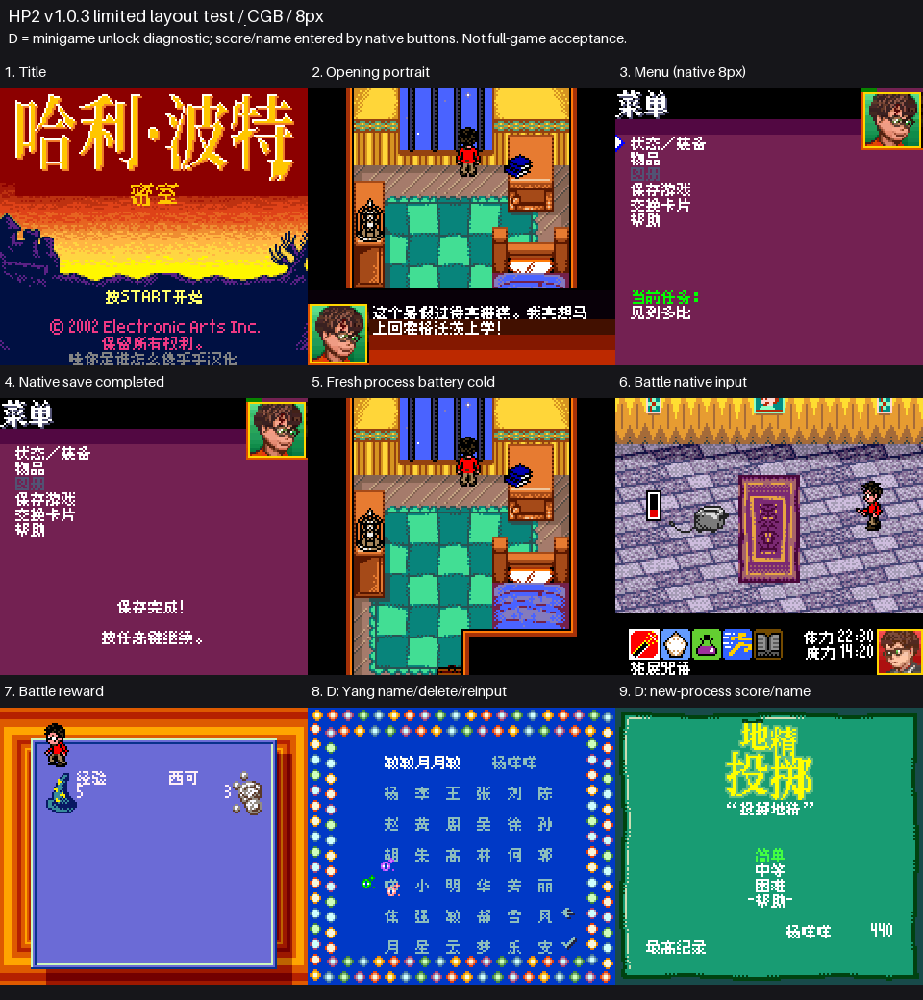
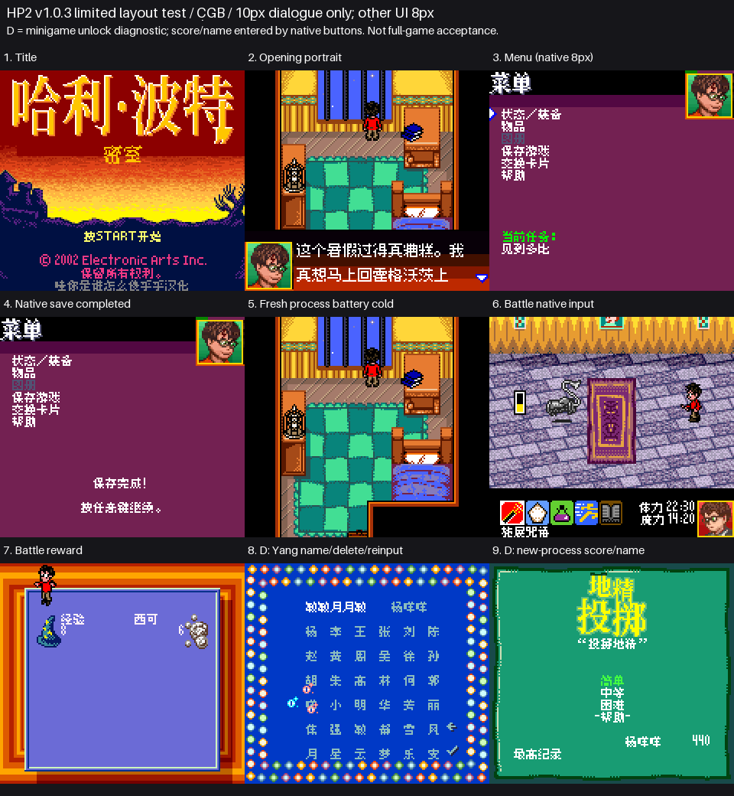

# 哈利波特与密室

原输入：Harry Potter and the Chamber of Secrets (multilingual USA/Europe, revision 0)

原输入完整SHA256：`2788df60fc6373bdf7c9fa241a4409da14726f23017953adc1121bb90ad6b99a`。此处“原输入”保留改版、既有汉化或地区修订身份，不一律称干净零售ROM。

| 字号 | 当前版本 | 音频 | 输出完整SHA256 |
| --- | --- | --- | --- |
| 8px | v1.0.3 | unchanged | `02246189b6a410574c43d0a60890433fdb65c0135e1b7209fb3cb19d3b430d20` |
| 10px-dialogue | v1.0.3 | unchanged | `bc1331e74dee231df31ae42fae32d76393c6cce1021f6c99dc148234c767ba50` |

## 源码与补丁

- 8px／v1.0.3／unchanged：完整修改源码：[下载](https://github.com/shiyi1133/youxi-hanhua-releases/releases/download/source-migration-20261022/harry-potter-chamber-v1.0.3-complete-source-public-r02.zip)（ZIP SHA256 `b1e6260badc5d63d4b029cc48a0d042ff38aac4e82e4d2441101315611ca3eb5`）；补丁：[下载](https://github.com/shiyi1133/youxi-hanhua-releases/releases/download/patch-migration-20261022/harry-potter-chamber-current-patches.zip)（ZIP SHA256 `f5ed6b5b0fcf23ca53ed9697704cec02ccb9b165544baa61b7c2d8c6b3c15864`）。
- 10px-dialogue／v1.0.3／unchanged：完整修改源码：[下载](https://github.com/shiyi1133/youxi-hanhua-releases/releases/download/source-migration-20261022/harry-potter-chamber-v1.0.3-complete-source-public-r02.zip)（ZIP SHA256 `b1e6260badc5d63d4b029cc48a0d042ff38aac4e82e4d2441101315611ca3eb5`）；补丁：[下载](https://github.com/shiyi1133/youxi-hanhua-releases/releases/download/patch-migration-20261022/harry-potter-chamber-current-patches.zip)（ZIP SHA256 `f5ed6b5b0fcf23ca53ed9697704cec02ccb9b165544baa61b7c2d8c6b3c15864`）。

补丁须直接应用于完整SHA一致的实际原输入；普通字、大字和音乐变体分别核对。公开源码归档不表示本轮重新构建或通过新的运行验收。原作、字体、已有翻译及工具依赖的权利与许可，依各包对应许可保留。

## 范围与验证边界

- 8px／v1.0.3：8px / 10px-dialogue。
- 10px-dialogue／v1.0.3：8px / 10px-dialogue。

两字号均为v1.0.3限定排版修订测试版。CGB专用；普通8px保留四行，大字仅标准头像框使用10px，菜单、命名和战斗等仍8px。

已有记录包含实际窗口参数的受控排版与字形回归，两版正常开局、菜单、战斗／胜利、手动保存和独立新进程普通电池冷读。小游戏计分和姓名经过按键与保存回读；前置解锁为诊断设置，九图第8、9格不表示自然剧情解锁。

标题Logo漏“与”字的反馈实际仍开放；不据此声称本版已复现或已修。商店、全部成绩路线、后期／全通关、任意存档与跨版兼容和实机未验收。

大字版更容易出现拖慢、刷新残留等问题。先备份普通电池档，不跨版本搬即时状态。

[公开反馈及BUG状态](feedback.md) · [报告BUG](https://github.com/shiyi1133/youxi-hanhua-releases/issues/new?template=bug_report.md)

本次资料搬运未新增模拟器、实机或全通验收；未记录或未测试的范围不写成通过。问题单开放只表示尚未关闭，已关闭也不单独证明全部场景都修复。

[公开反馈及问题状态](feedback.md) · [报告BUG](https://github.com/shiyi1133/youxi-hanhua-releases/issues/new?template=bug_report.md)

## 对应版本截图

v1.0.3 8px final native CGB: opening/menu/save/cold/battle; cells8/9 diagnostically unlock minigame then native score/name; UI8px; no fullgame/hardware claim

图像SHA256：`257ad0ec2e8ec8c4b9f84817f87ce8302552dc537fddd3bb66f35f40c7536588`；绑定ROM SHA256：`02246189b6a410574c43d0a60890433fdb65c0135e1b7209fb3cb19d3b430d20`。

v1.0.3 10px-dialogue final native CGB: opening/menu/save/cold/battle; cells8/9 diagnostically unlock minigame then native score/name; UI8px; no fullgame/hardware claim

图像SHA256：`d42d55fbe973f5ec5df02f8703a41a46f69b2ac2f725c15e6c62836e995c40d1`；绑定ROM SHA256：`bc1331e74dee231df31ae42fae32d76393c6cce1021f6c99dc148234c767ba50`。

