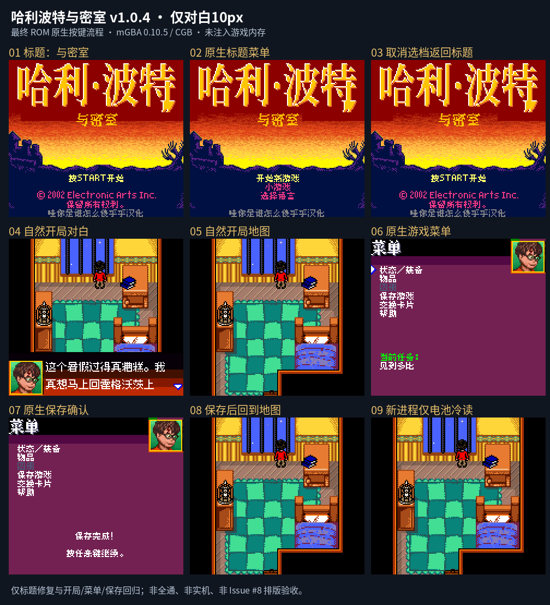
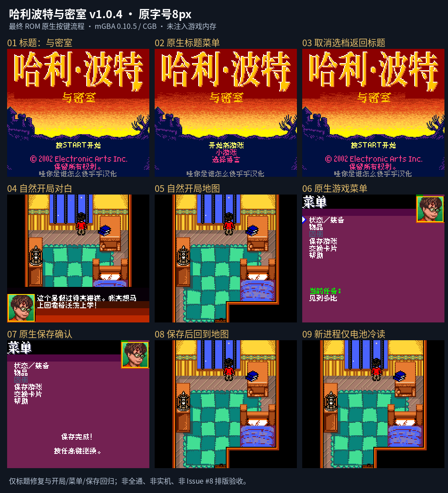

# 哈利波特与密室 v1.0.4（限定测试版）

[源码与补丁Release](https://github.com/shiyi1133/youxi-hanhua-releases/releases/tag/harry-potter-chamber-v1.0.4) · [公开反馈](feedback.md) · [报告BUG](https://github.com/shiyi1133/youxi-hanhua-releases/issues/new?template=bug_report.md)

原游戏／实际输入：Harry Potter and the Chamber of Secrets (multilingual USA/Europe, revision 0)

原输入完整 SHA-256：`2788df60fc6373bdf7c9fa241a4409da14726f23017953adc1121bb90ad6b99a`（4194304字节）。

范围：原生8px及仅对白10px两版标题补回“与”字；不是全作排版或新增字号。

## 10px-dialogue v1.0.4 / unchanged

字号范围：原生8px及仅对白10px两版标题补回“与”字；不是全作排版或新增字号。

目标完整 SHA-256：`18f42d86fc899e55652a5434fecf2354e1aeb72700c6b847a217ad852f941271`（4194304字节）。

补丁：`harry-potter-chamber-v1.0.4-10px-from-original.bps`，SHA-256 `c21a8855fdf2f62ca6136cf3ecb9eb92550557483597f7e609cc3c279a5a890e`。

[源码（完整性未独立确认）](https://github.com/shiyi1133/youxi-hanhua-releases/releases/download/harry-potter-chamber-v1.0.4/harry-potter-chamber-v1.0.4-complete-source.zip) · [补丁包](https://github.com/shiyi1133/youxi-hanhua-releases/releases/download/harry-potter-chamber-v1.0.4/harry-potter-chamber-v1.0.4-patches.zip)

原生8px及仅对白10px两版标题补回“与”字；不是全作排版或新增字号。；提供方对应最终ROM图证，具体自然/诊断类别见原图标签及材料；非维护运行、全通或实机验收。

## 8px v1.0.4 / unchanged

字号范围：原生8px及仅对白10px两版标题补回“与”字；不是全作排版或新增字号。

目标完整 SHA-256：`719475a2a25d72d7252e6cbf400032dfdfff8de06eb90d8f38fcdeb5df82a13c`（4194304字节）。

补丁：`harry-potter-chamber-v1.0.4-8px-from-original.bps`，SHA-256 `a7bd3cb9b3cb0847ff11b8f69aa3f597fa01f75a6a8b24a7e6498b5fb971096c`。

[源码（完整性未独立确认）](https://github.com/shiyi1133/youxi-hanhua-releases/releases/download/harry-potter-chamber-v1.0.4/harry-potter-chamber-v1.0.4-complete-source.zip) · [补丁包](https://github.com/shiyi1133/youxi-hanhua-releases/releases/download/harry-potter-chamber-v1.0.4/harry-potter-chamber-v1.0.4-patches.zip)

原生8px及仅对白10px两版标题补回“与”字；不是全作排版或新增字号。；提供方对应最终ROM图证，具体自然/诊断类别见原图标签及材料；非维护运行、全通或实机验收。

## 测试及限制

提供方自然范围：提供方报告的自然/正常按键流程，维护未重跑。

提供方诊断范围：提供方明确标注的受控消费者、解锁或边界测试，不能冒充自然到达。

保存边界：仅按具体版本材料，不推定所有旧存档兼容。

维护本轮独立核原输入、补丁逐字节还原、ZIP/CRC、Source安全与原图字节；未执行提供方源码、未重建或运行ROM，未宣称独立人员QA、实机或全流程验收。

- 未验证：维护仅独立核用户输入ZIP/ROM完整SHA、补丁逐字节还原、ZIP成员/CRC与源包静态材料；未执行提供者源码、重建工程或运行ROM。
- 未验证：运行、自然按键、受控诊断、保存/新进程冷读等范围以所附提供方报告分别为据，不冒充维护重跑、独立人员QA、玩家验收、实机或全流程通关。
- 未验证：使用前备份普通存档；不跨ROM版本/字号套用即时状态，旧电池兼容仅按提供方实际样本说明。

大字版更容易出现拖慢、刷新残留等问题，遇到请及时在原楼反馈。
