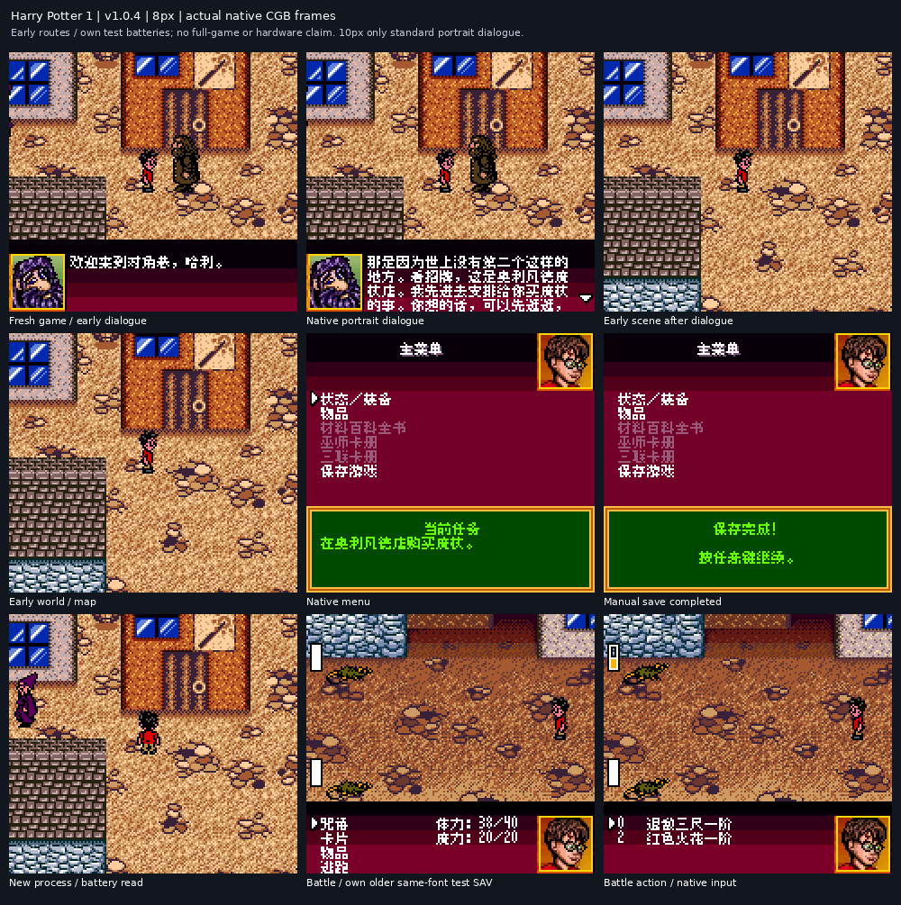

# 哈利波特与魔法石

原输入：Harry Potter and the Sorcerer's Stone (multilingual US English-slot base)

原输入完整SHA256：`8eb56e0d55a04aa3fcf940f172757f4f60baa6c53c82707def8ae4e78844b1da`。此处“原输入”保留改版、既有汉化或地区修订身份，不一律称干净零售ROM。

| 字号 | 当前版本 | 音频 | 输出完整SHA256 |
| --- | --- | --- | --- |
| 8px | v1.0.4 | unchanged | `409bdc8f8f0e7e863f6e96e12d44eeaa02cac0fd1e5ecdd3e3be7cff93275347` |
| 10px-dialogue | v1.0.5 | unchanged | `d97f855d7bf717525905a06ae264a00ed9bef74145a4f12c608ccf99bfcacb3d` |

## 源码与补丁

- 8px／v1.0.4／unchanged：完整修改源码：[下载](https://github.com/shiyi1133/youxi-hanhua-releases/releases/download/source-migration-20261022/harry-potter-stone-v1.0.5-complete-source-public-r03.zip)（ZIP SHA256 `2feadcecde91c7611d7b699a3b9067bde364587521eff1753113ed201b1afb04`）；补丁：[下载](https://github.com/shiyi1133/youxi-hanhua-releases/releases/download/patch-migration-20261022/harry-potter-stone-current-patches.zip)（ZIP SHA256 `80d07b5911a84c04d3b4b679115aac38f5e66033f733520935e9c0caad6905be`）。
- 10px-dialogue／v1.0.5／unchanged：完整修改源码：[下载](https://github.com/shiyi1133/youxi-hanhua-releases/releases/download/source-migration-20261022/harry-potter-stone-v1.0.5-complete-source-public-r03.zip)（ZIP SHA256 `2feadcecde91c7611d7b699a3b9067bde364587521eff1753113ed201b1afb04`）；补丁：[下载](https://github.com/shiyi1133/youxi-hanhua-releases/releases/download/patch-migration-20261022/harry-potter-stone-current-patches.zip)（ZIP SHA256 `80d07b5911a84c04d3b4b679115aac38f5e66033f733520935e9c0caad6905be`）。

补丁须直接应用于完整SHA一致的实际原输入；普通字、大字和音乐变体分别核对。公开源码归档不表示本轮重新构建或通过新的运行验收。原作、字体、已有翻译及工具依赖的权利与许可，依各包对应许可保留。

## 范围与验证边界

- 8px／v1.0.4：8px / 10px-dialogue。
- 10px-dialogue／v1.0.5：8px / 10px-dialogue。

普通8px仍v1.0.4，仅对白10px更新为v1.0.5。CGB专用；10px仅标准头像对白，菜单、战斗和密集窗口仍8px。

已有记录包含两字号排版受控用例、正常开局／菜单／手动保存／独立新进程普通电池冷读。v1.0.5恢复原生角色动画表并迁移辅助代码，通过马尔福、猫头鹰的具名受控追逐入口及随后按键回归；受控队列前提不等于自然剧情或追逐胜利。

玩家自然飞行课、龙追逐、任意玩家存档、全部后期／全通关和实机未验收。飞行／追逐反馈实际仍开放；旧零星乱码问题已关闭，不把两者混成同一个BUG。

大字版更容易出现拖慢、刷新残留等问题。先备份普通电池档，不跨版本搬即时状态。

[公开反馈及BUG状态](feedback.md) · [报告BUG](https://github.com/shiyi1133/youxi-hanhua-releases/issues/new?template=bug_report.md)

本次资料搬运未新增模拟器、实机或全通验收；未记录或未测试的范围不写成通过。问题单开放只表示尚未关闭，已关闭也不单独证明全部场景都修复。

[公开反馈及问题状态](feedback.md) · [报告BUG](https://github.com/shiyi1133/youxi-hanhua-releases/issues/new?template=bug_report.md)

## 对应版本截图

v1.0.4 8px final native CGB:earlydialogue/menu/manualsave/newprocessbatteryread/battle;own test batteries;no fullgame/hardware claim

图像SHA256：`fb1b0435b44ae0f09df8460c55ecb216814588964bf5af38b9127dc14258177d`；绑定ROM SHA256：`409bdc8f8f0e7e863f6e96e12d44eeaa02cac0fd1e5ecdd3e3be7cff93275347`。

v1.0.5仅对白10px实际CGB自然开场/原生菜单/保存/新进程普通电池冷读9图；菜单仍8px，非全流程/实机。

图像SHA256：`32ab7e984c1be607edbef9f6ee2572cb4c7deed02201caccda62b73cde666972`；绑定ROM SHA256：`d97f855d7bf717525905a06ae264a00ed9bef74145a4f12c608ccf99bfcacb3d`。

v1.0.5实际ROM受控马尔福/猫头鹰追逐及随后正常按键9图；显式RAM队列前提，非自然学校入口/玩家档/追逐胜利。

图像SHA256：`cfda007ab80bb438546995ec4f0fc54e25be80febaef9e741b47269b494fa152`；绑定ROM SHA256：`d97f855d7bf717525905a06ae264a00ed9bef74145a4f12c608ccf99bfcacb3d`。

