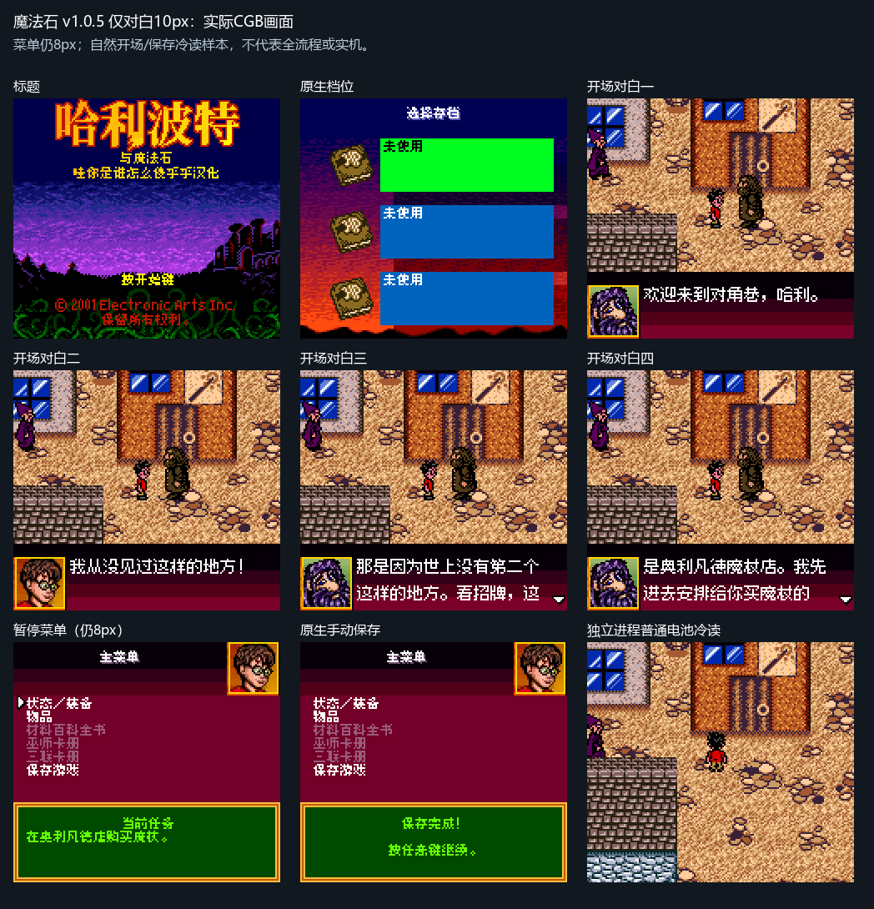

# 哈利波特与魔法石
当前公开源码／补丁资产：待本轮逐包核验与发布。此页面先登记实际最新版本与完整哈希，不提供ROM。

原输入：Harry Potter and the Sorcerer's Stone (multilingual US English-slot base)

原输入SHA256：`8eb56e0d55a04aa3fcf940f172757f4f60baa6c53c82707def8ae4e78844b1da`

| 字号 | 实际版本 | 输出SHA256 |
| --- | --- | --- |
| 8px | v1.0.4 | `409bdc8f8f0e7e863f6e96e12d44eeaa02cac0fd1e5ecdd3e3be7cff93275347` |
| 10px-dialogue | v1.0.5 | `d97f855d7bf717525905a06ae264a00ed9bef74145a4f12c608ccf99bfcacb3d` |

普通8px仍v1.0.4，仅对白10px更新为v1.0.5。CGB专用；10px仅标准头像对白，菜单、战斗和密集窗口仍8px。

已有记录包含两字号排版受控用例、正常开局／菜单／手动保存／独立新进程普通电池冷读。v1.0.5恢复原生角色动画表并迁移辅助代码，通过马尔福、猫头鹰的具名受控追逐入口及随后按键回归；受控队列前提不等于自然剧情或追逐胜利。

玩家自然飞行课、龙追逐、任意玩家存档、全部后期／全通关和实机未验收。飞行／追逐反馈实际仍开放；旧零星乱码问题已关闭，不把两者混成同一个BUG。

大字版更容易出现拖慢、刷新残留等问题。先备份普通电池档，不跨版本搬即时状态。

[公开反馈及BUG状态](feedback.md) · [报告BUG](https://github.com/shiyi1133/youxi-hanhua-releases/issues/new?template=bug_report.md)

## 对应最终ROM真实截图

下列图片按实际版本／字号／最终ROM绑定，已从实际Git全文读取、核完整SHA256并逐张查看；本次资料整理未重新运行模拟器。[图片核验记录](../../data/Harry-screenshot-provenance.json)。

v1.0.4 8px final native CGB:earlydialogue/menu/manualsave/newprocessbatteryread/battle;own test batteries;no fullgame/hardware claim

v1.0.5仅对白10px实际CGB自然开场/原生菜单/保存/新进程普通电池冷读9图；菜单仍8px，非全流程/实机。

v1.0.5实际ROM受控马尔福/猫头鹰追逐及随后正常按键9图；显式RAM队列前提，非自然学校入口/玩家档/追逐胜利。
