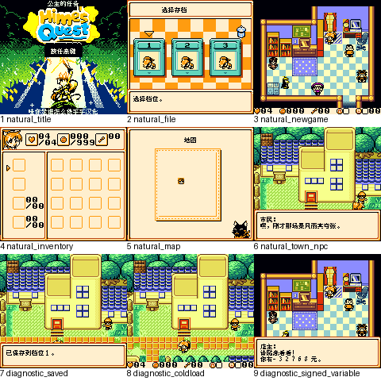

# 公主的任务：公开反馈

[报告BUG](https://github.com/shiyi1133/youxi-hanhua-releases/issues/new?template=bug_report.md)。请说明实际版本、字号、必要触发步骤和已有截图，不上传ROM、存档、即时状态或私人资料。

当前公开索引尚未登记本作BUG反馈；这不代表没有BUG、已全通或已实机验收。开放问题不等于正在修复。

[贴吧原需求](https://tieba.baidu.com/p/11092365551?pid=154054968009#154054968009)。

## 维护者交付通知：v0.1.0（限定测试版）

[贴吧实际答复](https://tieba.baidu.com/p/11092365551?pid=154064616591#p154064616591)（191楼，PID 154064616591；原关联楼层回复）。

以下为去除下载信息后的维护者通知摘要，不是玩家测试结论，也不是原文全文。

> 《公主的任务》v0.1.0限定测试版已发布。
> 字号：普通Fusion Pixel 8px；5tile窗口三行无不改布局的10px版。。
> 范围：CGB-only aftermarket；253候选场景、1410槽中1386槽/940种正文已译，24原作者工具/数值图标控制串保留；9处图字改动，原艺术标题与品牌/按键缩写保留。
> 原答复中的ROM下载链接、提取码、网盘目录及下载指示已省略；私库保留完整原文证据。

原答复全文UTF-8 SHA-256：`f4ffd9876a5d334f1d5b64a96d1a6e6f08f11998a9ea5d80b4cb75069b49a812`（272字节）。

公主的任务 v0.1.0 8px限定测试版；普通Fusion Pixel 8px；5tile窗口三行无不改布局的10px版。 自然路径与诊断范围见测试说明，不代表全流程。

[贴吧该PID第1张实际公开图片](https://tiebapic.baidu.com/forum/pic/item/01b86a2762d0f703459e20db4efa513d2697c531.jpg?tbpicau=2026-11-04-05_c65e906d129105f818af36958c375c89)。

原PNG SHA-256：`574aebb4a6718aebc56c660d53664b6bbb8b46ea4a4457050dc7914aa94dcbdf`；贴吧公开图片 SHA-256：`7ec15457ec6e75152b75280faa02266565d9bc2b4025fd4765e8a1b29ac6a126`。

原答复全文与全部图片已按该PID公开核验；此镜像不新增通关、实机、独立QA、源码完整性或BUG全部修复结论。
