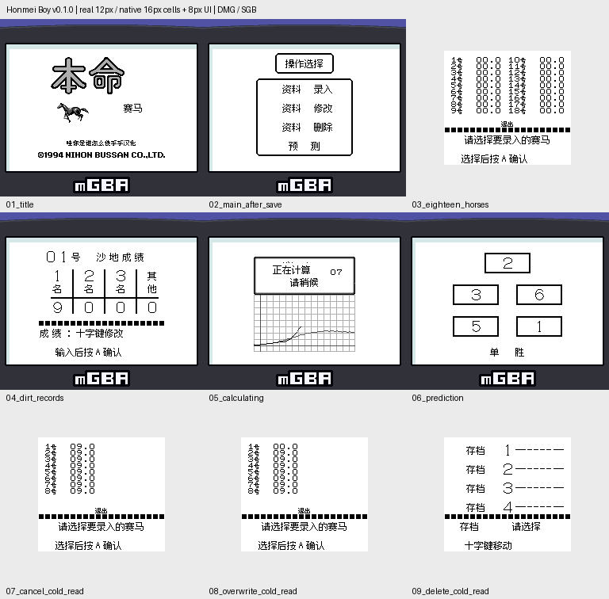

# 本命赛马：公开反馈

[报告BUG](https://github.com/shiyi1133/youxi-hanhua-releases/issues/new?template=bug_report.md)。请说明实际版本、字号、必要触发步骤和已有截图，不上传ROM、存档、即时状态或私人资料。

当前公开索引尚未登记本作BUG反馈；这不代表没有BUG、已全通或已实机验收。开放问题不等于正在修复。

[贴吧原需求](https://tieba.baidu.com/p/11092365551?pid=154051163806#154051163806)。

## 维护者交付通知：v0.1.0（限定测试版）

[贴吧实际答复](https://tieba.baidu.com/p/11092365551?pid=154064617305#p154064617305)（172楼，PID 154064617305；原关联楼层回复）。

以下为去除下载信息后的维护者通知摘要，不是玩家测试结论，也不是原文全文。

> 《本命赛马》v0.1.0限定测试版已发布。
> 字号：真实Fusion12px位于原生16×16单元；密集列表/小字8px；不是16px字形或独立大字版，无10px。
> 范围：赛马资料录入/修改/删除/预测工具；十赛场、四档、赔率/草沙成绩/跑法/保存/三种预测方法、标题副标/计算等待图片；不是操作赛马奔跑的动作游戏
> 原答复中的ROM下载链接、提取码、网盘目录及下载指示已省略；私库保留完整原文证据。

原答复全文UTF-8 SHA-256：`f9385daeaf0200766a47702655289a980ac9cef41516314e7c6247fca5e2e168`（278字节）。

本命赛马 v0.1.0 12px限定测试版；真实Fusion12px位于原生16×16单元；密集列表/小字8px；不是16px字形或独立大字版，无10px 自然路径与诊断范围见测试说明，不代表全流程。

[贴吧该PID第1张实际公开图片](https://tiebapic.baidu.com/forum/pic/item/4856f5039245d688a12d07a3e2c27d1ed21b2431.jpg?tbpicau=2026-11-04-05_a498ba3615b8b08ec59572cdc2960056)。

原PNG SHA-256：`54639faf052b8b65507dbbf9ad089db5a06a3f89191aad0e1d861543bf8535ed`；贴吧公开图片 SHA-256：`f2df62e294246722bbc7cd535ddaa4073f5bbd2681d4c2f777f45498d23a883c`。

原答复全文与全部图片已按该PID公开核验；此镜像不新增通关、实机、独立QA、源码完整性或BUG全部修复结论。
