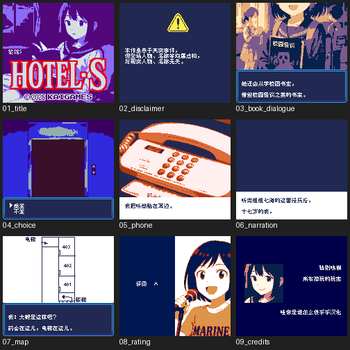

# 旅馆S

原输入：HOTEL・S

原输入完整SHA256：`450eaffb065ce555ea224751b7412349ccb91d4f640e9c5989536dd50b6966b8`。此处“原输入”保留改版、既有汉化或地区修订身份，不一律称干净零售ROM。

| 字号 | 当前版本 | 音频 | 输出完整SHA256 |
| --- | --- | --- | --- |
| 8px | v1.0 | unchanged | `6b8e3ff8544cf52bb308fc8588a8b346af445792aa348690511fcd89371918a8` |

## 源码与补丁

- 8px／v1.0／unchanged：源码包（完整性未独立确认）：[下载](https://github.com/shiyi1133/youxi-hanhua-releases/releases/download/source-migration-20261022-04/hotel-s-current-scope-source-public-r01.zip)（ZIP SHA256 `b2cc6af91434bd04654fe101c0b04904ad0307fea937e831e31b7c3c25b63c67`）；补丁：[下载](https://github.com/shiyi1133/youxi-hanhua-releases/releases/download/patch-migration-20261022/hotel-s-current-patches.zip)（ZIP SHA256 `cda6b8708d8f7c89d57697cb371df36357570ce915d52061d4a79458bb896f24`）。
  该包已核对对应版本与字节安全；完整修改源码覆盖范围未独立确认。

补丁须直接应用于完整SHA一致的实际原输入；普通字、大字和音乐变体分别核对。公开源码归档不表示本轮重新构建或通过新的运行验收。原作、字体、已有翻译及工具依赖的权利与许可，依各包对应许可保留。

## 范围与验证边界

- 8px／v1.0：v1.0测试版，普通原生8px，仅CGB；DMG/SGB不支持。。
  v1.0测试版，普通原生8px，仅CGB；DMG/SGB不支持。
  同一实施链自测，未独立QA或实机；主剧情未找到自然存读或命名入口，不新增；电视/街景未知小字保留。

本次资料搬运未新增模拟器、实机或全通验收；未记录或未测试的范围不写成通过。问题单开放只表示尚未关闭，已关闭也不单独证明全部场景都修复。

[公开反馈及问题状态](feedback.md) · [报告BUG](https://github.com/shiyi1133/youxi-hanhua-releases/issues/new?template=bug_report.md)

## 对应版本截图

九格均为提供方同目标自然路线帧；诊断图片不在该九宫格。；对应 v1.0 8px 最终ROM。

图像SHA256：`5734304e625d6b1a13439c868fa3411423761419013d6414aff4bd2f2e7e8172`；绑定ROM SHA256：`6b8e3ff8544cf52bb308fc8588a8b346af445792aa348690511fcd89371918a8`。

