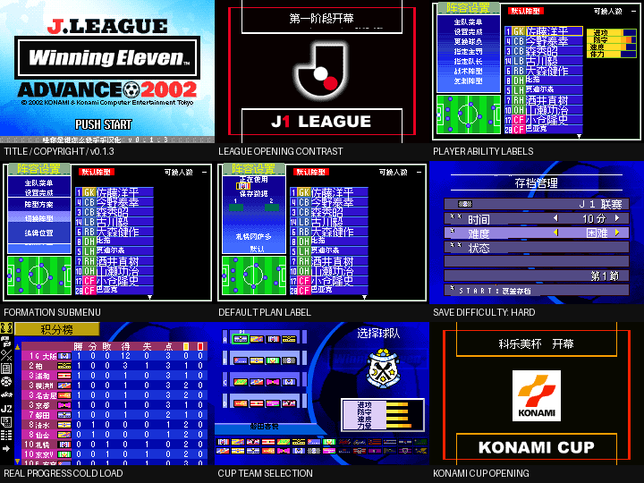

# J联赛胜利十一人Advance2002

原输入：J.League Winning Eleven Advance 2002 (Japan)

原输入完整SHA256：`ec01def0119790dfe7ad0dcc11f31e41e6f289a0b3d028a8fac94437f5b311f5`。此处“原输入”保留改版、既有汉化或地区修订身份，不一律称干净零售ROM。

| 字号 | 当前版本 | 音频 | 输出完整SHA256 |
| --- | --- | --- | --- |
| native8-12 | v0.1.3限定修复测试版 | unchanged | `a52c12571048850d7221f105d13325a21274b1cb7e57d1af03b0db7100655df4` |

## 源码与补丁

- native8-12／v0.1.3限定修复测试版／unchanged：源码包（完整性未独立确认）：[下载](https://github.com/shiyi1133/youxi-hanhua-releases/releases/download/source-migration-20261022-02a/j-league-winning-eleven-advance-2002-current-source-b21547c23c79-public-r01.zip)（ZIP SHA256 `89433273f719dcab523b4e17a4a0485940f4631fd3477888a2ffe404c8f2cd11`）；补丁：[下载](https://github.com/shiyi1133/youxi-hanhua-releases/releases/download/patch-migration-20261022/j-league-winning-eleven-advance-2002-current-patches.zip)（ZIP SHA256 `09aa83bd4a2290bd1fba676eac5f26e4be12e88ebcd32efaec925b99afcb5ad5`）。
  该包已核对对应版本与字节安全；完整修改源码覆盖范围未独立确认。

补丁须直接应用于完整SHA一致的实际原输入；普通字、大字和音乐变体分别核对。公开源码归档不表示本轮重新构建或通过新的运行验收。原作、字体、已有翻译及工具依赖的权利与许可，依各包对应许可保留。

## 范围与验证边界

- native8-12／v0.1.3限定修复测试版：一个原生混合8/12px目标：密集名单8px、原生菜单12px；不是独立大字版，无10px/SGB。。
  既有反馈合并限定修复：保留原生混合8/12px，已核条目修订及入口实图范围见审计；深层赛季/全部姓名/联机未验，既有反馈保持open。
  完整所有姓名与最长组合、全部球队及动态存档值未穷举。
  深层赛季/杯赛/隐藏大师杯、联机成功、硬件和全流程未验。
  未证实可达的遗留队名、世界杯最终预选和候选地图保持；部分阶段值仅静态核对。
  混合8/12px为一个原生布局目标，不是普通/大字两份ROM。
  同一提供者自测；本次维护审计没有重建或运行游戏。

本次资料搬运未新增模拟器、实机或全通验收；未记录或未测试的范围不写成通过。问题单开放只表示尚未关闭，已关闭也不单独证明全部场景都修复。

[公开反馈及问题状态](feedback.md) · [报告BUG](https://github.com/shiyi1133/youxi-hanhua-releases/issues/new?template=bug_report.md)

## 对应版本截图

对应版本的原始截图；此导出未新增运行或通关验收。

图像SHA256：`f14358b3965f4ae5e90a446d49c98640215b898a8cf07ef4f92ddf44033e3f91`；绑定ROM SHA256：`a52c12571048850d7221f105d13325a21274b1cb7e57d1af03b0db7100655df4`。

