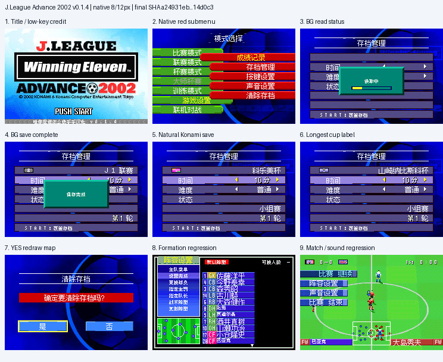

# J联赛胜利十一人Advance2002 v0.1.4（限定测试版）

[源码与补丁Release](https://github.com/shiyi1133/youxi-hanhua-releases/releases/tag/j-league-winning-eleven-advance-2002-v0.1.4) · [公开反馈](feedback.md) · [报告BUG](https://github.com/shiyi1133/youxi-hanhua-releases/issues/new?template=bug_report.md)

原游戏／实际输入：J.League Winning Eleven Advance 2002 (Japan)

原输入完整 SHA-256：`ec01def0119790dfe7ad0dcc11f31e41e6f289a0b3d028a8fac94437f5b311f5`（8388608字节）。

范围：原生混合8/12px子菜单背景、存档动态槽/状态图及轮次独立图像限定修复；部分深层仍未验。

## native8-12 v0.1.4 / unchanged

字号范围：原生混合8/12px子菜单背景、存档动态槽/状态图及轮次独立图像限定修复；部分深层仍未验。

目标完整 SHA-256：`a24931eb5d51461ef9b857a9f8008ace62ca05d43d7c1c6a264b25e2b014d0c3`（16777216字节）。

补丁：`JLeague2002-v0.1.4-native8-12px.bps`，SHA-256 `06e8bbefcc2fdb07983db2361e2da72f9974fc56976802ba3ad600f9a9921ad1`。

[源码（完整性未独立确认）](https://github.com/shiyi1133/youxi-hanhua-releases/releases/download/j-league-winning-eleven-advance-2002-v0.1.4/j-league-winning-eleven-advance-2002-v0.1.4-complete-source.zip) · [补丁包](https://github.com/shiyi1133/youxi-hanhua-releases/releases/download/j-league-winning-eleven-advance-2002-v0.1.4/j-league-winning-eleven-advance-2002-v0.1.4-patches.zip)

原生混合8/12px子菜单背景、存档动态槽/状态图及轮次独立图像限定修复；部分深层仍未验。；提供方对应最终ROM图证，具体自然/诊断类别见原图标签及材料；非维护运行、全通或实机验收。

## 测试及限制

提供方自然范围：提供方报告的自然/正常按键流程，维护未重跑。

提供方诊断范围：提供方明确标注的受控消费者、解锁或边界测试，不能冒充自然到达。

保存边界：仅按具体版本材料，不推定所有旧存档兼容。

维护本轮独立核原输入、补丁逐字节还原、ZIP/CRC、Source安全与原图字节；未执行提供方源码、未重建或运行ROM，未宣称独立人员QA、实机或全流程验收。

- 未验证：维护仅独立核用户输入ZIP/ROM完整SHA、补丁逐字节还原、ZIP成员/CRC与源包静态材料；未执行提供者源码、重建工程或运行ROM。
- 未验证：运行、自然按键、受控诊断、保存/新进程冷读等范围以所附提供方报告分别为据，不冒充维护重跑、独立人员QA、玩家验收、实机或全流程通关。
- 未验证：使用前备份普通存档；不跨ROM版本/字号套用即时状态，旧电池兼容仅按提供方实际样本说明。
