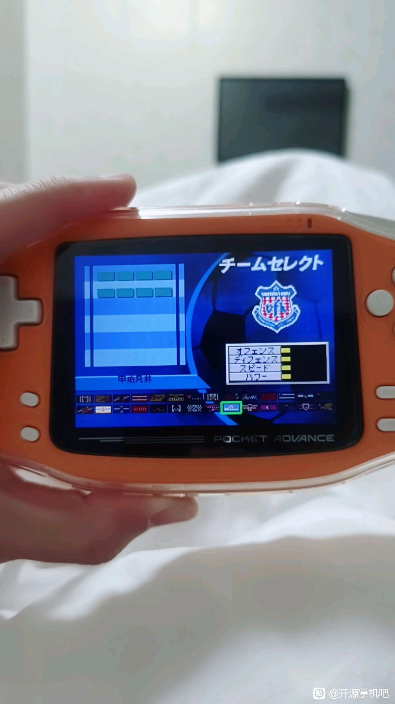
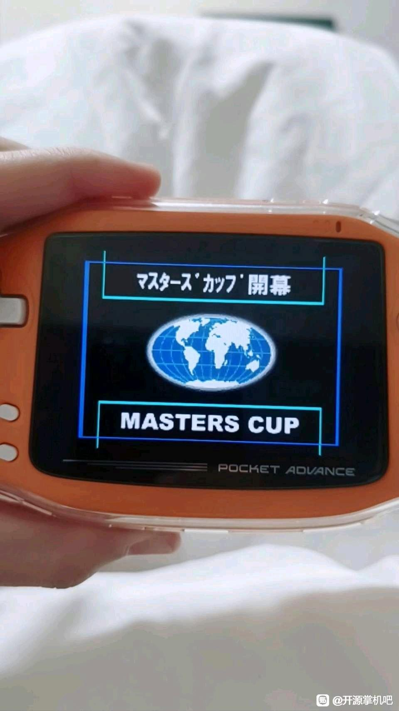
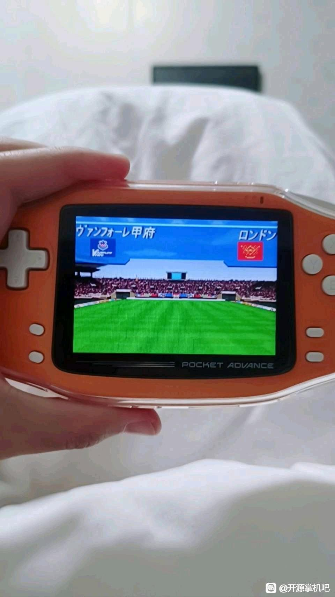

# J联赛胜利十一人Advance2002：公开反馈

以下为已公开证据摘录，不能自动当成已经复现或修复。下载／存档分享地址、本机路径或项目署名文字省略时逐条标记。

## 154038536282

7楼 · une21 · [原回帖](https://tieba.baidu.com/p/11097560613?pid=154038536282#154038536282)

> @哇你是谁怎么傻乎乎 该楼层游戏已测试并上传bug反馈请您查收

仅摘录公开反馈；下载／存档分享地址或本机路径已省略。

## 154038544927

7楼 · une21 · [原回帖](https://tieba.baidu.com/p/11097560613?pid=154038544927#154038544927)

> @哇你是谁怎么傻乎乎

## 154048988684

7楼 · une21 · [原回帖](https://tieba.baidu.com/p/11097560613?pid=154048988684#154048988684)

> 回复 哇你是谁怎么傻乎乎 :@哇你是谁怎么傻乎乎 经下载测试，J联赛2002 v0.1.3与世界足球迈向胜利之路v0.1.4的最新问题反馈截图已上传完毕，请您查收 【超级会员V9】通过百度网盘分享的文件：足球游戏二测反馈… 链接:

仅摘录公开反馈；下载／存档分享地址或本机路径已省略。

## 问题状态

- [待复现] J联赛胜利十一人Advance2002 v0.1.0：菜单字形/图块异常、残留日文和署名遮挡：开放；公开问题单待单独建档。

问题单开放不等于正在修复；关闭不自动代表所有报告症状全部验收。玩家实际ROM SHA未知时仍保留未知，当前版本的参考SHA见[游戏页面](README.md)。

## 20261025-1619 公开反馈更新

按当前实际未关闭问题去重：纯BUG 1 项，建议/覆盖等 0 项，分类待核 0 项。开放不代表正在修复。

玩家实际完整ROM字节未知时仍保留未知；自然流程、原生消费者诊断及静态证据分别记录，不外推实机或全流程。

## 20261101-0442 增量反馈

玩家报告《J联赛2002》主菜单→模式选择→大师杯赛→选队等界面的日文残留，并补充三张公开原图。已补充到已有问题，合并确认并仅补问实际ROM文件名或版本。玩家版本、字号和完整ROM哈希尚未知；当前v0.1.4仅作参考，不代表玩家所用字节，也不把旧版局部修复冒称此界面已验收。

[原反馈](https://tieba.baidu.com/p/11097560613?pid=154092190308#154092190308)

> @哇你是谁怎么傻乎乎 刚刚在运行j联赛2002的时候又发现一处漏翻，在主菜单-模式选择-大师杯赛里，选择球队的界面没有汉化，包含球队实力条的描述以及右上方的日文字样 

原字节SHA256 b0a9bf61e5fddec75d48be70e9ae597143d07b3e0d28c46a5b8d15a9e250062b，143996字节。

[原反馈](https://tieba.baidu.com/p/11097560613?pid=154092199842#154092199842)

> 再补充两张图  

原字节SHA256 04ae50f13b481addc16e7695db8f5a454f9932a2a68f07f03efeb1d898dc9b17，89482字节。

原字节SHA256 feda45085467dec6375093edd1fb4e31a528daa8794f3de53fa4a0aa0c1d8f06，90889字节。

[已核公开确认](https://tieba.baidu.com/p/11097560613?pid=154093241594#154093241594)：《J联赛2002》大师杯赛选队等界面的日文残留和三张图已记录。请补一下正在用的 ROM 文件名或版本，方便对应排查。

## 20261101-1644 版本信息补充

玩家补充《J联赛2002》使用0.1.4版，并称此前问题均基于所分享的各游戏最新版。本条仅确认此处报告版本；字号、实际输入及输出ROM哈希仍未知，也未据此验收此前五游戏附件。已补充到原问题，尚未复现或修复。

[玩家补充](https://tieba.baidu.com/p/11097560613?pid=154094607643#154094607643)

> j联赛是0.1.4版本，给您发的问题全部都是基于您分享的各个游戏最新版本
