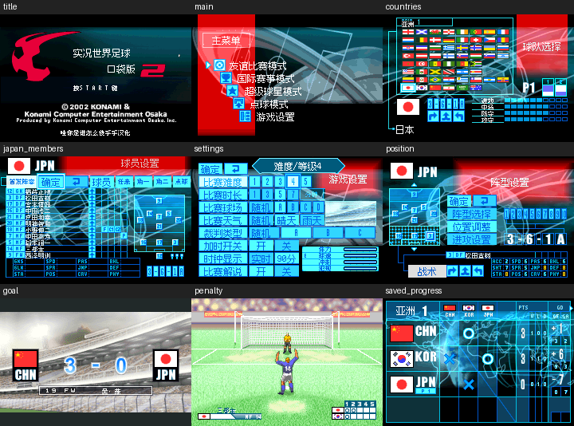

# 实况世界足球Pocket 2（限定测试版）

[公开反馈](feedback.md) · [报告BUG](https://github.com/shiyi1133/youxi-hanhua-releases/issues/new?template=bug_report.md)

原游戏／实际基底：Jikkyou World Soccer Pocket 2

原输入完整SHA-256：`5cfd354c5dcba7583a954bfb04d28145ced4ccc0a441dcb3b694c039bae583aa`（8388608字节，日本Rev0实际用户输入）。

## v0.1.0 native8-12px

字号范围：原生8px/12px按原窗口混排；原大幅公告图形按原空间整数放大；单一普通版本，无独立大字/SGB

[源码包（语义完整性未独立确认）](https://github.com/shiyi1133/youxi-hanhua-releases/releases/download/jikkyou-world-soccer-pocket-2-v0.1.0/jikkyou-world-soccer-pocket-2-v0.1.0-native8-12px-source-public.zip) · [补丁包](https://github.com/shiyi1133/youxi-hanhua-releases/releases/download/jikkyou-world-soccer-pocket-2-v0.1.0/jikkyou-world-soccer-pocket-2-v0.1.0-native8-12px-patches-public.zip)

目标完整SHA-256：`f3ab9cda05b0dccbc241c792c28e4f506847aa5ea7b8b97db16f5badaf43fcc0`（9720404字节）。

v0.1.0 原生8px/12px混排普通字号最终ROM真实九宫格；9幅原生240×160画面像素一致。自然比赛/菜单/国家球员与诊断内容按提供方证据区分；不是独立大字版或全通验收。

## 范围与测试边界

GBA日版Rev0 v0.1.0限定测试版；按原窗口保留原生8px/12px混排普通字号，单一ROM，无独立大字版及SGB。提供方记录自然友谊赛上下半场、国家/球员名称及最终ROM电池冷读，诊断范围另记。

- 提供者自测属于同一实现者证据，不等于独立QA；本轮维护未执行附件源码、未新增模拟器或真机运行测试。
- 自然友谊赛上下半场0比3、进球履历和菜单；58国家自然查看、1334国家队球员名称及1276赛前名称匹配按提供方记录保留。
- SS招募/排行50项、换人字形与映射6行、公告21项为诊断验证；不代表自然招募成功、自然换人或全部边界通过。
- 杯赛存档源于较早自然首场0比7进度，由最终ROM重新保存并在独立冷进程保留1负7失球；不是最终ROM重新全程打完杯赛。
- 实机、联机、杯赛/SS全通、隐藏队伍解锁、自然获胜招募、自然换人及原生命名/重输/存读未验收；完整修改源码来源及本轮独立重建状态未知。

提供方结构化自测摘要见[对应版本记录](provider-selftest.json)，保留自然、诊断、静态及未测边界；不表示本轮维护新增运行或源码重建。本次源码语义完整性保持未知。

开放问题不等于正在修复；有限验证不表示完整游戏、全部变量边界或真机验收。
