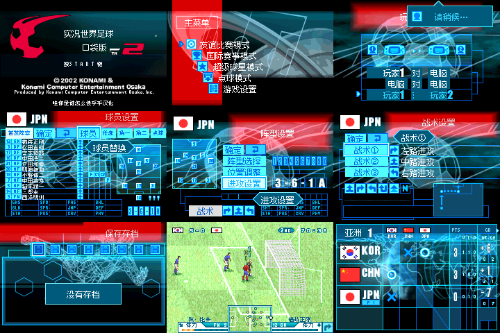

# 实况世界足球Pocket 2 v0.1.1（限定测试版）

[源码与补丁Release](https://github.com/shiyi1133/youxi-hanhua-releases/releases/tag/jikkyou-world-soccer-pocket-2-v0.1.1) · [公开反馈](feedback.md) · [报告BUG](https://github.com/shiyi1133/youxi-hanhua-releases/issues/new?template=bug_report.md)

原游戏／实际输入：Jikkyou World Soccer Pocket 2

原输入完整SHA-256：`5cfd354c5dcba7583a954bfb04d28145ced4ccc0a441dcb3b694c039bae583aa`（8388608字节）。

范围：v0.1.1限定测试：存档/继续对话底板及保存标题、战术图块冲突、杯赛高亮分配等修正；新增等待与5球员/3阵型/3战术提示，玩家2与电脑标签左对齐。

## native8-12px v0.1.1

字号范围：原生8px/12px按原窗口混排；原大幅公告图形按原空间整数放大；单一普通版本，无独立大字/SGB

目标完整SHA-256：`693e8636b5de46e10982282c5f06f3fa017dbd3b6580e9067f9e6f7e145f539a`（9749076字节）。

补丁：`soccer-pocket-2-zh-v0.1.1-native.bps`，SHA-256 `8386a73556411df2af8feb7003e8cb0afc45d16ef57fdcf6a30754407db64d9d`。

[源码（完整性未独立确认）](https://github.com/shiyi1133/youxi-hanhua-releases/releases/download/jikkyou-world-soccer-pocket-2-v0.1.1/jikkyou-world-soccer-pocket-2-v0.1.1-native8-12px-SOURCE-public.zip) · [补丁包](https://github.com/shiyi1133/youxi-hanhua-releases/releases/download/jikkyou-world-soccer-pocket-2-v0.1.1/jikkyou-world-soccer-pocket-2-v0.1.1-native8-12px-PATCH.zip)

提供方：自然菜单、保存及有限比赛路径；图像/提示对应实际最终ROM。 提供方ABI入口与场景切换诊断按原证据保留；不等于所有杯赛或完整流程。 九宫格逐格与提供方最终ROM原生帧像素一致。

## 测试及限制

提供者自然路径：提供方：自然菜单、保存及有限比赛路径；图像/提示对应实际最终ROM。

提供者诊断路径：提供方ABI入口与场景切换诊断按原证据保留；不等于所有杯赛或完整流程。

保存边界：提供方保存相关有限用例；本维护只核补丁与字节，不新增存读档或冷启动验收。

同一实现者自测，不是独立人员QA；维护未新增ROM运行或源码重建，未宣称实机或完整通关。

- 未验证：原生8px/12px混排，仅一个普通字号版本；无独立大字/SGB。
- 未验证：深层未译文字仍可能存在；全赛事、隐藏队伍、全部命名、实机与真实联机未验。
- 未验证：Issue121并非全部标题美术重制；Issue125只覆盖已明确提示，不自动关闭整单。
- 核对补丁还原、资产完整SHA和截图字节不等于全部游戏功能验收。

