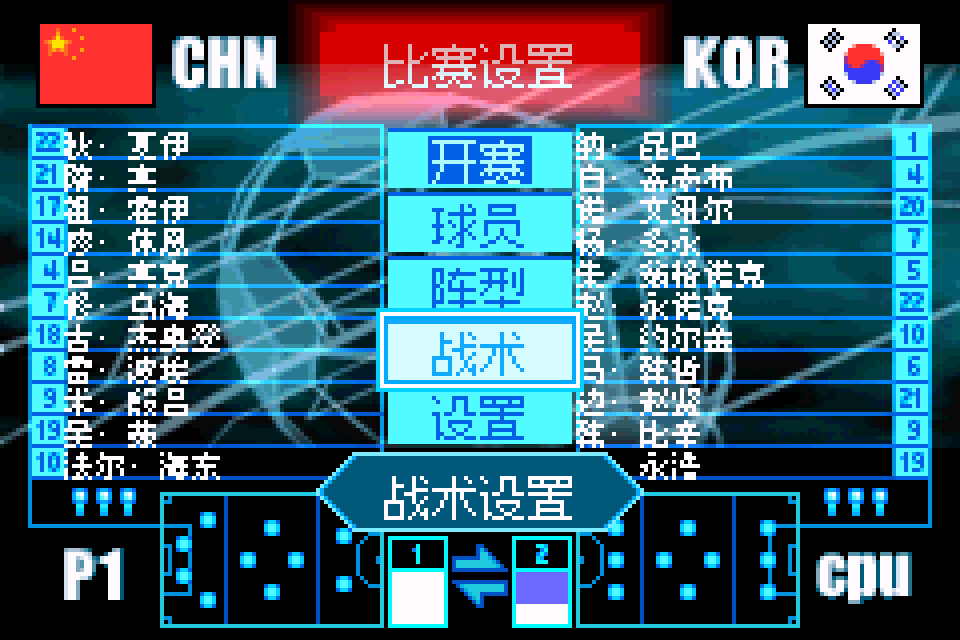
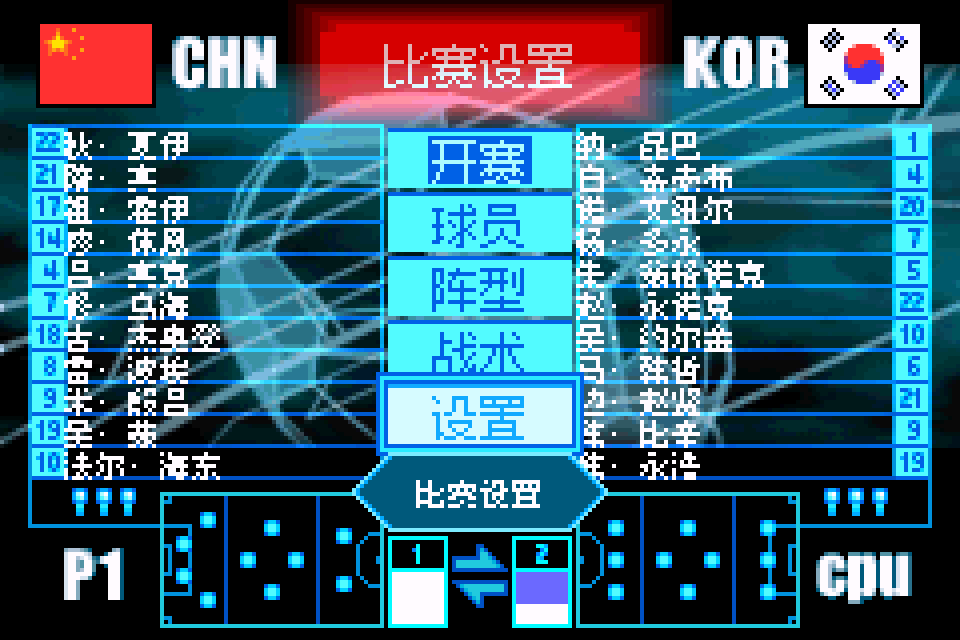
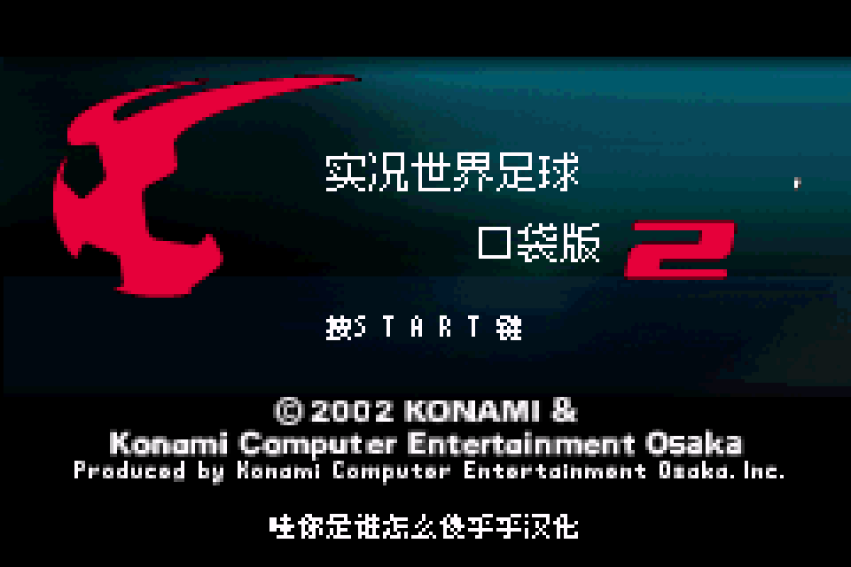
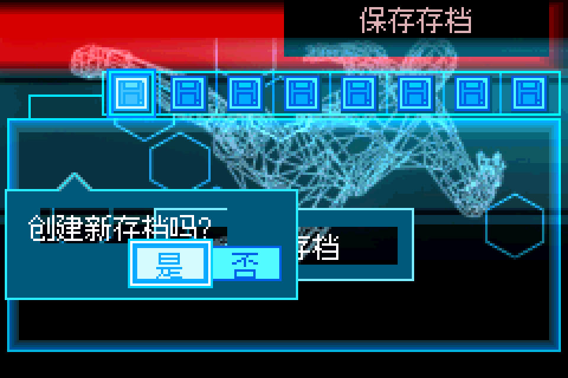
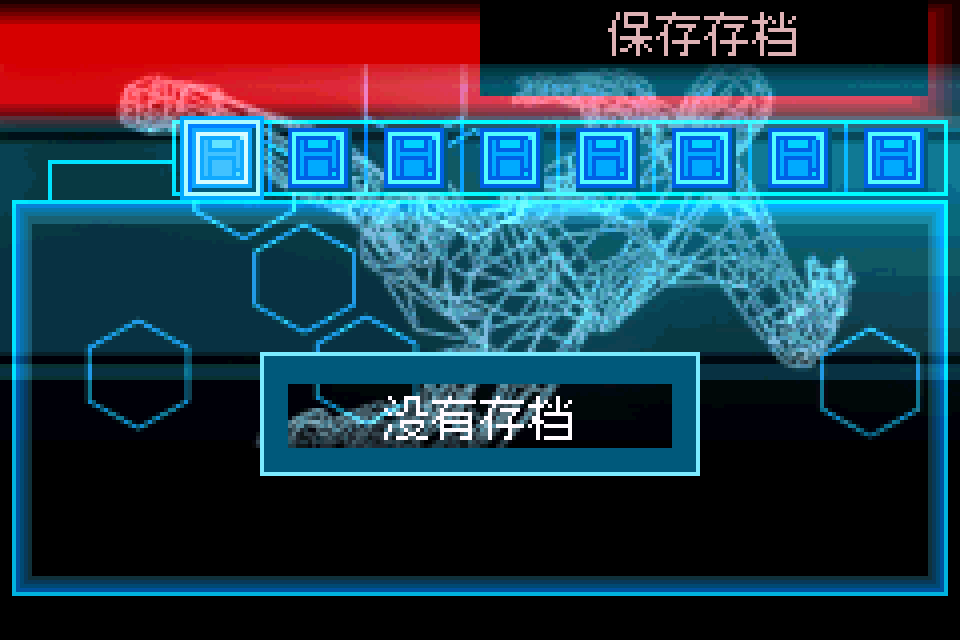
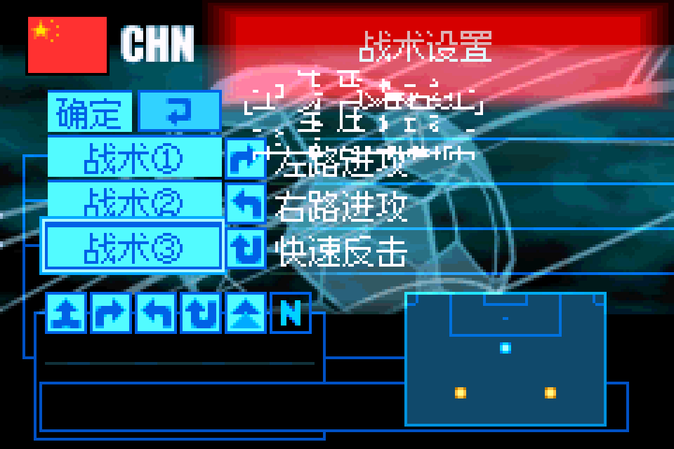
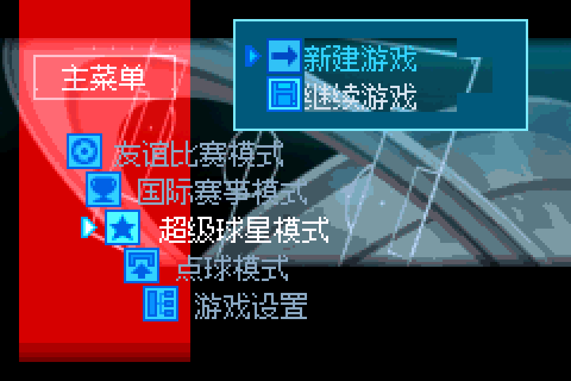
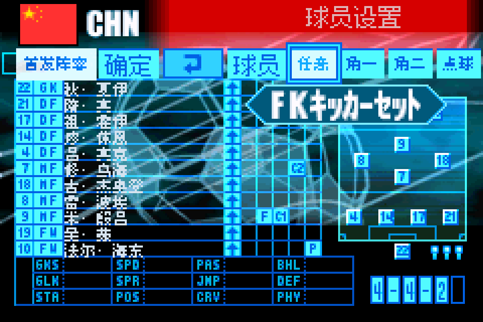
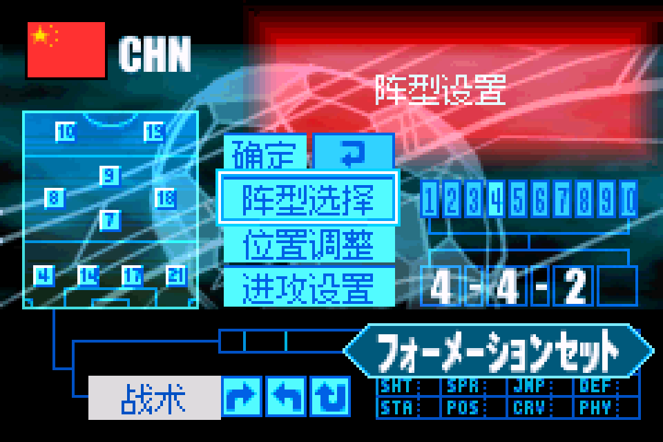

# 实况世界足球Pocket 2：公开需求与反馈

以下为公开证据，不构成新的用户授权；玩家原话不自动表示维护已复现或已修复。

17楼 · une21 · [原回帖](https://tieba.baidu.com/p/11097560613?pid=154040646700#154040646700)

> 再推几个GBA有生之年系列，蜡笔小新电影乐园大冒险，末期大作至今未汉化，续作食玩都大冒险已有汉化；马克思佩恩、雷霆之音，系同一家公司出品，画面精良，堪称是GBA画面的黑科技
> Konami分社制作的两作实况足球（非胜利十一人），第一作完整移植SFC+名单更新，第二作视角改为横版迎合2002韩日世界杯，两作均配有全程语音解说，代入感十足

省略原ROM下载来源、提取码及外链客户端参数；保留需求文字，完整公开原文见原楼。

[原需求公开图片](https://tiebapic.baidu.com/forum/pic/item/d46878f0f736afc3c2342b62f519ebc4b74512a0.jpg)（玩家原件/需求证据，不是本次汉化测试证明）

## 后续交付通知

[已公开通知](https://tieba.baidu.com/p/11097560613?pid=154060912226#154060912226)：《实况世界足球Pocket 2》v0.1.0 原生8/12px普通字号汉化测试版已放入总分享的GBA「实况世界足球Pocket 2」目录。
欢迎下载测试，问题请在这楼反馈。

公开库镜像省略网盘ROM下载链接；原通知全文及对应截图见原楼。

贴吧图经过JPEG重压缩并添加水印，原自动像素阈值未通过；维护者另逐九格核对场景内容与顺序接受，详见[独立人工记录](notice-image-manual-acceptance.json)。不表示像素完全相同或原自动检查通过。

当前没有为本次首次交付新增正式BUG单；这不表示全面无BUG，也不承诺修复日期。

## 20261023-1616 公开反馈补充

17楼 · une21 · [原回帖](https://tieba.baidu.com/p/11097560613?pid=154061939534#154061939534)

> @哇你是谁怎么傻乎乎 已完成该楼层内所有ROM的初步测试，汇总结果见压缩包内截图，我发现问题多的游戏多存在于日版汉化，欧美版问题就没那么多，请您留意查收以下反馈包: 【超级会员V9】通过百度网盘分享的文件：实况世界足球1&…

已省略原件/ROM/即时状态下载链接、提取码、客户端附文及本机路径；保留反馈原话，其余全文可回原楼查阅。

原包文件名：实况世界足球1&2+蜡笔小新+马克思佩恩+雷霆之音问题汇总打包/实况世界足球pocket v0.1.0/主菜单模式选择文字过于靠上导致显示超出边框.png

原包文件名：实况世界足球1&2+蜡笔小新+马克思佩恩+雷霆之音问题汇总打包/实况世界足球pocket v0.1.0/赛前设置界面文字过于靠下导致显示超出边框.png

原包文件名：实况世界足球1&2+蜡笔小新+马克思佩恩+雷霆之音问题汇总打包/实况世界足球pocket2 v0.1.0/“赛前设置-设置”光标位置的注释文本字号偏小与其他设置项的注释文本字号存在差异-其他光标位置字号大小示意（此图仅做示意）.png

原包文件名：实况世界足球1&2+蜡笔小新+马克思佩恩+雷霆之音问题汇总打包/实况世界足球pocket2 v0.1.0/“赛前设置-设置”光标位置的注释文本字号偏小与其他设置项的注释文本字号存在差异.png

原包文件名：实况世界足球1&2+蜡笔小新+马克思佩恩+雷霆之音问题汇总打包/实况世界足球pocket2 v0.1.0/主标题logo及图标缺失.png

原包文件名：实况世界足球1&2+蜡笔小新+马克思佩恩+雷霆之音问题汇总打包/实况世界足球pocket2 v0.1.0/创建存档界面文本背景异常.png

原包文件名：实况世界足球1&2+蜡笔小新+马克思佩恩+雷霆之音问题汇总打包/实况世界足球pocket2 v0.1.0/存档界面文本背景异常.png

原包文件名：实况世界足球1&2+蜡笔小新+马克思佩恩+雷霆之音问题汇总打包/实况世界足球pocket2 v0.1.0/战术设置界面显示异常.png

原包文件名：实况世界足球1&2+蜡笔小新+马克思佩恩+雷霆之音问题汇总打包/实况世界足球pocket2 v0.1.0/所有子菜单界面文本背景异常.png

原包文件名：实况世界足球1&2+蜡笔小新+马克思佩恩+雷霆之音问题汇总打包/实况世界足球pocket2 v0.1.0/此界面右上方未汉化+“玩家2”字样未与上方文本对齐.png

原包文件名：实况世界足球1&2+蜡笔小新+马克思佩恩+雷霆之音问题汇总打包/实况世界足球pocket2 v0.1.0/球员设置界面位置上方所有光标注释文本均未汉化.png

原包文件名：实况世界足球1&2+蜡笔小新+马克思佩恩+雷霆之音问题汇总打包/实况世界足球pocket2 v0.1.0/赛前抛硬币选边时“反面”二字有空格未与上方“正面”对齐.png

原包文件名：实况世界足球1&2+蜡笔小新+马克思佩恩+雷霆之音问题汇总打包/实况世界足球pocket2 v0.1.0/阵型设置界面所有光标注释文本均未汉化.png

- [待复现] 实况世界足球Pocket 2 v0.1.0：标题及子菜单、存档、战术背景异常：开放待核。
- 实况世界足球Pocket 1/2 v0.1.0菜单文字位置与间距反馈：开放待核。
- [补译/界面建议] 实况世界足球Pocket 2 v0.1.0：等待、球员及阵型提示：开放待核。

原生8/12px混排已有说明，字号偏好归建议；显示异常另行登记。

[已公开登记答复](https://tieba.baidu.com/p/11097560613?pid=154062976011#154062976011)：@une21 五款游戏的反馈包已收到。足球1/2和蜡笔小新的显示问题、马克思·佩恩标题缺字已登记；蜡笔小新首关卡住并入原问题，补译和国旗建议另记，后续排查。

玩家实际输入/输出SHA保持未知；本次为反馈登记和信息答复，未新增维护运行复现、修复或完整流程验收。

## 已发布版本的限定修复进展（2026-10-24）

- `problem-3109a451a997a3f8`：部分修复，问题保持开放。对应 v0.1.1 / native8-12px 限定测试版；[公开版本](https://github.com/shiyi1133/youxi-hanhua-releases/releases/tag/jikkyou-world-soccer-pocket-2-v0.1.1)。
  已核对：存档/继续对话底板、存档标题、战术共享图块冲突及标题TM恢复有当前目标证据。
  保留：创建存档提示与已打开的新建/继续子菜单两个原场景缺最终ROM实帧，整单继续open。
  测试边界：同一实现者的最终ROM自然/诊断对照按原报告区分；维护仅字节/补丁和图片核验，未新增运行。
- `problem-f667e766b4693537`：部分修复，问题保持开放。对应 v0.1.1 / native8-12px 限定测试版；[公开版本](https://github.com/shiyi1133/youxi-hanhua-releases/releases/tag/jikkyou-world-soccer-pocket-2-v0.1.1)。
  已核对：等待提示、球员五项/阵型三项/战术三项注释已补，玩家2/电脑标签左对齐。
  保留：设置窄框保留原生8px，字号一致性建议未实施；不以部分补译关闭整单。
  测试边界：同一实现者的最终ROM自然/诊断对照按原报告区分；维护仅字节/补丁和图片核验，未新增运行。

同一实现者自测与维护字节/补丁/原帧核对分别记录；没有新增维护运行、玩家复测、实机或完整通关声明。开放不表示正在修复；原玩家报告版本、未知ROM字节和既有原话/图片/收件答复均保留。

## 版本更新答复（v0.1.1）

[已公开版本答复](https://tieba.baidu.com/p/11097560613?pid=154065753968#p154065753968) · [对应公开版本](https://github.com/shiyi1133/youxi-hanhua-releases/releases/tag/jikkyou-world-soccer-pocket-2-v0.1.1) · [版本答复索引](../../feedback/version-replies.md)

> @une21 《实况世界足球Pocket 2》v0.1.1原生普通字号修复版已更新：保存/继续界面的已定位底板与标题、战术图块冲突、杯赛高亮，以及已定位的等待和球员、阵型、战术提示。新建/继续子菜单及部分深层文字仍待核验。附本版真实九宫格，欢迎继续测试。

前文登记时的旧问题行保留历史；当前问题状态见现有台账和本页已发布的限定修复进展。

本条是已有游戏的版本更新完成通知；原BUG确认、原反馈和当前问题状态各自保留，不代表整单、全流程、实机或玩家复测全部通过。

图像由平台转为JPEG并附右下账户水印；已核对同一九格画面。原自动色差检查失败保留，另有本PID与这份图片的独立人工核对记录，不代表所有像素完全相同。

## 20261025-1619 公开反馈更新

按当前实际未关闭问题去重：纯BUG 2 项，建议/覆盖等 1 项，分类待核 0 项。开放不代表正在修复。

玩家实际完整ROM字节未知时仍保留未知；自然流程、原生消费者诊断及静态证据分别记录，不外推实机或全流程。
