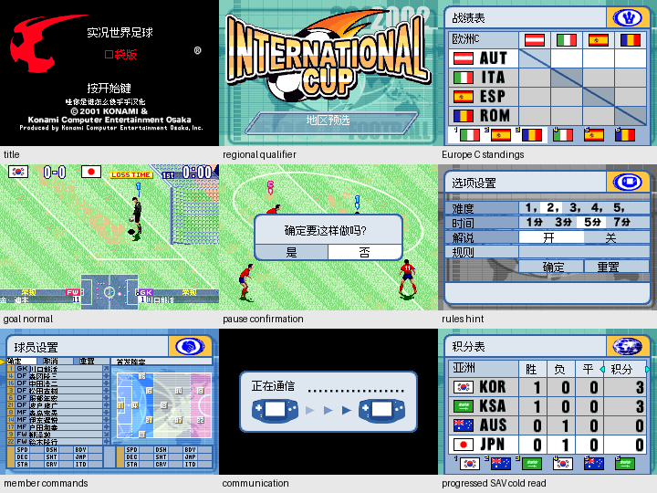

# 实况世界足球Pocket v0.1.1（限定测试版）

[源码与补丁Release](https://github.com/shiyi1133/youxi-hanhua-releases/releases/tag/jikkyou-world-soccer-pocket-v0.1.1) · [公开反馈](feedback.md) · [报告BUG](https://github.com/shiyi1133/youxi-hanhua-releases/issues/new?template=bug_report.md)

原游戏／实际输入：Jikkyou World Soccer Pocket

原输入完整SHA-256：`834f5b79a18b456e1f765e4531b68745daeb8244b37fcc834fb064101ba8025e`（8388608字节）。

范围：v0.1.1限定测试：保留标题红色球及拖尾、原版权；姓名字库改走安全动态HUD区，补地区/暂停/规则/天气/联机等待等已定位文字。

## native-8-12px v0.1.1

字号范围：普通原生字号：主要菜单12px、密集界面及姓名8px；无独立大字版。

目标完整SHA-256：`2cdd15d4d46fbbdafdf63b14aea2318685dda8a3b1f848be35051060ada975b7`（8787784字节）。

补丁：`soccer-pocket.zh-Hans.v0.1.1.native.bps`，SHA-256 `8e98bf67cdccd8ffbffbf960b5b8c291daf81460633abe84af323b36e1fb2c48`。

[源码（完整性未独立确认）](https://github.com/shiyi1133/youxi-hanhua-releases/releases/download/jikkyou-world-soccer-pocket-v0.1.1/jikkyou-world-soccer-pocket-v0.1.1-native-8-12px-SOURCE-public.zip) · [补丁包](https://github.com/shiyi1133/youxi-hanhua-releases/releases/download/jikkyou-world-soccer-pocket-v0.1.1/jikkyou-world-soccer-pocket-v0.1.1-native-8-12px-PATCH.zip)

提供方：40支球队名单、10地区初赛、菜单天气、比赛/暂停；首场国际杯日本0:5韩国完成并进入下场。 提供方：881姓名×2槽ABI与45×22静态覆盖；不是全部球队解锁/自然全流程。 九宫格逐格与提供方最终ROM原生帧像素一致。

## 测试及限制

提供者自然路径：提供方：40支球队名单、10地区初赛、菜单天气、比赛/暂停；首场国际杯日本0:5韩国完成并进入下场。

提供者诊断路径：提供方：881姓名×2槽ABI与45×22静态覆盖；不是全部球队解锁/自然全流程。

保存边界：提供方：进度保存、覆盖取消及新进程电池存档冷读；本维护未新增运行。

同一实现者自测，不是独立人员QA；维护未新增ROM运行或源码重建，未宣称实机或完整通关。

- 未验证：未穷尽全赛事/全明星/隐藏队伍；实机及真实联机未验。
- 未验证：日语语音、部分深层英文保留；未找到独立原生命名入口，不承诺任意中文输入。
- 未验证：Issue120/124只按本版本已提供用例和范围判断，不据覆盖数自动关闭全部问题。
- 核对补丁还原、资产完整SHA和截图字节不等于全部游戏功能验收。

