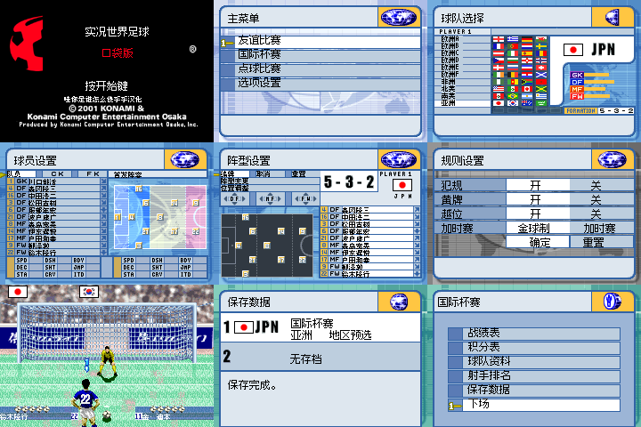

# 实况世界足球Pocket

原输入：Jikkyou World Soccer Pocket

原输入完整SHA256：`834f5b79a18b456e1f765e4531b68745daeb8244b37fcc834fb064101ba8025e`。此处“原输入”保留改版、既有汉化或地区修订身份，不一律称干净零售ROM。

| 字号 | 当前版本 | 音频 | 输出完整SHA256 |
| --- | --- | --- | --- |
| native-8-12px | v0.1.0 | unchanged | `567a80c8fbc1b56c0b003cec0f61a416dc5f0ecb60551dc6b86feced708552ad` |

## 源码与补丁

- native-8-12px／v0.1.0／unchanged：源码包（完整性未独立确认）：[下载](https://github.com/shiyi1133/youxi-hanhua-releases/releases/download/source-migration-20261022-02a/jikkyou-world-soccer-pocket-current-source-b429c380dc8d-public-r01.zip)（ZIP SHA256 `7c1e573d03aa654da0b8ef453e6a399f75cf91c21711fa230b8f6a7df9501aa8`）；补丁：[下载](https://github.com/shiyi1133/youxi-hanhua-releases/releases/download/patch-migration-20261022/jikkyou-world-soccer-pocket-current-patches.zip)（ZIP SHA256 `49fe8a299771cb757bd2f625ee44cdbc6d0769a9dd908ebabf367e2111c13e44`）。
  该包已核对对应版本与字节安全；完整修改源码覆盖范围未独立确认。

补丁须直接应用于完整SHA一致的实际原输入；普通字、大字和音乐变体分别核对。公开源码归档不表示本轮重新构建或通过新的运行验收。原作、字体、已有翻译及工具依赖的权利与许可，依各包对应许可保留。

## 范围与验证边界

- native-8-12px／v0.1.0：普通原生字号：主要菜单12px、密集界面及姓名8px；无独立大字版。。
  普通原生字号：主要菜单12px、密集界面及姓名8px；无独立大字版。
  完整比赛结束、杯赛通关和带比赛进度的自然存档未验。
  5支全明星队未自然解锁，非空射手榜/最强对手记录、深层地区杯赛及全部存档失败/损坏/满槽提示未验。
  保留日语解说、部分英文事件图像及PLAYER/FORMATION和能力缩写；深层/异常界面可能仍有日文。
  未发现原生命名入口，未新增命名功能；实机、联机及全部历史存档兼容未验。

本次资料搬运未新增模拟器、实机或全通验收；未记录或未测试的范围不写成通过。问题单开放只表示尚未关闭，已关闭也不单独证明全部场景都修复。

[公开反馈及问题状态](feedback.md) · [报告BUG](https://github.com/shiyi1133/youxi-hanhua-releases/issues/new?template=bug_report.md)

## 对应版本截图

v0.1.0 普通原生字号：主要菜单12px、密集界面及姓名8px；无独立大字版。 九宫格包含同一最终ROM的自然按键画面、同ROM检查点分支和初始0场杯赛新进程冷读；不代表完整比赛、带进度存档或通关。

图像SHA256：`5ee2a3f1fd92f65a99fa62278058b6a58b3858406d455779acbe72ed46fd97c9`；绑定ROM SHA256：`567a80c8fbc1b56c0b003cec0f61a416dc5f0ecb60551dc6b86feced708552ad`。

