# 实况世界足球Pocket：公开反馈

以下为已公开证据摘录，不能自动当成已经复现或修复。下载／存档分享地址、本机路径或项目署名文字省略时逐条标记。

## 登记时问题状态（历史）

当前导出未取得可关联的正式问题单；这不表示已完成全面测试。

问题单开放不等于正在修复；关闭不自动代表所有报告症状全部验收。玩家实际ROM SHA未知时仍保留未知，当前版本的参考SHA见[游戏页面](README.md)。

## 20261023-1616 公开反馈补充

17楼 · une21 · [原回帖](https://tieba.baidu.com/p/11097560613?pid=154061939534#154061939534)

> @哇你是谁怎么傻乎乎 已完成该楼层内所有ROM的初步测试，汇总结果见压缩包内截图，我发现问题多的游戏多存在于日版汉化，欧美版问题就没那么多，请您留意查收以下反馈包: 【超级会员V9】通过百度网盘分享的文件：实况世界足球1&…

已省略原件/ROM/即时状态下载链接、提取码、客户端附文及本机路径；保留反馈原话，其余全文可回原楼查阅。

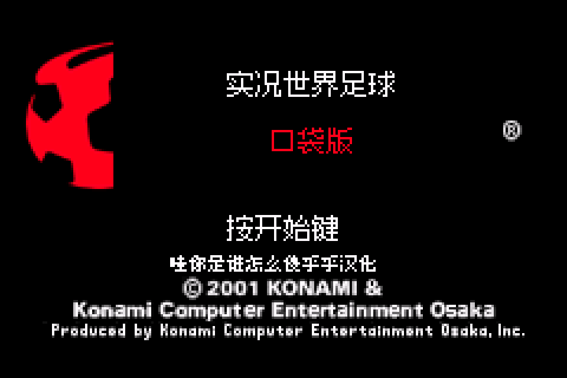

原包文件名：实况世界足球1&2+蜡笔小新+马克思佩恩+雷霆之音问题汇总打包/实况世界足球pocket v0.1.0/主菜单logo被切割且显示异常.png

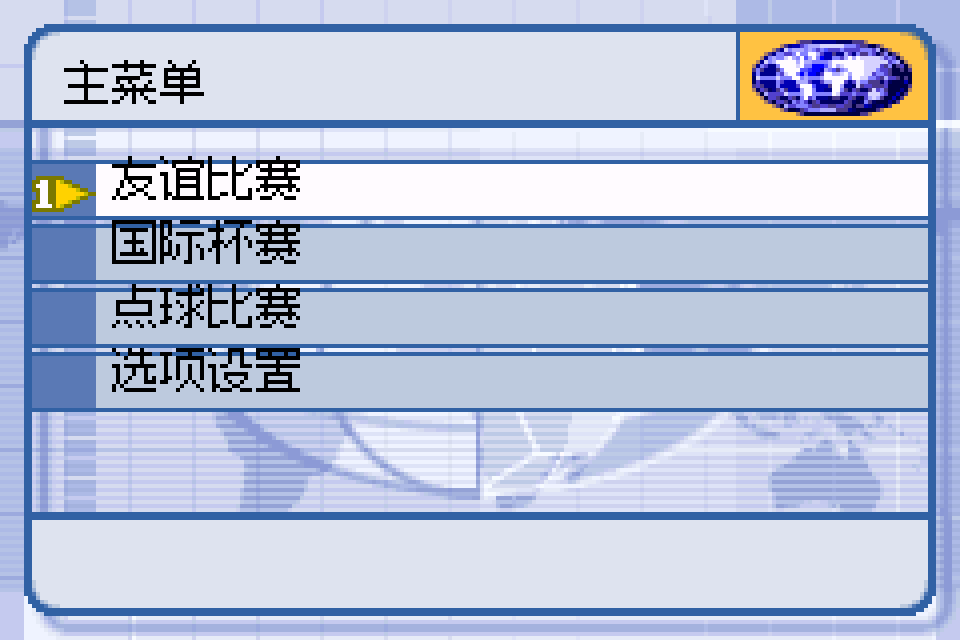

原包文件名：实况世界足球1&2+蜡笔小新+马克思佩恩+雷霆之音问题汇总打包/实况世界足球pocket v0.1.0/主菜单模式选择文字过于靠上导致显示超出边框.png

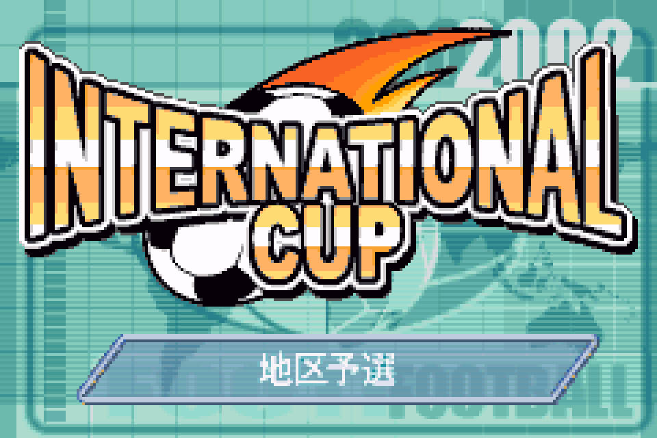

原包文件名：实况世界足球1&2+蜡笔小新+马克思佩恩+雷霆之音问题汇总打包/实况世界足球pocket v0.1.0/国际杯赛开幕图片下方日文未汉化.png

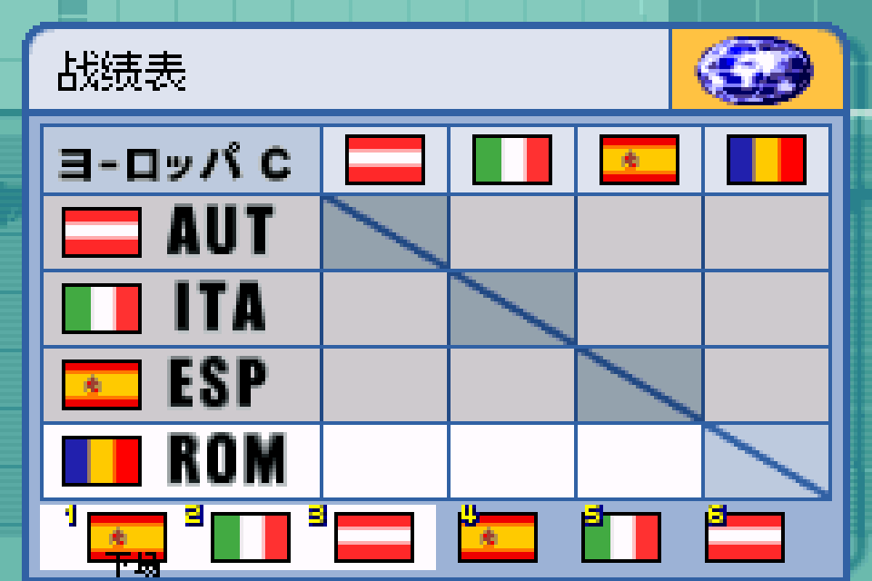

原包文件名：实况世界足球1&2+蜡笔小新+马克思佩恩+雷霆之音问题汇总打包/实况世界足球pocket v0.1.0/战绩表界面存在未汉化日文.png

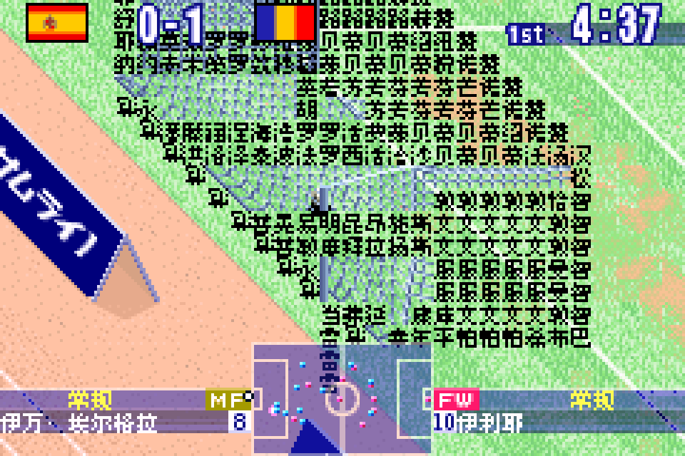

原包文件名：实况世界足球1&2+蜡笔小新+马克思佩恩+雷霆之音问题汇总打包/实况世界足球pocket v0.1.0/比赛中双方球门均显示异常.png

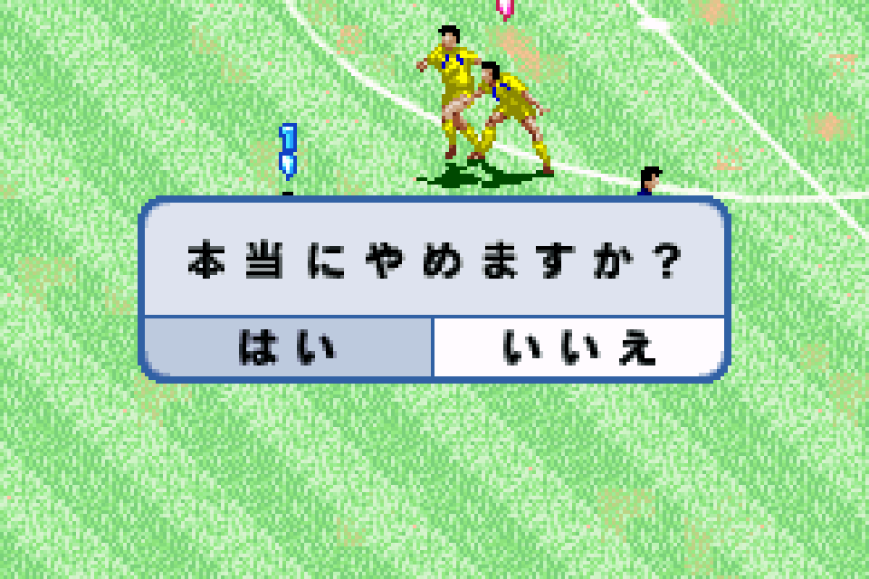

原包文件名：实况世界足球1&2+蜡笔小新+马克思佩恩+雷霆之音问题汇总打包/实况世界足球pocket v0.1.0/比赛中暂停退出界面提示未汉化.png

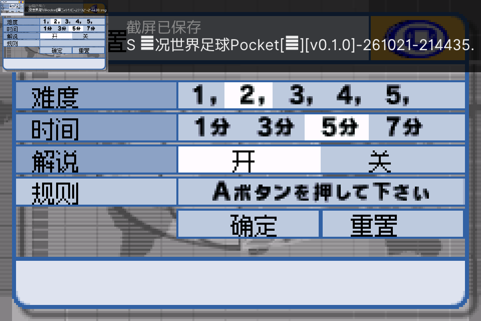

原包文件名：实况世界足球1&2+蜡笔小新+马克思佩恩+雷霆之音问题汇总打包/实况世界足球pocket v0.1.0/比赛设置-规则位置的注释未汉化.png

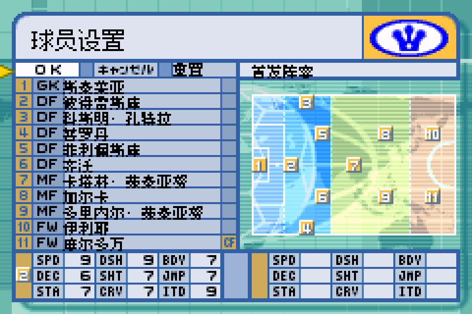

原包文件名：实况世界足球1&2+蜡笔小新+马克思佩恩+雷霆之音问题汇总打包/实况世界足球pocket v0.1.0/球员设置界面存在未汉化日文.png

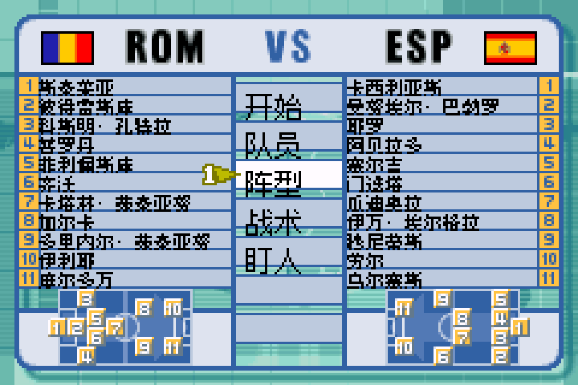

原包文件名：实况世界足球1&2+蜡笔小新+马克思佩恩+雷霆之音问题汇总打包/实况世界足球pocket v0.1.0/赛前设置界面文字过于靠下导致显示超出边框.png

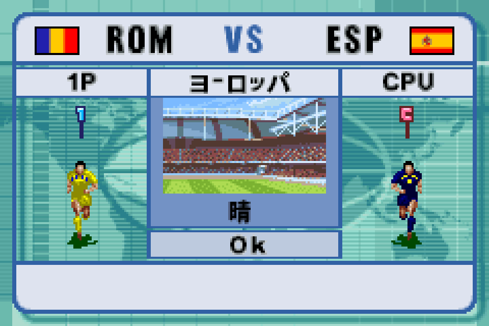

原包文件名：实况世界足球1&2+蜡笔小新+马克思佩恩+雷霆之音问题汇总打包/实况世界足球pocket v0.1.0/赛前预备界面存在未汉化日文.png

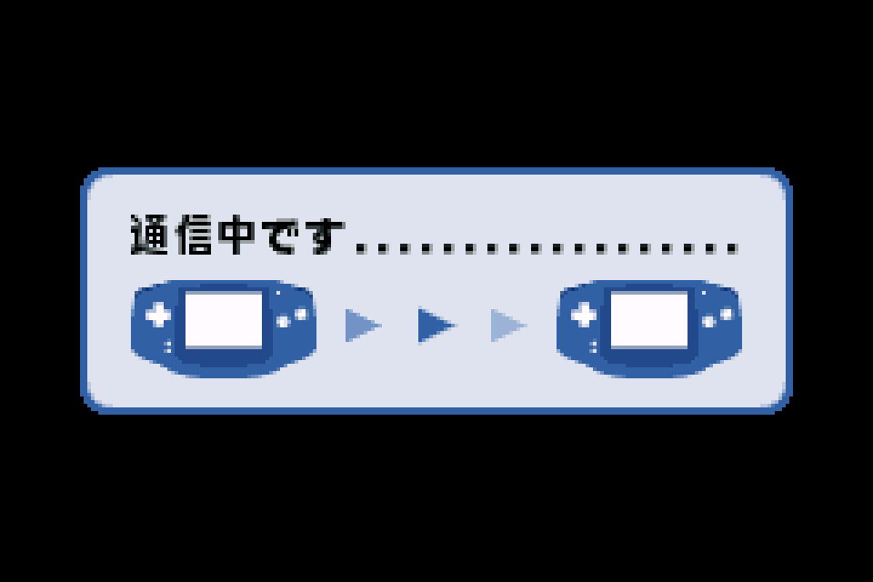

原包文件名：实况世界足球1&2+蜡笔小新+马克思佩恩+雷霆之音问题汇总打包/实况世界足球pocket v0.1.0/通信界面未汉化.png

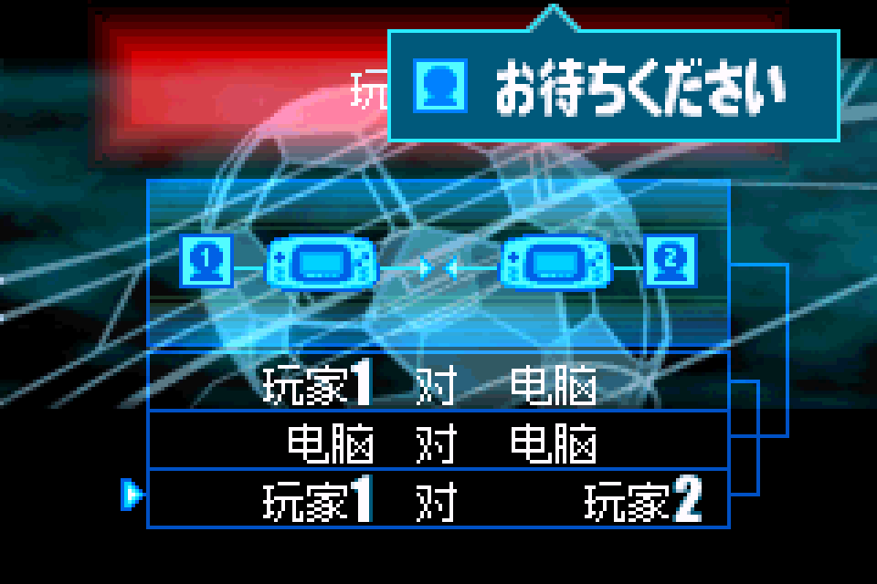

原包文件名：实况世界足球1&2+蜡笔小新+马克思佩恩+雷霆之音问题汇总打包/实况世界足球pocket2 v0.1.0/此界面右上方未汉化+“玩家2”字样未与上方文本对齐.png

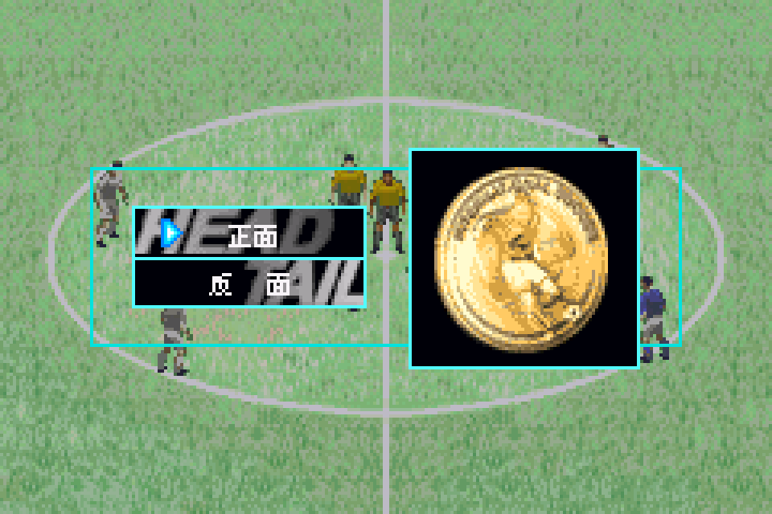

原包文件名：实况世界足球1&2+蜡笔小新+马克思佩恩+雷霆之音问题汇总打包/实况世界足球pocket2 v0.1.0/赛前抛硬币选边时“反面”二字有空格未与上方“正面”对齐.png

- [待复现] 实况世界足球Pocket v0.1.0：标题标志与比赛画面图形异常：开放待核。
- 实况世界足球Pocket 1/2 v0.1.0菜单文字位置与间距反馈：开放待核。
- [补译需求] 实况世界足球Pocket v0.1.0：杯赛、设置及通信界面残留日文：开放待核。

[已公开登记答复](https://tieba.baidu.com/p/11097560613?pid=154062976011#154062976011)：@une21 五款游戏的反馈包已收到。足球1/2和蜡笔小新的显示问题、马克思·佩恩标题缺字已登记；蜡笔小新首关卡住并入原问题，补译和国旗建议另记，后续排查。

玩家实际输入/输出SHA保持未知；本次为反馈登记和信息答复，未新增维护运行复现、修复或完整流程验收。

## 已发布版本的限定修复进展（2026-10-24）

- `problem-d8e95b2aaf369c30`：原反馈所列定位范围已关闭。对应 v0.1.1 / native-8-12px 限定测试版；[公开版本](https://github.com/shiyi1133/youxi-hanhua-releases/releases/tag/jikkyou-world-soccer-pocket-v0.1.1)。
  已核对：原反馈图01标题球形标志切割、图05球门两项均有原/旧/新精确最终ROM实际原帧；标题与球门恢复可按定位关闭。保留原声/深层未译及全赛事边界不妨碍该定位修复。
  保留：仅关闭原单定位显示/覆盖范围；不代表全部游戏问题或全流程通过。
  测试边界：同一实现者的最终ROM自然/诊断对照按原报告区分；维护仅字节/补丁和图片核验，未新增运行。
- `problem-565c62336579e0bc`：原反馈所列定位范围已关闭。对应 v0.1.1 / native-8-12px 限定测试版；[公开版本](https://github.com/shiyi1133/youxi-hanhua-releases/releases/tag/jikkyou-world-soccer-pocket-v0.1.1)。
  已核对：图03/04/06/07/08/10/11七处定位都有最终2cdd…原帧和来源元数据；关闭只表示这些请求定位已覆盖，不表示深层全部界面/全赛事自然通关。
  保留：仅关闭原单定位显示/覆盖范围；不代表全部游戏问题或全流程通过。
  测试边界：同一实现者的最终ROM自然/诊断对照按原报告区分；维护仅字节/补丁和图片核验，未新增运行。

同一实现者自测与维护字节/补丁/原帧核对分别记录；没有新增维护运行、玩家复测、实机或完整通关声明。开放不表示正在修复；原玩家报告版本、未知ROM字节和既有原话/图片/收件答复均保留。

## 版本更新答复（v0.1.1）

[已公开版本答复](https://tieba.baidu.com/p/11097560613?pid=154065741232#p154065741232) · [对应公开版本](https://github.com/shiyi1133/youxi-hanhua-releases/releases/tag/jikkyou-world-soccer-pocket-v0.1.1) · [版本答复索引](../../feedback/version-replies.md)

> @une21 《实况世界足球Pocket》v0.1.1原生普通字号修复版已更新：球员姓名显示、地区与暂停等已定位文字，同时保留标题红球及拖尾。附本版真实九宫格，欢迎继续测试。

前文登记时的旧问题行保留历史；当前问题状态见现有台账和本页已发布的限定修复进展。

本条是已有游戏的版本更新完成通知；原BUG确认、原反馈和当前问题状态各自保留，不代表整单、全流程、实机或玩家复测全部通过。

