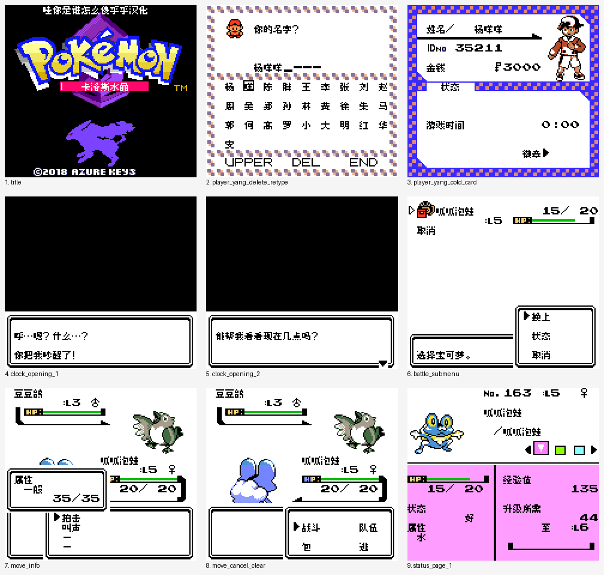

# 卡洛斯水晶

原输入：Kalos Crystal v1.0 (user-provided ROM hack)

原输入完整SHA256：`7cd8957e47a04bf0542de5d6a65affb369704e85ce11e03022be491be7dc1050`。此处“原输入”保留改版、既有汉化或地区修订身份，不一律称干净零售ROM。

| 字号 | 当前版本 | 音频 | 输出完整SHA256 |
| --- | --- | --- | --- |
| 8px | v0.1.3限定测试版 | unchanged | `cb25e2e1cd3338435b6b5780d7e61f13d0c1320cbd44366103ff50cf7a032597` |

## 源码与补丁

- 8px／v0.1.3限定测试版／unchanged：源码包（完整性未独立确认）：[下载](https://github.com/shiyi1133/youxi-hanhua-releases/releases/download/source-migration-20261022-04/kalos-crystal-current-scope-source-public-r01.zip)（ZIP SHA256 `686719e4fa0c944ea25e0aa17bd8feaff82c1b497460b42a0fde22a49f8f45ff`）；补丁：[下载](https://github.com/shiyi1133/youxi-hanhua-releases/releases/download/patch-migration-20261022/kalos-crystal-current-patches.zip)（ZIP SHA256 `56cea798b387b8b8b54acedfd289ae8b99dfe252b611cce0e5125f50bde2b8b7`）。
  该包已核对对应版本与字节安全；完整修改源码覆盖范围未独立确认。

补丁须直接应用于完整SHA一致的实际原输入；普通字、大字和音乐变体分别核对。公开源码归档不表示本轮重新构建或通过新的运行验收。原作、字体、已有翻译及工具依赖的权利与许可，依各包对应许可保留。

## 范围与验证边界

- 8px／v0.1.3限定测试版：普通8px点阵汉化；原生英文/假名及未覆盖图形按实际版本保留。。
  保留招式返回残字、时钟两句和战斗队伍菜单的局部修复，并减少部分战斗入口耗帧。
  v0.1.2资料与原包完整保留，当前仅选择v0.1.3。
  战斗入口样本原英文246帧、v0.1.1为438、v0.1.2为440、新版364；RNG/存档不相同，不能将76帧差完全归因优化，仍比英文慢118帧。
  No.168状态页整页乱码未复现；地图名/拾取/研究所等全场景慢未完成验证，既有反馈和59保持open。
  2888项CPU等价用例是受控诊断；自然取名、新开局、战斗、菜单返回及保存冷启动另有提供方记录，无全流程/实机验收。
  本维护会话仅独立静态、BPS还原、文件校验和九宫格像素核验；未执行附件代码、未运行模拟器或复测游戏。
  提供方限定路线验证；维护独立核完整SHA、补丁和截图，未运行附包代码或游戏。
  未声明实机、全流程通关或全部旧存档兼容。

本次资料搬运未新增模拟器、实机或全通验收；未记录或未测试的范围不写成通过。问题单开放只表示尚未关闭，已关闭也不单独证明全部场景都修复。

[公开反馈及问题状态](feedback.md) · [报告BUG](https://github.com/shiyi1133/youxi-hanhua-releases/issues/new?template=bug_report.md)

## 对应版本截图

卡洛斯水晶 v0.1.3限定测试版 普通8px；提供方最终ROM画面，维护实际查看九宫格，不代表维护重跑游戏。

图像SHA256：`1779991943620437d9aa2a733a303553b99d69070e1e82be30002885ee6b2c2b`；绑定ROM SHA256：`cb25e2e1cd3338435b6b5780d7e61f13d0c1320cbd44366103ff50cf7a032597`。

