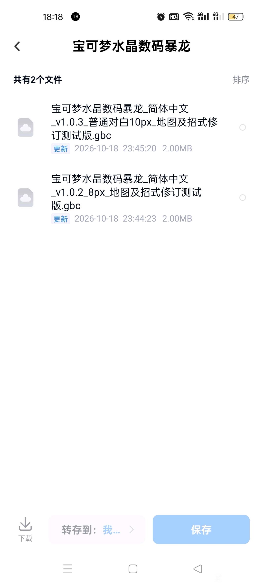
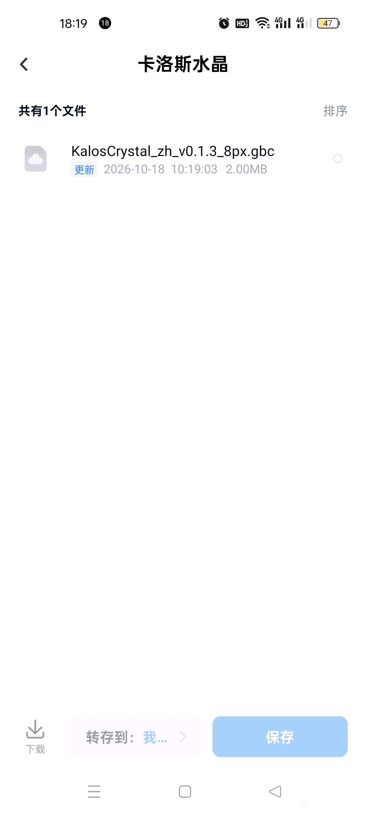

# 卡洛斯水晶：公开反馈

以下均为公开证据，玩家原话不自动等于维护已复现或已修复。

## 154041460639

26楼 · fgjxchtd · [原回帖](https://tieba.baidu.com/p/11090183907?pid=154041460639#154041460639)

> 才才刚开始就出现了，后面聊天后面还有什么abcd的英文出现出现快，消失也快

[玩家公开图片](https://tiebapic.baidu.com/forum/pic/item/26e0d81373f08202a8d480380dfbfbedaa641b9a.jpg)（玩家反馈图）

[玩家公开图片](https://tiebapic.baidu.com/forum/pic/item/433ed843ad4bd113838ba6351cafa40f4afb059a.jpg)（玩家反馈图）

[玩家公开图片](https://tiebapic.baidu.com/forum/pic/item/f85b8b025aafa40fbf80dfdaed64034f79f0199a.jpg)（玩家反馈图）

## 154041483315

29楼 · fgjxchtd · [原回帖](https://tieba.baidu.com/p/11090183907?pid=154041483315#154041483315)

> 这什么玩意？

[玩家公开图片](https://tiebapic.baidu.com/forum/pic/item/59b007f41bd5ad6e045f75edc7cb39dbb7fd3cba.jpg)（玩家反馈图）

[玩家公开图片](https://tiebapic.baidu.com/forum/pic/item/5f948e94a4c27d1e07802ac35dd5ad6edcc438ba.jpg)（玩家反馈图）

## 154042331941

134楼 · fgjxchtd · [原回帖](https://tieba.baidu.com/p/11092365551?pid=154042331941#154042331941)

> 卡洛斯水晶查看宠物花屏，对战结束之后，出现这些东西，对战的时候，这精灵后面有字，在对战界面打开，是英文，开始的性别选择之后前两句就是英文，聊天最后都会显示什么abcd这样的，但是又会很快消失

[玩家公开图片](https://tiebapic.baidu.com/forum/pic/item/3bd5c38065380cd7f928bfeae744ad345982812a.jpg)（玩家反馈图）

[玩家公开图片](https://tiebapic.baidu.com/forum/pic/item/f772841001e939015a3490393dec54e736d1962a.jpg)（玩家反馈图）

[玩家公开图片](https://tiebapic.baidu.com/forum/pic/item/59b007f41bd5ad6e045f75edc7cb39dbb7fd3cba.jpg)（玩家反馈图）

[玩家公开图片](https://tiebapic.baidu.com/forum/pic/item/5f948e94a4c27d1e07802ac35dd5ad6edcc438ba.jpg)（玩家反馈图）

[玩家公开图片](https://tiebapic.baidu.com/forum/pic/item/26e0d81373f08202a8d480380dfbfbedaa641b9a.jpg)（玩家反馈图）

[玩家公开图片](https://tiebapic.baidu.com/forum/pic/item/433ed843ad4bd113838ba6351cafa40f4afb059a.jpg)（玩家反馈图）

## 154042574041

127楼 · fgjxchtd · [原回帖](https://tieba.baidu.com/p/11092365551?pid=154042574041#154042574041)

> 查看变乱码，对战结束都会出现这些字，在对战的时候，查看状态或者属性都是英文，会显示地址的地方经过都会卡顿一下

[玩家公开图片](https://tiebapic.baidu.com/forum/pic/item/c90cd033c895d14347bff92435f082025baf0713.jpg)（玩家反馈图）

[玩家公开图片](https://tiebapic.baidu.com/forum/pic/item/3d565b66d016092476ecbf1c920735fae7cd3413.jpg)（玩家反馈图）

[玩家公开图片](https://tiebapic.baidu.com/forum/pic/item/b270bffd5266d016d5d0832fd12bd40734fa3513.jpg)（玩家反馈图）

## 154043155088

127楼 · fgjxchtd · [原回帖](https://tieba.baidu.com/p/11092365551?pid=154043155088#154043155088)

> 蛋没问题

## 154043162183

127楼 · fgjxchtd · [原回帖](https://tieba.baidu.com/p/11092365551?pid=154043162183#154043162183)

> 版本就那一个

## 154045341947

134楼 · fgjxchtd · [原回帖](https://tieba.baidu.com/p/11092365551?pid=154045341947#154045341947)

> 起名字还是英文，查看属性还是会这样

## 154045462108

134楼 · fgjxchtd · [原回帖](https://tieba.baidu.com/p/11092365551?pid=154045462108#154045462108)

> 还是会出现，不过并不是每一局都会出现

## 154045508059

134楼 · fgjxchtd · [原回帖](https://tieba.baidu.com/p/11092365551?pid=154045508059#154045508059)

> 不知道为什么，每一次遇到这一只，都会有一条黑色的

## 154045748153

134楼 · fgjxchtd · [原回帖](https://tieba.baidu.com/p/11092365551?pid=154045748153#154045748153)

> 有时候有概率会出现这样一条

## 154047256388

134楼 · fgjxchtd · [原回帖](https://tieba.baidu.com/p/11092365551?pid=154047256388#154047256388)

> 点收音机第一句跳出来这玩意，打印技能打不出来

## 154047257980

134楼 · fgjxchtd · [原回帖](https://tieba.baidu.com/p/11092365551?pid=154047257980#154047257980)

> 请看这是什么精灵？

## 154041478869

28楼 · fgjxchtd · [原回帖](https://tieba.baidu.com/p/11090183907?pid=154041478869#154041478869)

> 卡洛斯水晶，会显示地址的时候比如刚出家门就会卡顿一下

## 154041498146

30楼 · fgjxchtd · [原回帖](https://tieba.baidu.com/p/11090183907?pid=154041498146#154041498146)

> 卡洛斯水晶，嗯，怎么说呢？就跟这个第一个字一样。进入战斗跟退出战斗的时候，出门会显示地址的时候，跟大木博士聊天，都卡的一批

## 154041505962

28楼 · fgjxchtd · [原回帖](https://tieba.baidu.com/p/11090183907?pid=154041505962#154041505962)

> 另外，捡东西也是一样，老卡了

## 154045348350

134楼 · fgjxchtd · [原回帖](https://tieba.baidu.com/p/11092365551?pid=154045348350#154045348350)

> 过门或者显示地址的地方，经过都会卡顿一下，有时候会瞬间出现一下乱码

## 154045410725

134楼 · fgjxchtd · [原回帖](https://tieba.baidu.com/p/11092365551?pid=154045410725#154045410725)

> 又发现了一个比较严重的问题，没拿到图鉴之前，不能进化，进化就卡死

## 154046916892

134楼 · fgjxchtd · [原回帖](https://tieba.baidu.com/p/11092365551?pid=154046916892#154046916892)

> 御三家等级进化，没拿图鉴的情况下进化会卡死

## 154046917205

134楼 · fgjxchtd · [原回帖](https://tieba.baidu.com/p/11092365551?pid=154046917205#154046917205)

> 就是0.1.3

## 154053012418

134楼 · fgjxchtd · [原回帖](https://tieba.baidu.com/p/11092365551?pid=154053012418#154053012418)

> 对了，忘了说了，游戏厅里面兑换

[玩家公开图片](https://tiebapic.baidu.com/forum/pic/item/42411cce36d3d539990e68c47c87e950352ab035.jpg)（玩家反馈图）

## 154053041935

134楼 · fgjxchtd · [原回帖](https://tieba.baidu.com/p/11092365551?pid=154053041935#154053041935)

> 龙穴里面的问题

[玩家公开图片](https://tiebapic.baidu.com/forum/pic/item/a39f3d9b033b5bb5e2c447f970d3d539b700bcd5.jpg)（玩家反馈图）

## 154057741777

205楼 · fgjxchtd · [原回帖](https://tieba.baidu.com/p/11092365551?pid=154057741777#154057741777)

> 卡洛斯水晶，宝可梦水晶数码暴龙，都是这样的，所有都是，原版不会变色

## 154058616784

205楼 · fgjxchtd · [原回帖](https://tieba.baidu.com/p/11092365551?pid=154058616784#154058616784)

> 发不了视频问题就是点攻击之后退出来它就上色了，攻击完之后又恢复正常

## 问题状态

- 粉色杂乱怪兽页与战斗图上的残字均有实际图片；abcd瞬态以原话保存，不能从静态图确认全部。；与同作者跨两个征集帖反馈按来源PID合并，版本/字号/完整ROM哈希保持未知。；玩家补充所有攻击都会变色，选择攻击后退出来即上色、攻击完成后恢复，并称原版不会；另提宝可梦水晶数码暴龙。：开放；公开Issue待单独建档。
- 场景由玩家明确描述，截图不能证明帧率或回归原因；不因换行处卡顿而路由排版既有反馈。；鸡蛋进度疑虑另作待信息观察，不先假定与界面拖慢同根因。：开放；公开Issue待单独建档。
- 已查看Will you check the clock for me / Zzz... Hm? Wha...? You woke me up!及SWITCH/STATS/CANCEL画面。；当前README声明有230项未确认片段，但未明确这几个消费者是否已覆盖；先对照发布源范围，不将所有英文残留称新增回归。；原ASCII命名页/英文默认名保留本身不直接登记程序BUG。：已关闭；公开Issue待单独建档。
- 玩家报告没拿到图鉴之前不能进化，进化时卡死，附两图。：开放；公开Issue待单独建档。
- 玩家补充游戏厅精灵兑换列表、龙穴问题选择项仍是英文，两张图实际查看。：开放；公开Issue待单独建档。

## 已公开答复

- [原答复](https://tieba.baidu.com/p/11092365551?pid=154059399004#154059399004)：@fgjxchtd 退出攻击菜单变色、攻击后恢复的触发已记录。请发《卡洛斯水晶》和《宝可梦水晶数码暴龙》两份ROM的完整文件名与字号，便于区分版本。

实际玩家ROM SHA未知时保持未知；当前参考版本SHA不能冒充玩家字节。

## 20261023-0416 公开反馈补充

205楼 · fgjxchtd · [原回帖](https://tieba.baidu.com/p/11092365551?pid=154059654703#154059654703)

> 那两个18号的版本，都是最新的

205楼 · fgjxchtd · [原回帖](https://tieba.baidu.com/p/11092365551?pid=154059661256#154059661256)

> 一个是只有一个，另外一个就是第一个，也就是最新的

- 卡洛斯/数码暴龙攻击退出变色：补18号实际文件名截图：开放待核；本次没有新增维护复现、修复或完整流程验收。

玩家实际输入/输出完整SHA保持未知；公开答复属于登记/信息回复，不是ROM新交付或修复完成通知。
