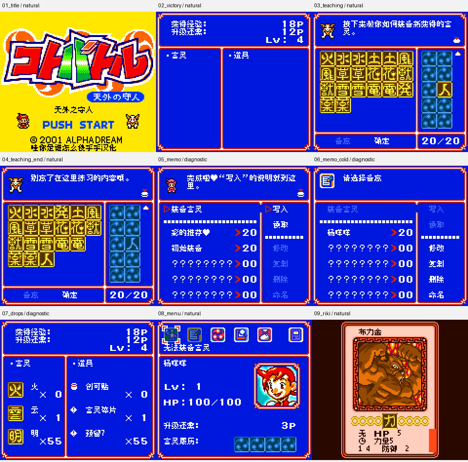

# Koto Battle 天外之守人 v0.1.3（限定测试版）

[源码与补丁Release](https://github.com/shiyi1133/youxi-hanhua-releases/releases/tag/kotobattle-v0.1.3) · [公开反馈](feedback.md) · [报告BUG](https://github.com/shiyi1133/youxi-hanhua-releases/issues/new?template=bug_report.md)

原游戏／实际输入：Koto Battle - Tengai no Moribito (Japan)

原输入完整SHA-256：`08190dc9eaf82f213caddd21174391f0cd2a3907ef1a679b5271c95f555ef676`（2097152字节）。

范围：普通8px限定修复测试版：装备45段、备忘54段教学及独立结算消费者；保留卡片中央图标、标题署名底边和菜单帮助标题刷新修复。

## 8px v0.1.3

字号范围：原生普通8px；无另行大字版；CGB原生彩色，非SGB验收。

目标完整SHA-256：`73886fbf7c0d9e9c9c659b8b6f38c70efb32147db64bdcd71608707ae0ece387`（4194304字节）。

补丁：`KotoBattle_zh_v0.1.3_8px.bps`，SHA-256 `cf8c93dd3f9a7e2e33cc662b9200c8a8ff7cf2096aa18d808258b98ac88995f0`。

[源码（完整性未独立确认）](https://github.com/shiyi1133/youxi-hanhua-releases/releases/download/kotobattle-v0.1.3/kotobattle-v0.1.3-8px-SOURCE-public.zip) · [补丁包](https://github.com/shiyi1133/youxi-hanhua-releases/releases/download/kotobattle-v0.1.3/kotobattle-v0.1.3-8px-PATCH-public.zip)

v0.1.3普通8px最终ROM提供者真实九宫格；九格原生160×144完整像素经2倍整数放大逐格核对。第5/6/7格分别为备忘入口、备忘冷读及掉落受控诊断，其余格按提供者自然路径记录；非新增维护运行或全流程验收。

## 测试及限制

提供者自然路径：提供者实施团队自测：最终ROM全新开机149036帧，经引导战、普通试炼获胜及北门自然装备教学；71次真实按键完成课程。普通保存、新进程电池冷读和一份作者v0.1.2电池转v0.1.3具体路线分别保留边界。

提供者诊断路径：提供者受控诊断：99页装备/备忘教学原生消费者、备忘61键入口、60言灵/40道具及数量边界、371卡名/图标消费者；共享旧教学结算例程未自然触发。备忘及掉落诊断不当自然剧情或自然全收集。

保存边界：未据原件SRAM或空存档推定保存冷读成功。

同一实现者自测，不是独立人员QA；维护未新增ROM运行或源码重建，未宣称实机或完整通关。

- 未验证：维护仅做数据静态与独立BPS还原校验，未执行提供者源码或ROM，未独立重建。
- 未验证：#116仍为部分覆盖改进，不据99页教学关闭整项；#136保存后四图标变箭头仍未复现，保持open。
- 未验证：未全流程、全部事件/最长变量、自然全卡收集、实机、联机、其他模拟器或玩家实际存档验收；一份旧电池示例不保证通用兼容。
- 未验证：原标题艺术Logo、原版权、PUSH START及玩法语义单字图标保留；无10px或SGB版本。
- 核对补丁还原、资产完整SHA和截图字节不等于全部游戏功能验收。

