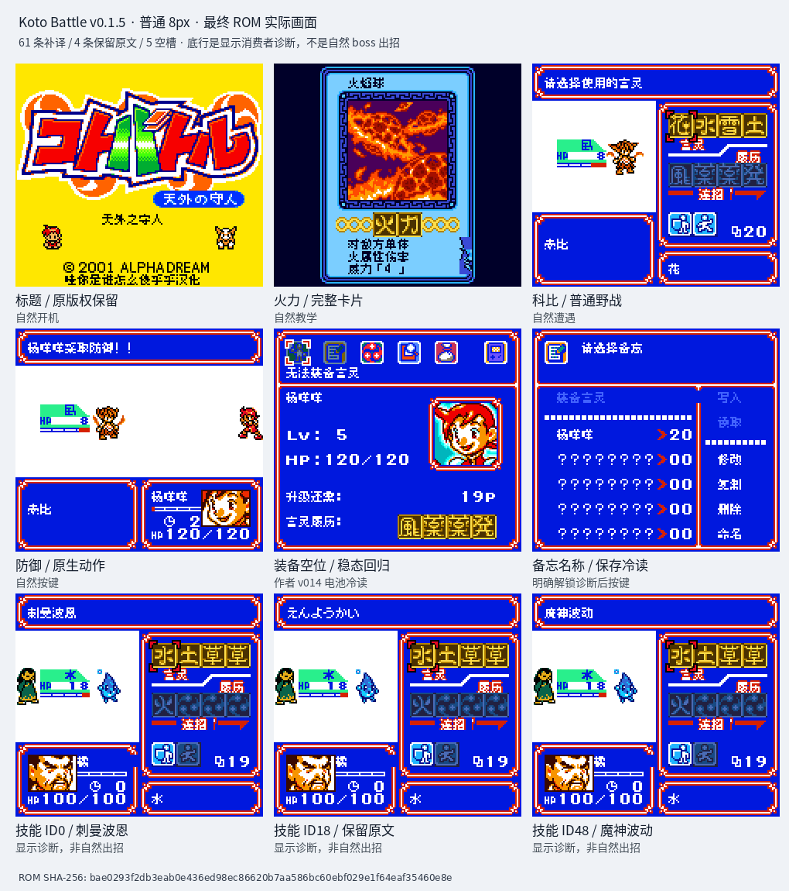

# Koto Battle 天外之守人 v0.1.5（限定测试版）

[源码与补丁Release](https://github.com/shiyi1133/youxi-hanhua-releases/releases/tag/kotobattle-v0.1.5) · [公开反馈](feedback.md) · [报告BUG](https://github.com/shiyi1133/youxi-hanhua-releases/issues/new?template=bug_report.md)

原游戏／实际输入：Koto Battle - Tengai no Moribito (Japan)

原输入完整 SHA-256：`08190dc9eaf82f213caddd21174391f0cd2a3907ef1a679b5271c95f555ef676`（2097152字节）。

范围：独立八格技能标题61记录53独名补译，保留v0.1.4战斗/卡面/名字/空位稳定修复。

## 8px v0.1.5 / unchanged

字号范围：普通8px；本批不新增大字号。

目标完整 SHA-256：`bae0293f2db3eab0e436ed98ec86620b7aa586bc60ebf029e1f64eaf35460e8e`（4194304字节）。

补丁：`KotoBattle_zh_v0.1.5_8px.bps`，SHA-256 `87b75fe1f4d7e29deecd06c6e64a9a0826ae7014fb9d9efc6925c8b3649cd40c`。

[源码（完整性未独立确认）](https://github.com/shiyi1133/youxi-hanhua-releases/releases/download/kotobattle-v0.1.5/kotobattle-v0.1.5-SOURCE-public.zip) · [补丁包](https://github.com/shiyi1133/youxi-hanhua-releases/releases/download/kotobattle-v0.1.5/kotobattle-v0.1.5-PATCH-public.zip)

v0.1.5 / 8px / unchanged 最终ROM提供者实际画面；真实九格，按提供者场景分别保留自然和诊断边界。维护未运行、未全通或实机验收。

## 测试及限制

提供方自然范围：提供者自测：最终ROM自然开机/教学/普通试炼/北门课程/野战/防御逃跑与正常保存冷读，提供者39项有限测试。

提供方诊断范围：提供者诊断：完整70槽与全部技能/卡名/野怪名为原生消费者诊断；九格底行三格明确显示诊断，非自然Boss。

保存边界：仅按具体版本材料，不推定所有旧存档兼容。

维护本轮独立核原输入、补丁逐字节还原、ZIP/CRC、Source安全与原图字节；未执行提供方源码、未重建或运行ROM，未宣称独立人员QA、实机或全流程验收。

- 未验证：维护仅做数据/字节与独立补丁验证，未执行提供者源码或ROM，未独立重建。
- 未验证：4条歧义假名与5原生空槽保留；全作漏译仍部分覆盖。
- 未验证：首Boss现场未自然到达、保存图标箭头未复现，历史排版未接手。
- 未验证：未全通/实机/成功联机/全部Boss技能/玩家真实SAV与任意跨版档兼容。
