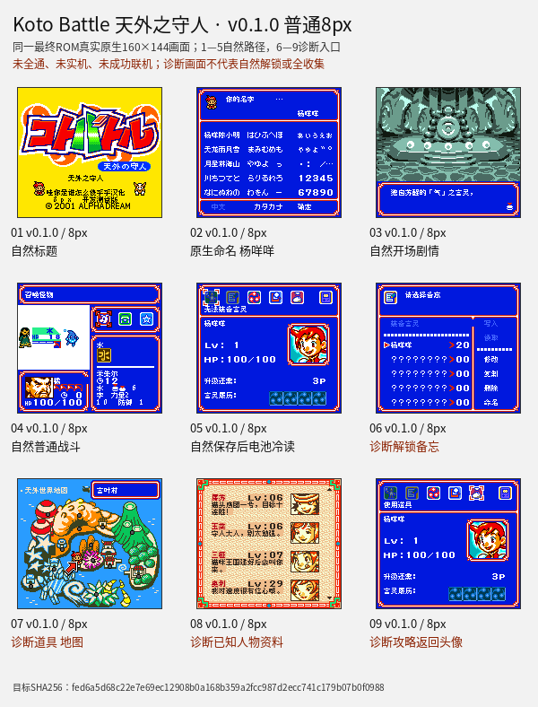

# Koto Battle 天外之守人（限定测试版）

[公开反馈](feedback.md) · [报告BUG](https://github.com/shiyi1133/youxi-hanhua-releases/issues/new?template=bug_report.md)

原游戏／实际基底：Koto Battle - Tengai no Moribito (Japan)

原输入完整SHA-256：`08190dc9eaf82f213caddd21174391f0cd2a3907ef1a679b5271c95f555ef676`（2097152字节，日本Rev0实际用户输入）。

## v0.1.0 8px

字号范围：普通原生8px中文点阵；Fusion Pixel；艺术Logo/技术ASCII及原生假名等按交付实际范围保留。

[源码包（语义完整性未独立确认）](https://github.com/shiyi1133/youxi-hanhua-releases/releases/download/kotobattle-v0.1.0/kotobattle-v0.1.0-8px-source-public.zip) · [补丁包](https://github.com/shiyi1133/youxi-hanhua-releases/releases/download/kotobattle-v0.1.0/kotobattle-v0.1.0-8px-patches-public.zip)

目标完整SHA-256：`fed6a5d68c22e7e69ec12908b0a168b359a2fcc987d2ecc741c179b07b0f0988`（4194304字节）。

v0.1.0 普通8px最终ROM真实九宫格；1–5自然路径、6–9诊断入口，非全通/全收集；原生160×144像素。

## 范围与测试边界

普通8px中文测试版；提供者自然开场、原生命名、普通战斗及电池冷读记录，另含诊断菜单/地图/人物资料。

- 九宫格1–5为自然路径、6–9为诊断入口，不能代表自然解锁或全收集；原厂日文艺术Logo及原生命名假名/字母保留；未全通、未实机、未成功联机；本维护未执行源码或新增运行测试。

提供方结构化自测摘要见[对应版本记录](provider-selftest.json)，保留自然、诊断、静态及未测边界；不表示本轮维护新增运行或源码重建。本次源码语义完整性保持未知。

开放问题不等于正在修复；有限验证不表示完整游戏、全部变量边界或真机验收。
