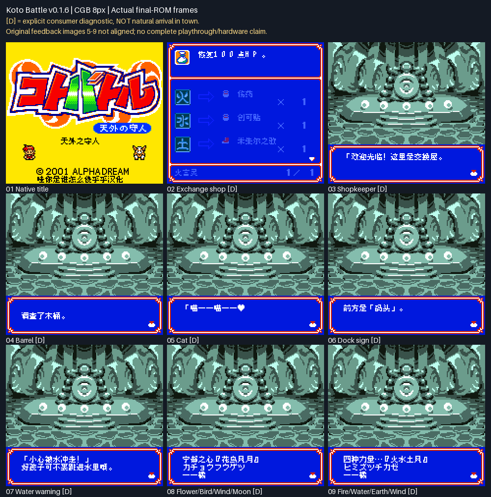

# Koto Battle 天外之守人 v0.1.6（限定测试版）

[源码与补丁Release](https://github.com/shiyi1133/youxi-hanhua-releases/releases/tag/kotobattle-v0.1.6) · [公开反馈](feedback.md) · [报告BUG](https://github.com/shiyi1133/youxi-hanhua-releases/issues/new?template=bug_report.md)

原游戏／实际输入：Koto Battle - Tengai no Moribito (Japan)

原输入完整 SHA-256：`08190dc9eaf82f213caddd21174391f0cd2a3907ef1a679b5271c95f555ef676`（2097152字节）。

范围：补译7条镇内/水道共享消息、两处保留假名线索的挂画释义，并修正交换页描述、道具名和底部言灵名显示。

## 8px v0.1.6 / unchanged

字号范围：普通原生8px；未新增大字号。

目标完整 SHA-256：`e3c40e472f9c5ae965e4b759bab72e37f98d5d2c097914e2488e87c18810d8da`（4194304字节）。

补丁：`KotoBattle_zh_v0.1.6_8px.bps`，SHA-256 `b280c1da6e5116e8f5eff5f5cd6cfff014a7ba39d11bc02c2c003155e0fa91b8`。

[源码（完整性未独立确认）](https://github.com/shiyi1133/youxi-hanhua-releases/releases/download/kotobattle-v0.1.6/kotobattle-v0.1.6-complete-source.zip) · [补丁包](https://github.com/shiyi1133/youxi-hanhua-releases/releases/download/kotobattle-v0.1.6/kotobattle-v0.1.6-PATCH.zip)

补译7条镇内/水道共享消息、两处保留假名线索的挂画释义，并修正交换页描述、道具名和底部言灵名显示。 标题、自然试炼/装备教学/野战、姓名保存冷读与至珊瑚森林路线按提供方报告；未自然到城下镇。 九宫格仅首格自然标题，其余8格明确[D]原生消费者诊断，开场背景不是城镇现场；商店150布局亦为诊断。

## 测试及限制

提供方自然范围：标题、自然试炼/装备教学/野战、姓名保存冷读与至珊瑚森林路线按提供方报告；未自然到城下镇。

提供方诊断范围：九宫格仅首格自然标题，其余8格明确[D]原生消费者诊断，开场背景不是城镇现场；商店150布局亦为诊断。

保存边界：仅按具体版本材料，不推定所有旧存档兼容。

维护本轮独立核原输入、补丁逐字节还原、ZIP/CRC、Source安全与原图字节；未执行提供方源码、未重建或运行ROM，未宣称独立人员QA、实机或全流程验收。

- 未验证：维护独立核输入ZIP/ROM完整SHA、BPS逐字节还原、ZIP成员CRC与Root实际查看最终图；未执行附件源码或ROM、未独立重建。
- 未验证：提供方自然/受控/静态证据分别记录，不冒充维护运行、独立外部人员QA、玩家实际存档、实机、联机或完整通关验收。
- 未验证：备份原件与普通存档，不跨ROM完整SHA加载即时状态；既有旧Release、标签、引用、原始包与本地历史保留。
- 未验证：Issue116保持部分覆盖/open；玩家反馈图5–9未对齐，六处自然到访及完整商店自然返回未验；Issue8未接，136箭头/自然首boss未确认。
