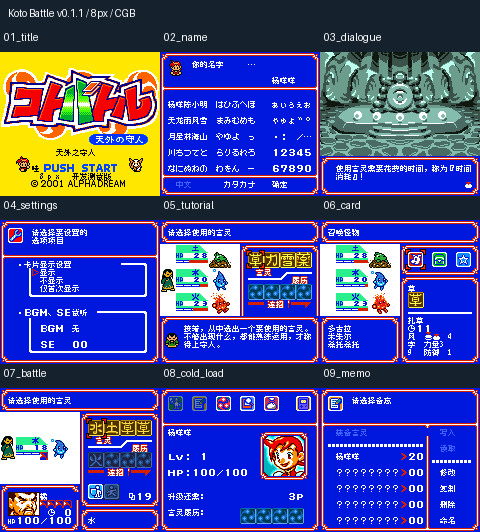

# Koto Battle 天外之守人 v0.1.1（限定测试版）

[源码与补丁Release](https://github.com/shiyi1133/youxi-hanhua-releases/releases/tag/kotobattle-v0.1.1) · [公开反馈](feedback.md) · [报告BUG](https://github.com/shiyi1133/youxi-hanhua-releases/issues/new?template=bug_report.md)

原游戏／实际输入：Koto Battle - Tengai no Moribito (Japan)

原输入完整SHA-256：`08190dc9eaf82f213caddd21174391f0cd2a3907ef1a679b5271c95f555ef676`（2097152字节）。

范围：原生普通8px限定修订：17字对白安全预算与右框属性，设置/BGM、石碑回血共享文本、教学独立卡名属性/读音/怪物名及战斗图形标签。

## 8px v0.1.1

字号范围：原生普通8px；无另行大字版；CGB原生彩色，非SGB验收。

目标完整SHA-256：`5c96e69b77886b7b59364407c5b9a16a34e3b5cab7c6a40f63085fd7bd14080e`（4194304字节）。

补丁：`KotoBattle_JP_v0.1.1_8px.bps`，SHA-256 `51d88c291df1b17892016a125599d3aaa66e2ffef4b8f7fd4330841123377949`。

[源码（完整性未独立确认）](https://github.com/shiyi1133/youxi-hanhua-releases/releases/download/kotobattle-v0.1.1/kotobattle-v0.1.1-8px-SOURCE-public-r02.zip) · [补丁包](https://github.com/shiyi1133/youxi-hanhua-releases/releases/download/kotobattle-v0.1.1/kotobattle-v0.1.1-8px-PATCH-public.zip)

v0.1.1 原生普通8px最终ROM真实九宫格；自然/受控诊断消费者分层见说明，不作全流程/实机证明。

## 测试及限制

提供者自然路径：提供者自然自测：中文命名、设置选择/取消/曲目、开场教学和普通战斗、正常保存与新进程电池冷读。

提供者诊断路径：精确对白99D5C、石碑8FBCA/回血8FBE0原生消费者对照；备忘解锁与手册入口为诊断，其输入/操作/保存走原生路径。

保存边界：提供者自测与诊断按上述边界区分；维护未运行ROM/源码，建议先备份存档、跨版本不用即时状态。

同一实现者自测，不是独立人员QA；维护未新增ROM运行或源码重建，未宣称实机或完整通关。

- 未验证：原反馈玩家实际SHA未核；原石碑/回血/杂志交互自然到达未建立；不声称自然全流程。
- 未验证：新Issue136闪烁/保存短花屏与137标题残字未有连续帧专项验收，保持未确认。
- 未验证：全通/全部敌人/最长变量、实机、联机和全部外部历史SAV未测。
- 核对补丁还原、资产完整SHA和截图字节不等于全部游戏功能验收。

