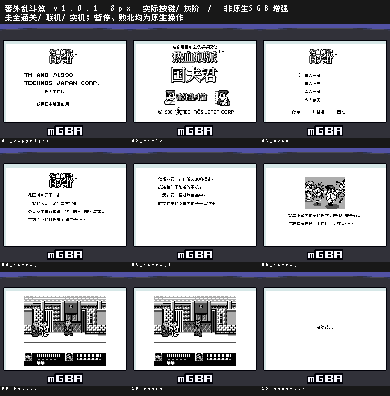
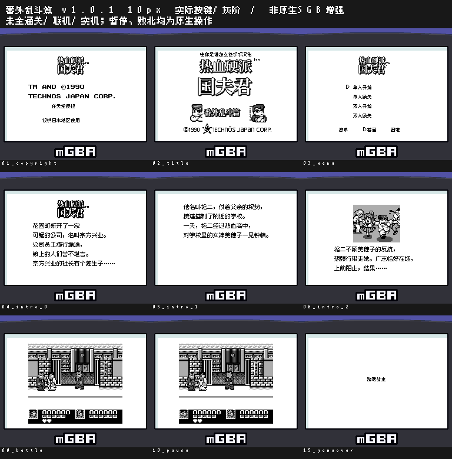

# 热血硬派国夫君番外乱斗篇

原输入：Nekketsu Kouha Kunio-kun - Bangai Rantou Hen (Japan)

原输入完整SHA256：`d912c10d466586b633812ecbccc9bc20eb425f8f11b6b5e80c72ea2a760908ed`。此处“原输入”保留改版、既有汉化或地区修订身份，不一律称干净零售ROM。

| 字号 | 当前版本 | 音频 | 输出完整SHA256 |
| --- | --- | --- | --- |
| 8px | v1.0.1 | unchanged | `fb8fb8c806965da9fdebc35d2fdfcd6b3c50b76488c266eb62136965bc2ef097` |
| 10px-dialogue | v1.0.1 | unchanged | `5dd4f255fc1a00f14707f306432578434f8dc9c277ea03c04310287972488743` |

## 源码与补丁

- 8px／v1.0.1／unchanged：完整修改源码：[下载](https://github.com/shiyi1133/youxi-hanhua-releases/releases/download/source-migration-20261022/kunio-bangai-current-source-7659b6f5d511-public-r02.zip)（ZIP SHA256 `cd713399aa7a8d2ded78431206fcdcae840714e7b8bc079d00ca405a5b59a9e3`）；补丁：[下载](https://github.com/shiyi1133/youxi-hanhua-releases/releases/download/patch-migration-20261022/kunio-bangai-current-patches.zip)（ZIP SHA256 `a1fa1e2c1e5c49efc9a7e5420062cba368e663ea0a1d6ec38b70eae9d4ae3247`）。
- 10px-dialogue／v1.0.1／unchanged：完整修改源码：[下载](https://github.com/shiyi1133/youxi-hanhua-releases/releases/download/source-migration-20261022/kunio-bangai-current-source-7659b6f5d511-public-r02.zip)（ZIP SHA256 `cd713399aa7a8d2ded78431206fcdcae840714e7b8bc079d00ca405a5b59a9e3`）；补丁：[下载](https://github.com/shiyi1133/youxi-hanhua-releases/releases/download/patch-migration-20261022/kunio-bangai-current-patches.zip)（ZIP SHA256 `a1fa1e2c1e5c49efc9a7e5420062cba368e663ea0a1d6ec38b70eae9d4ae3247`）。

补丁须直接应用于完整SHA一致的实际原输入；普通字、大字和音乐变体分别核对。公开源码归档不表示本轮重新构建或通过新的运行验收。原作、字体、已有翻译及工具依赖的权利与许可，依各包对应许可保留。

## 范围与验证边界

- 8px／v1.0.1：8px / 10px-dialogue。
- 10px-dialogue／v1.0.1：8px / 10px-dialogue。

本次资料搬运未新增模拟器、实机或全通验收；未记录或未测试的范围不写成通过。问题单开放只表示尚未关闭，已关闭也不单独证明全部场景都修复。

[公开反馈及问题状态](feedback.md) · [报告BUG](https://github.com/shiyi1133/youxi-hanhua-releases/issues/new?template=bug_report.md)

## 对应版本截图

v1.0.1 8px最终ROM实际按键九宫格；原始灰阶/强制SGB兼容，非原生增强；未全通/联机/实机

图像SHA256：`e76a00888a1fff0de45d7c051c008988db748c5171902bffe2bcfc9c606cf343`；绑定ROM SHA256：`fb8fb8c806965da9fdebc35d2fdfcd6b3c50b76488c266eb62136965bc2ef097`。

v1.0.1 10px最终ROM实际按键九宫格；原始灰阶/强制SGB兼容，非原生增强；未全通/联机/实机

图像SHA256：`934dd55ac935bb309604367c576cf71a36fe065e7849180e2195a21c48643212`；绑定ROM SHA256：`5dd4f255fc1a00f14707f306432578434f8dc9c277ea03c04310287972488743`。

