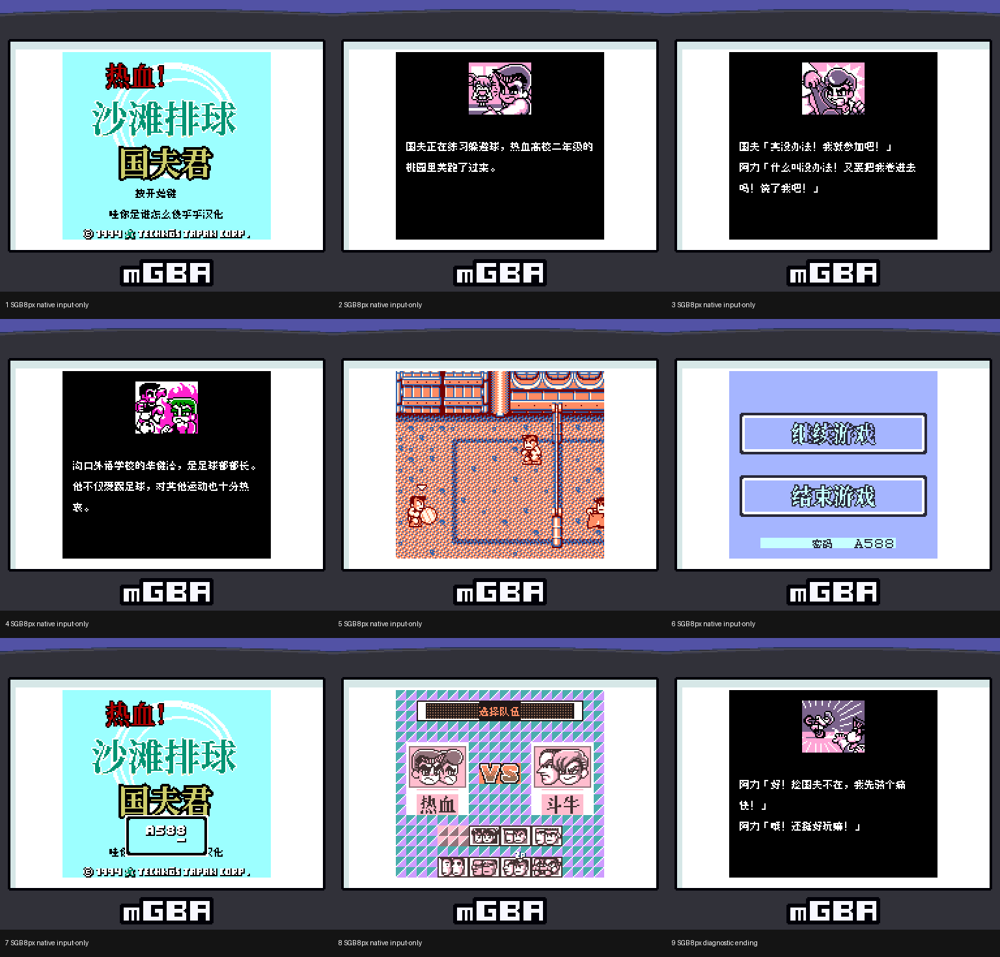
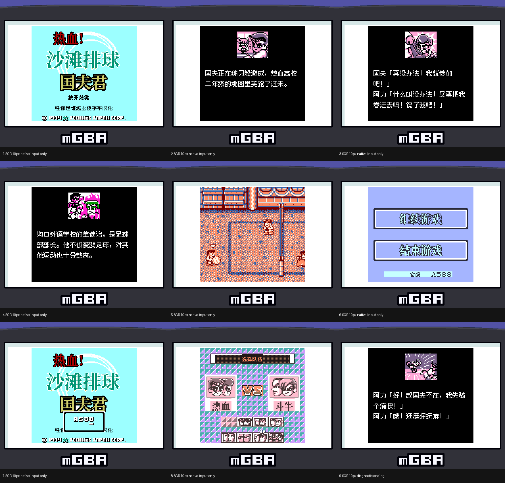

# 热血沙滩排球

原输入：Nekketsu! Beach Volley dayo Kunio-kun (Japan)

原输入完整SHA256：`310a362b8eed5b6246585d947f9fd1ba5b22127b83f4fdc79d1d56039748b770`。此处“原输入”保留改版、既有汉化或地区修订身份，不一律称干净零售ROM。

| 字号 | 当前版本 | 音频 | 输出完整SHA256 |
| --- | --- | --- | --- |
| 8px | v1.0.1 | unchanged | `204182e4db87e10e93b89accdcc35b348cb17d7ca2500e3f4ec299bc0718e090` |
| 10px-dialogue | v1.0.1 | unchanged | `1276b54c91562c0bd31209c0022ec887392e78784b9b3a7506f1ed3336b40bfb` |

## 源码与补丁

- 8px／v1.0.1／unchanged：完整修改源码：[下载](https://github.com/shiyi1133/youxi-hanhua-releases/releases/download/source-migration-20261022/kunio-beach-volley-current-source-60370426dee8-public-r02.zip)（ZIP SHA256 `4a7f89fde11f4539c50865974e645dc74a7c4817f08f1333ad221da73546d284`）；补丁：[下载](https://github.com/shiyi1133/youxi-hanhua-releases/releases/download/patch-migration-20261022/kunio-beach-volley-current-patches.zip)（ZIP SHA256 `e0b503f8afffb7e901131d15cb0ef9e163dfb570f33a133fe0e0f9100a1b1538`）。
- 10px-dialogue／v1.0.1／unchanged：完整修改源码：[下载](https://github.com/shiyi1133/youxi-hanhua-releases/releases/download/source-migration-20261022/kunio-beach-volley-current-source-60370426dee8-public-r02.zip)（ZIP SHA256 `4a7f89fde11f4539c50865974e645dc74a7c4817f08f1333ad221da73546d284`）；补丁：[下载](https://github.com/shiyi1133/youxi-hanhua-releases/releases/download/patch-migration-20261022/kunio-beach-volley-current-patches.zip)（ZIP SHA256 `e0b503f8afffb7e901131d15cb0ef9e163dfb570f33a133fe0e0f9100a1b1538`）。

补丁须直接应用于完整SHA一致的实际原输入；普通字、大字和音乐变体分别核对。公开源码归档不表示本轮重新构建或通过新的运行验收。原作、字体、已有翻译及工具依赖的权利与许可，依各包对应许可保留。

## 范围与验证边界

- 8px／v1.0.1：8px / 10px-dialogue。
- 10px-dialogue／v1.0.1：8px / 10px-dialogue。

本次资料搬运未新增模拟器、实机或全通验收；未记录或未测试的范围不写成通过。问题单开放只表示尚未关闭，已关闭也不单独证明全部场景都修复。

[公开反馈及问题状态](feedback.md) · [报告BUG](https://github.com/shiyi1133/youxi-hanhua-releases/issues/new?template=bug_report.md)

## 对应版本截图

v1.0.1 finalSGB 8px;native SGB opening/menu/password-match;last ending panel diagnostic;nofull-clear/hardware claim

图像SHA256：`32cec31f7ec1601637e8a922a30a17d06f938910c5c240c07f3b138bf373a3a8`；绑定ROM SHA256：`204182e4db87e10e93b89accdcc35b348cb17d7ca2500e3f4ec299bc0718e090`。

v1.0.1 finalSGB 10px;native SGB opening/menu/password-match;last ending panel diagnostic;nofull-clear/hardware claim

图像SHA256：`87cc0528fce9f8f7ac168665fe2d7b61de0d8ae70c7be7833cd587057b5194ce`；绑定ROM SHA256：`1276b54c91562c0bd31209c0022ec887392e78784b9b3a7506f1ed3336b40bfb`。

