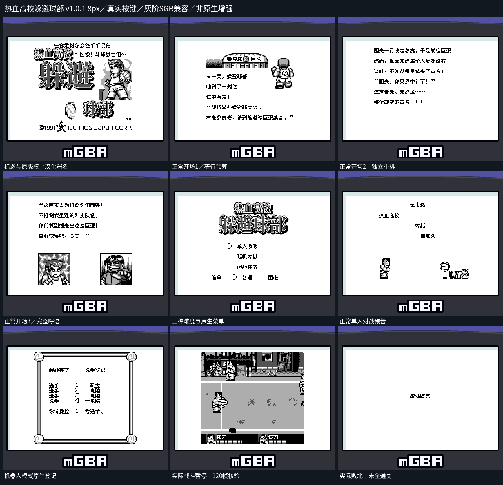
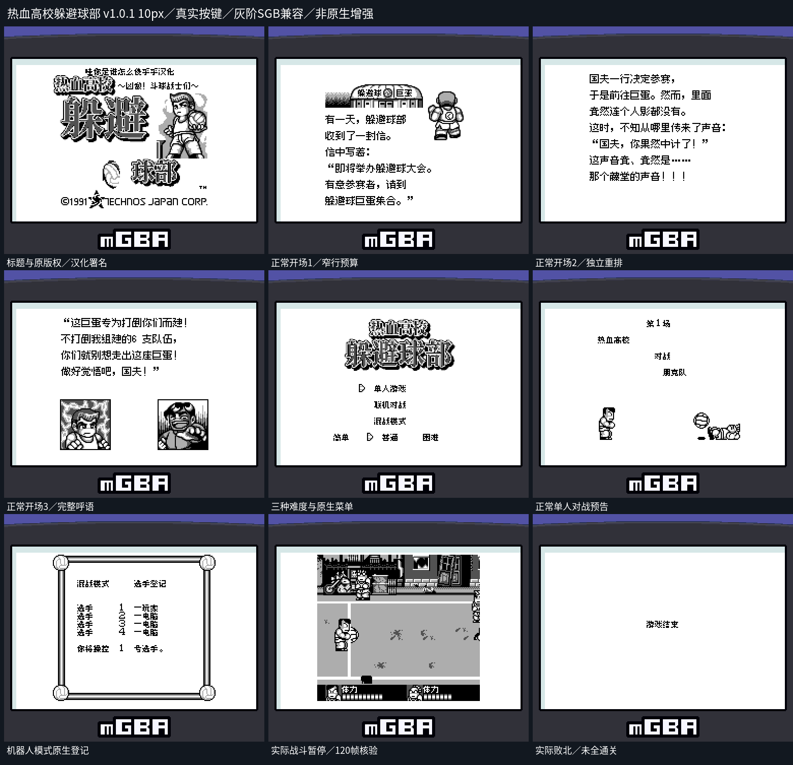

# 热血高校躲避球部

原输入：Nekketsu Koukou Dodge Ball-bu (Japan)

原输入完整SHA256：`9eadcd25c2f364a1d0320e4e74ca3a7083469e53e41747bf7eeb555e5f233f0c`。此处“原输入”保留改版、既有汉化或地区修订身份，不一律称干净零售ROM。

| 字号 | 当前版本 | 音频 | 输出完整SHA256 |
| --- | --- | --- | --- |
| 8px | v1.0.1 | unchanged | `2ffa6fdd733d03d622c0cd564c02be4e81c01ec4143bf8d1f5ff0389c7aae16f` |
| 10px-dialogue | v1.0.1 | unchanged | `de5fff70dc92cd75992a5ea74fccbc2f9636b386c231a02c8f0c49584fcf7c55` |

## 源码与补丁

- 8px／v1.0.1／unchanged：完整修改源码：[下载](https://github.com/shiyi1133/youxi-hanhua-releases/releases/download/source-migration-20261022/kunio-dodgeball-current-source-64e4333be6d6-public-r02.zip)（ZIP SHA256 `249b02333c13087031ba94a1de606571c5cabd9bbe929670871daa4d4ec98fdd`）；补丁：[下载](https://github.com/shiyi1133/youxi-hanhua-releases/releases/download/patch-migration-20261022/kunio-dodgeball-current-patches.zip)（ZIP SHA256 `74049d633def43a37b11f200a05f13190a70b1198eb254b5ec0dc1fefde227d0`）。
- 10px-dialogue／v1.0.1／unchanged：完整修改源码：[下载](https://github.com/shiyi1133/youxi-hanhua-releases/releases/download/source-migration-20261022/kunio-dodgeball-current-source-64e4333be6d6-public-r02.zip)（ZIP SHA256 `249b02333c13087031ba94a1de606571c5cabd9bbe929670871daa4d4ec98fdd`）；补丁：[下载](https://github.com/shiyi1133/youxi-hanhua-releases/releases/download/patch-migration-20261022/kunio-dodgeball-current-patches.zip)（ZIP SHA256 `74049d633def43a37b11f200a05f13190a70b1198eb254b5ec0dc1fefde227d0`）。

补丁须直接应用于完整SHA一致的实际原输入；普通字、大字和音乐变体分别核对。公开源码归档不表示本轮重新构建或通过新的运行验收。原作、字体、已有翻译及工具依赖的权利与许可，依各包对应许可保留。

## 范围与验证边界

- 8px／v1.0.1：8px / 10px-dialogue。
- 10px-dialogue／v1.0.1：8px / 10px-dialogue。

本次资料搬运未新增模拟器、实机或全通验收；未记录或未测试的范围不写成通过。问题单开放只表示尚未关闭，已关闭也不单独证明全部场景都修复。

[公开反馈及问题状态](feedback.md) · [报告BUG](https://github.com/shiyi1133/youxi-hanhua-releases/issues/new?template=bug_report.md)

## 对应版本截图

v1.0.1 8px实际按键九宫格；强制SGB兼容灰阶，非原生增强；短程结局不代表全部通关

图像SHA256：`cef9b9b5a16e624fd2f1db647a33454c2f975081975c1351e36a2c32546d6369`；绑定ROM SHA256：`2ffa6fdd733d03d622c0cd564c02be4e81c01ec4143bf8d1f5ff0389c7aae16f`。

v1.0.1 10px实际按键九宫格；强制SGB兼容灰阶，非原生增强；短程结局不代表全部通关

图像SHA256：`4be02e56454cd89f46e03245565d8dc7125a3c620cb02e0fad23a1fb9c4d95ae`；绑定ROM SHA256：`de5fff70dc92cd75992a5ea74fccbc2f9636b386c231a02c8f0c49584fcf7c55`。

