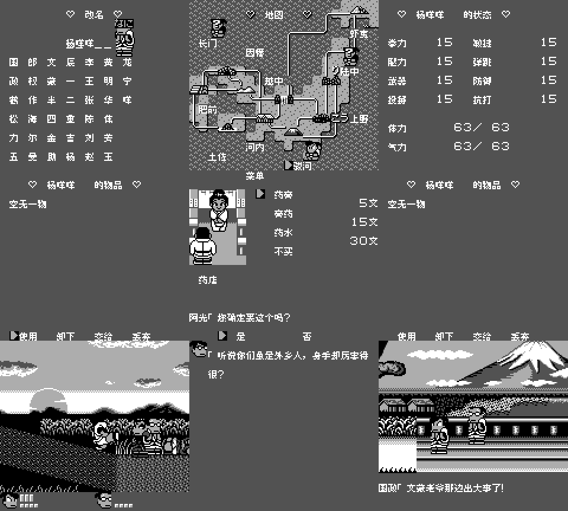
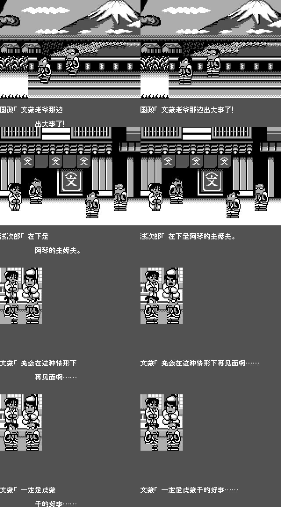

# 热血时代剧

原输入：Kunio-kun no Jidaigeki dayo Zenin Shuugou! (Japan)

原输入完整SHA256：`8fa401d71fa6d6b02773a72dd1eea55b866abb3e94f6644b57616c3e30cf05d4`。此处“原输入”保留改版、既有汉化或地区修订身份，不一律称干净零售ROM。

| 字号 | 当前版本 | 音频 | 输出完整SHA256 |
| --- | --- | --- | --- |
| 8px | v1.0.3 | unchanged | `78668755e3bfa3938544528db1054b667cd603e735873cd5b8b1348ee0286ce8` |
| 10px-dialogue | v1.0.3 | unchanged | `ebaf23279f46a3e7e27ca400b6e3fe11b4da0ffa183861ce5d0cd805303f3326` |

## 源码与补丁

- 8px／v1.0.3／unchanged：完整修改源码：[下载](https://github.com/shiyi1133/youxi-hanhua-releases/releases/download/source-migration-20261022/kunio-jidaigeki-current-source-c8bf5525abb0-public-r02.zip)（ZIP SHA256 `9c98178c269a18e23b831da4cbc110751c85b0462ac66e3e0ed56e890870cf3f`）；补丁：[下载](https://github.com/shiyi1133/youxi-hanhua-releases/releases/download/patch-migration-20261022/kunio-jidaigeki-current-patches.zip)（ZIP SHA256 `8a49f5b0b43c7242a4e1a980bfa08cf0836f67547c5ed5500f9e73ff413852f4`）。
- 10px-dialogue／v1.0.3／unchanged：完整修改源码：[下载](https://github.com/shiyi1133/youxi-hanhua-releases/releases/download/source-migration-20261022/kunio-jidaigeki-current-source-c8bf5525abb0-public-r02.zip)（ZIP SHA256 `9c98178c269a18e23b831da4cbc110751c85b0462ac66e3e0ed56e890870cf3f`）；补丁：[下载](https://github.com/shiyi1133/youxi-hanhua-releases/releases/download/patch-migration-20261022/kunio-jidaigeki-current-patches.zip)（ZIP SHA256 `8a49f5b0b43c7242a4e1a980bfa08cf0836f67547c5ed5500f9e73ff413852f4`）。

补丁须直接应用于完整SHA一致的实际原输入；普通字、大字和音乐变体分别核对。公开源码归档不表示本轮重新构建或通过新的运行验收。原作、字体、已有翻译及工具依赖的权利与许可，依各包对应许可保留。

## 范围与验证边界

- 8px／v1.0.3：8px / 10px-dialogue。
- 10px-dialogue／v1.0.3：8px / 10px-dialogue。

本次资料搬运未新增模拟器、实机或全通验收；未记录或未测试的范围不写成通过。问题单开放只表示尚未关闭，已关闭也不单独证明全部场景都修复。

[公开反馈及问题状态](feedback.md) · [报告BUG](https://github.com/shiyi1133/youxi-hanhua-releases/issues/new?template=bug_report.md)

## 对应版本截图

v1.0.3 九张实际DMG原帧；战斗使用原作金名秘技；只有剧情格可为10px，其余8px

图像SHA256：`47f2cefb46cd83a53c7de5195418bf5aa2a13c9138f2c25a95cd93cc823e493e`；绑定ROM SHA256：`78668755e3bfa3938544528db1054b667cd603e735873cd5b8b1348ee0286ce8`。

v1.0.3 自然开场2/7/13/15，左旧右新；两字号开场均8px

图像SHA256：`6525cbd15f2ae2fff13bf390caf6cc3b90f900002ca43c84b550777c7e927382`；绑定ROM SHA256：`78668755e3bfa3938544528db1054b667cd603e735873cd5b8b1348ee0286ce8`。

v1.0.3 自然开场2/7/13/15，左旧右新；两字号开场均8px

图像SHA256：`6525cbd15f2ae2fff13bf390caf6cc3b90f900002ca43c84b550777c7e927382`；绑定ROM SHA256：`ebaf23279f46a3e7e27ca400b6e3fe11b4da0ffa183861ce5d0cd805303f3326`。

v1.0.3 九张实际DMG原帧；战斗使用原作金名秘技；只有剧情格可为10px，其余8px

图像SHA256：`55137230ac17c1f4511b7ef25e697701b26fb1149f7d0f0ea74ed706056be8bf`；绑定ROM SHA256：`ebaf23279f46a3e7e27ca400b6e3fe11b4da0ffa183861ce5d0cd805303f3326`。

