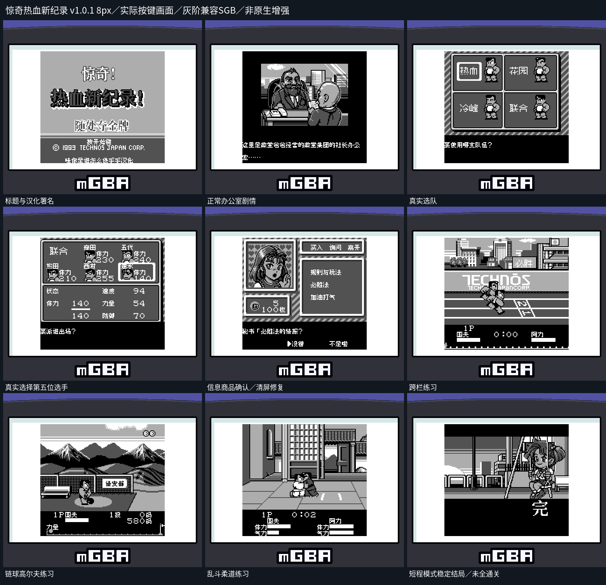
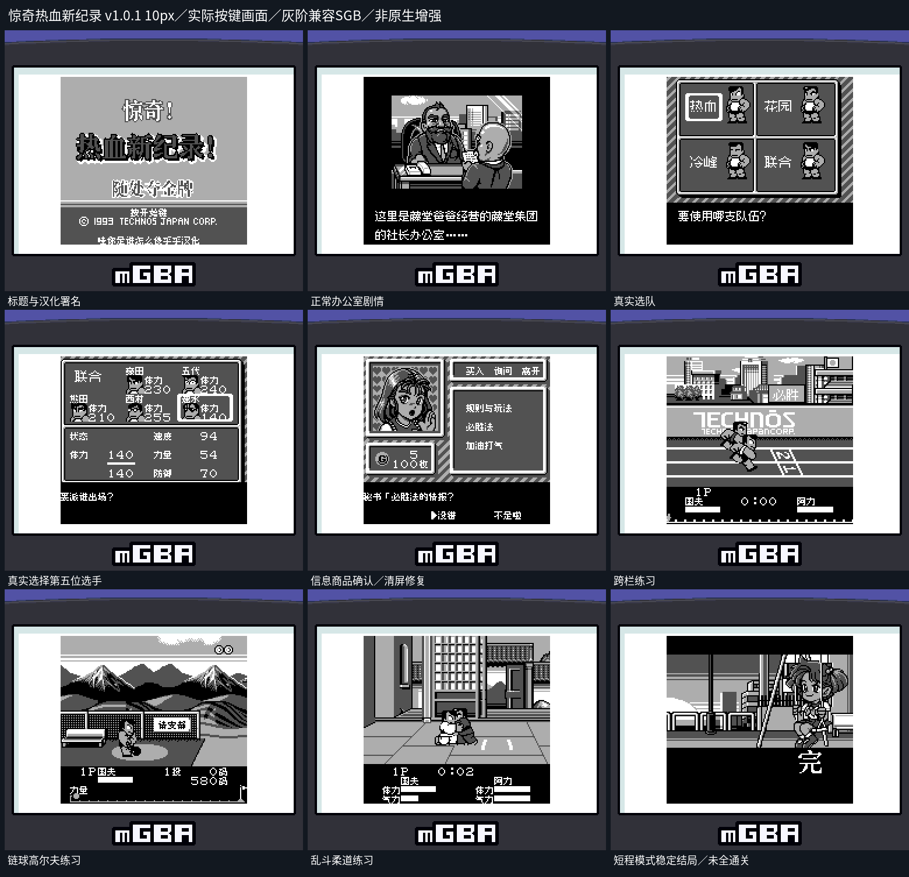

# 惊奇热血新纪录

原输入：Bikkuri Nekketsu Shinkiroku! - Dokodemo Kin Medal (Japan)

原输入完整SHA256：`ec530379bee82d89a97acfd8e0cafadddbae687550ee81e9b1c11e285720a2f4`。此处“原输入”保留改版、既有汉化或地区修订身份，不一律称干净零售ROM。

| 字号 | 当前版本 | 音频 | 输出完整SHA256 |
| --- | --- | --- | --- |
| 8px | v1.0.1 | unchanged | `45a3865194697aad0d44b75df819bcb9453b8a4bc2ee4dcc3d8016e167a9735d` |
| 10px-dialogue | v1.0.1 | unchanged | `3427632461fa73b3820b4c23c7c07c0387bf34155cb6624774d5d3aef8581bd7` |

## 源码与补丁

- 8px／v1.0.1／unchanged：完整修改源码：[下载](https://github.com/shiyi1133/youxi-hanhua-releases/releases/download/source-migration-20261022/kunio-shinkiroku-current-source-e46c71352608-public-r02.zip)（ZIP SHA256 `4fc4092ec7e28e4db5f4a6d453aaf56030f5ba364ef533185f46159133a12ae8`）；补丁：[下载](https://github.com/shiyi1133/youxi-hanhua-releases/releases/download/patch-migration-20261022/kunio-shinkiroku-current-patches.zip)（ZIP SHA256 `5a8db3e9e745ce273e6356a1542e0358159e1d362427d5349dcab85e85089dee`）。
- 10px-dialogue／v1.0.1／unchanged：完整修改源码：[下载](https://github.com/shiyi1133/youxi-hanhua-releases/releases/download/source-migration-20261022/kunio-shinkiroku-current-source-e46c71352608-public-r02.zip)（ZIP SHA256 `4fc4092ec7e28e4db5f4a6d453aaf56030f5ba364ef533185f46159133a12ae8`）；补丁：[下载](https://github.com/shiyi1133/youxi-hanhua-releases/releases/download/patch-migration-20261022/kunio-shinkiroku-current-patches.zip)（ZIP SHA256 `5a8db3e9e745ce273e6356a1542e0358159e1d362427d5349dcab85e85089dee`）。

补丁须直接应用于完整SHA一致的实际原输入；普通字、大字和音乐变体分别核对。公开源码归档不表示本轮重新构建或通过新的运行验收。原作、字体、已有翻译及工具依赖的权利与许可，依各包对应许可保留。

## 范围与验证边界

- 8px／v1.0.1：8px / 10px-dialogue。
- 10px-dialogue／v1.0.1：8px / 10px-dialogue。

本次资料搬运未新增模拟器、实机或全通验收；未记录或未测试的范围不写成通过。问题单开放只表示尚未关闭，已关闭也不单独证明全部场景都修复。

[公开反馈及问题状态](feedback.md) · [报告BUG](https://github.com/shiyi1133/youxi-hanhua-releases/issues/new?template=bug_report.md)

## 对应版本截图

v1.0.1 8px实际按键九宫格；强制SGB兼容灰阶，非原生增强；短程结局不代表全部通关

图像SHA256：`199cdd57d73676d9a4ecd1edf1de2b6ee00823d4e61714face7694e51575ff1b`；绑定ROM SHA256：`45a3865194697aad0d44b75df819bcb9453b8a4bc2ee4dcc3d8016e167a9735d`。

v1.0.1 10px实际按键九宫格；强制SGB兼容灰阶，非原生增强；短程结局不代表全部通关

图像SHA256：`ae12670c2bb20c0ffc8159b933dccbcaea8adaa64072153bbd1c89c11141e047`；绑定ROM SHA256：`3427632461fa73b3820b4c23c7c07c0387bf34155cb6624774d5d3aef8581bd7`。

