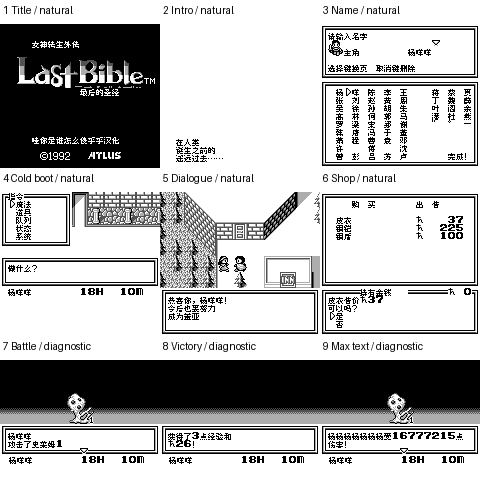

# 女神转生外传：最后的圣经（黑白GB版） v0.1.0（限定测试版）

[源码与补丁Release](https://github.com/shiyi1133/youxi-hanhua-releases/releases/tag/last-bible-gb-v0.1.0) · [公开反馈](feedback.md) · [报告BUG](https://github.com/shiyi1133/youxi-hanhua-releases/issues/new?template=bug_report.md)

原游戏／实际输入：Megami Tensei Gaiden - Last Bible (Japan)

原输入完整SHA-256：`29cd752ce9589e77bb041c6b3d736bb6b24463305f996641eb1cd2c0be5a0c67`（262144字节）。

范围：973主消息、104物品/90魔法/109魔兽及已识别固定词表/标题/BANK-FRONT图字；静态全已识别文本不等于全路可达

## 8px v0.1.0

字号范围：黑白GB版原生8px，无10px或原生SGB彩色；不是GBC版/二代

目标完整SHA-256：`3646170622c970e026d34497c7f30fcfcb4b6c33b86579e555349919cd54e9d5`（524288字节）。

补丁：`LastBibleGB_v0.1.0_8px_zh.bps`，SHA-256 `d69bdb3ea355e260f413db9395a1682bdd979195303fd54c4e119fbbad24f6f3`。

[源码（完整性未独立确认）](https://github.com/shiyi1133/youxi-hanhua-releases/releases/download/last-bible-gb-v0.1.0/last-bible-gb-v0.1.0-source-public-r02.zip) · [补丁包](https://github.com/shiyi1133/youxi-hanhua-releases/releases/download/last-bible-gb-v0.1.0/last-bible-gb-v0.1.0-patch.zip)

女神转生外传：最后的圣经（黑白GB版） v0.1.0 8px限定测试版；黑白GB版原生8px，无10px或原生SGB彩色；不是GBC版/二代 自然路径与诊断范围见测试说明，不代表全流程。

## 测试及限制

提供者自然路径：标题/开场卷轴/首城移动对白/菜单；三7格姓名分别杨咩咩/重复/删重输/7格上限、秘密名ポン；正常记录、覆盖取消/确认、新进程仅读电池冷读；商店标题/价格/取消/金钱不足

提供者诊断路径：原生门加载器目的地改到城外，触发战斗/伤害/胜败；HP临改胜利非自然；七格变量+24位16777215真实renderer；临给1000款后两次37交易963→926；旅馆/银行入口

保存边界：保持8KiB SRAM，B000-B3FF为原记录外渲染影子；本版三个中文名冷读有记录。旧日文名可能按新编码显示，旧档全兼容未保证

同一实现者自测，不是独立人员QA；维护未新增ROM运行或源码重建，未宣称实机或完整通关。

- 未验证：自然离首城后长线/结局
- 未验证：自然成功购买/升级
- 未验证：深层魔法合体召唤/全部物品支线图像
- 未验证：联机/实机/长期旧档
- 核对补丁还原、资产完整SHA和截图字节不等于全部游戏功能验收。

