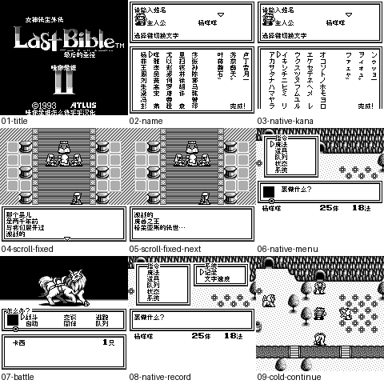

# 女神转生外传：最后的圣经Ⅱ（黑白GB版） v0.1.1（限定测试版）

[源码与补丁Release](https://github.com/shiyi1133/youxi-hanhua-releases/releases/tag/last-bible-ii-gb-v0.1.1) · [公开反馈](feedback.md) · [报告BUG](https://github.com/shiyi1133/youxi-hanhua-releases/issues/new?template=bug_report.md)

原游戏／实际输入：Megami Tensei Gaiden - Last Bible II (Japan)

原输入完整SHA-256：`f0e3a5f918e65dc089e3cbc3d70cb49863b1ff59ac9e3c7013381887d238d746`（262144字节）。

范围：黑白GB日本版普通8px限定修复：修正原生捕获入口未同步文字语义影子导致的滚屏黑块，并优化满缓存活跃标记与回收，改善所测对白/菜单窗口的严重帧及音乐IRQ迟滞；不是GBC版。

## 8px v0.1.1

字号范围：黑白GB普通8px；无10px/原生SGB彩色；独立于GBC last-bible-ii，不能共用版本或存档。

目标完整SHA-256：`64e2d29f04111434656ad7eac82e890ef4dbd3a5836f234bac343b79fc98e4e4`（524288字节）。

补丁：`last-bible-ii-gb-v0.1.1-8px.bps`，SHA-256 `cc61a9d73a7f0564880eed65fc7cd811ea51de7c090ff4a8af037cb742d88f15`。

[源码（完整性未独立确认）](https://github.com/shiyi1133/youxi-hanhua-releases/releases/download/last-bible-ii-gb-v0.1.1/last-bible-ii-gb-v0.1.1-8px-SOURCE-public.zip) · [补丁包](https://github.com/shiyi1133/youxi-hanhua-releases/releases/download/last-bible-ii-gb-v0.1.1/last-bible-ii-gb-v0.1.1-8px-PATCH-public.zip)

女神转生外传：最后的圣经Ⅱ（黑白GB版） v0.1.1 普通8px最终ROM真实DMG九宫格；自然/指令级定量分析按提供者实际边界记录，不代表GBC版、全通或实机。

## 测试及限制

提供者自然路径：提供者报告：各自新游戏自然输入三个角色名杨咩咩（重复/删除重输、原假名页）、开场滚屏/连续对白/原生菜单、记录及新OS进程仅电池继续，战斗攻击/败北复归和自然逃跑。维护未运行ROM。

提供者诊断路径：提供者定量分析：原版/旧v0.1.0/本v0.1.1分别冷启自然路线，同对白检查点每窗300帧，mGBA0.10.5 DMG指令时序及非零PCM；不是主观听音或实机音频验收。源码静态与旧历史场景不替代本版自然验证。

保存边界：本版新档冷读已由提供者自测；旧版已有进度电池存档迁移未实测，不跨SHA即时状态，不混用GBC存档。

同一实现者自测，不是独立人员QA；维护未新增ROM运行或源码重建，未宣称实机或完整通关。

- 未验证：Issue138玩家具体文件名/版本/字号及完整SHA仍未知；同类缺陷已在精确旧目标自测复现，不断言玩家全部原因相同。
- 未验证：所测对白/菜单VBlank与Timer IRQ次数恢复原版水平，仍有额外CPU工作与IRQ抖动；未做主观音频、实机或全场景测试。
- 未验证：商店购买、银行、深层谈判/融合、最长剧情变量、全流程/结局、联机/实机本版未复验；旧说明仅为历史范围。
- 未验证：本版新档冷读已由提供者自测；旧版已有进度电池存档迁移未实测，不跨SHA即时状态，不混用GBC存档。
- 核对补丁还原、资产完整SHA和截图字节不等于全部游戏功能验收。

