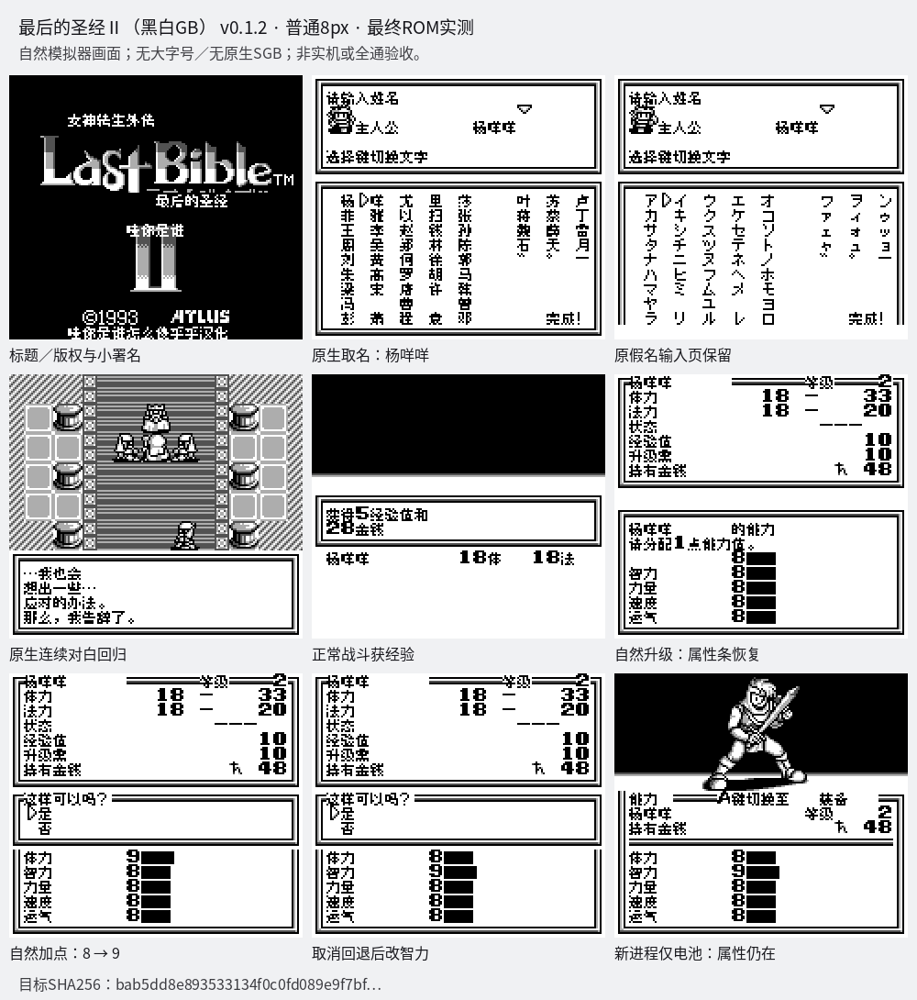

# 女神转生外传：最后的圣经Ⅱ（黑白GB版） v0.1.2（限定测试版）

[源码与补丁Release](https://github.com/shiyi1133/youxi-hanhua-releases/releases/tag/last-bible-ii-gb-v0.1.2) · [公开反馈](feedback.md) · [报告BUG](https://github.com/shiyi1133/youxi-hanhua-releases/issues/new?template=bug_report.md)

原游戏／实际输入：Megami Tensei Gaiden - Last Bible II (Japan)

原输入完整 SHA-256：`f0e3a5f918e65dc089e3cbc3d70cb49863b1ff59ac9e3c7013381887d238d746`（262144字节）。

范围：黑白GB普通8px升级加点/能力页属性条乱码限定修复；其它声音/迟滞反馈未一并关闭。

## 8px v0.1.2 / unchanged

字号范围：黑白GB普通8px升级加点/能力页属性条乱码限定修复；其它声音/迟滞反馈未一并关闭。

目标完整 SHA-256：`bab5dd8e893533134f0c0fd089e9f7bf01383d41c154b15f48d92d6aed682f50`（524288字节）。

补丁：`last-bible-ii-gb-v0.1.2-8px.bps`，SHA-256 `69e5c88644cc2340bbaa161e1d95ff99a6c43aec607473ccd59108da49fb6312`。

[源码（完整性未独立确认）](https://github.com/shiyi1133/youxi-hanhua-releases/releases/download/last-bible-ii-gb-v0.1.2/last-bible-ii-gb-v0.1.2-complete-source.zip) · [补丁包](https://github.com/shiyi1133/youxi-hanhua-releases/releases/download/last-bible-ii-gb-v0.1.2/last-bible-ii-gb-v0.1.2-patches.zip)

黑白GB普通8px升级加点/能力页属性条乱码限定修复；其它声音/迟滞反馈未一并关闭。；提供方对应最终ROM图证，具体自然/诊断类别见原图标签及材料；非维护运行、全通或实机验收。

## 测试及限制

提供方自然范围：提供方报告的自然/正常按键流程，维护未重跑。

提供方诊断范围：提供方明确标注的受控消费者、解锁或边界测试，不能冒充自然到达。

保存边界：仅按具体版本材料，不推定所有旧存档兼容。

维护本轮独立核原输入、补丁逐字节还原、ZIP/CRC、Source安全与原图字节；未执行提供方源码、未重建或运行ROM，未宣称独立人员QA、实机或全流程验收。

- 未验证：维护仅独立核用户输入ZIP/ROM完整SHA、补丁逐字节还原、ZIP成员/CRC与源包静态材料；未执行提供者源码、重建工程或运行ROM。
- 未验证：运行、自然按键、受控诊断、保存/新进程冷读等范围以所附提供方报告分别为据，不冒充维护重跑、独立人员QA、玩家验收、实机或全流程通关。
- 未验证：使用前备份普通存档；不跨ROM版本/字号套用即时状态，旧电池兼容仅按提供方实际样本说明。
