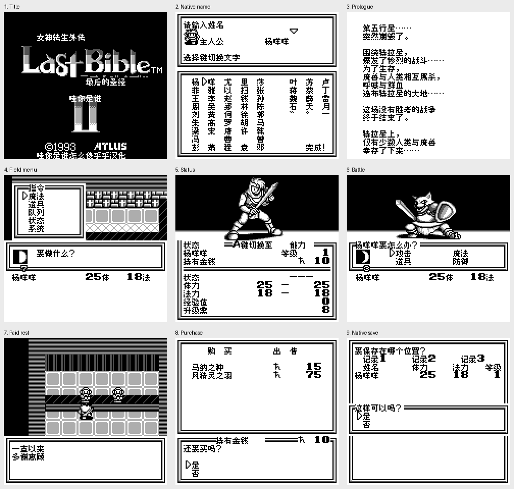

# 女神转生外传：最后的圣经Ⅱ（黑白GB版） v0.1.0（限定测试版）

[源码与补丁Release](https://github.com/shiyi1133/youxi-hanhua-releases/releases/tag/last-bible-ii-gb-v0.1.0) · [公开反馈](feedback.md) · [报告BUG](https://github.com/shiyi1133/youxi-hanhua-releases/issues/new?template=bug_report.md)

原游戏／实际输入：Megami Tensei Gaiden - Last Bible II (Japan)

原输入完整SHA-256：`f0e3a5f918e65dc089e3cbc3d70cb49863b1ff59ac9e3c7013381887d238d746`（262144字节）。

范围：1307主记录（1290中文、8原署名、3标点、6控制）与582固定块、1470字形；已识别全量实装，非自然全通

## 8px v0.1.0

字号范围：黑白GB二代8px，无10px/原生SGB彩色；独立于GBC版last-bible-ii

目标完整SHA-256：`341263f49d7637c4442a69b9d7dc09589c0550af57622403d42389646903ed40`（524288字节）。

补丁：`LastBibleII_GB_v0.1.0_8px.bps`，SHA-256 `61ee461f5e5b1744b2be2ea6843492acd4da6f874e47c74ae8e2afa16ca3fa82`。

[源码（完整性未独立确认）](https://github.com/shiyi1133/youxi-hanhua-releases/releases/download/last-bible-ii-gb-v0.1.0/last-bible-ii-gb-v0.1.0-source-public-r02.zip) · [补丁包](https://github.com/shiyi1133/youxi-hanhua-releases/releases/download/last-bible-ii-gb-v0.1.0/last-bible-ii-gb-v0.1.0-patch.zip)

女神转生外传：最后的圣经Ⅱ（黑白GB版） v0.1.0 8px限定测试版；黑白GB二代8px，无10px/原生SGB彩色；独立于GBC版last-bible-ii 自然路径与诊断范围见测试说明，不代表全流程。

## 测试及限制

提供者自然路径：三角色杨咩咩/重复/删重输/片假名页、开场/菜单状态；走出村庄随机遭遇狗头人、攻击受伤/自然战败复归，非胜利升级；从同补丁家族自然电池进度回归：30金/3物品/两装备→付5住宿→买15种子→10金/4物品；覆盖后新进程电池冷读保持

提供者诊断路径：较早孤立银行长金额/升级分配显示缺上下文，有精灵覆盖，不算自然功能通过

保存边界：SRAM扩32KiB，前8KiB原生进度不动，后部渲染缓存；一个有进度最终SHA回归不代表旧档全兼容；即时状态不得跨SHA

同一实现者自测，不是独立人员QA；维护未新增ROM运行或源码重建，未宣称实机或完整通关。

- 未验证：自然胜利升级
- 未验证：银行存取/仲魔合成
- 未验证：全部剧情结局/最长变量实际组合/全支线
- 未验证：实机/通信/全部旧档
- 核对补丁还原、资产完整SHA和截图字节不等于全部游戏功能验收。

