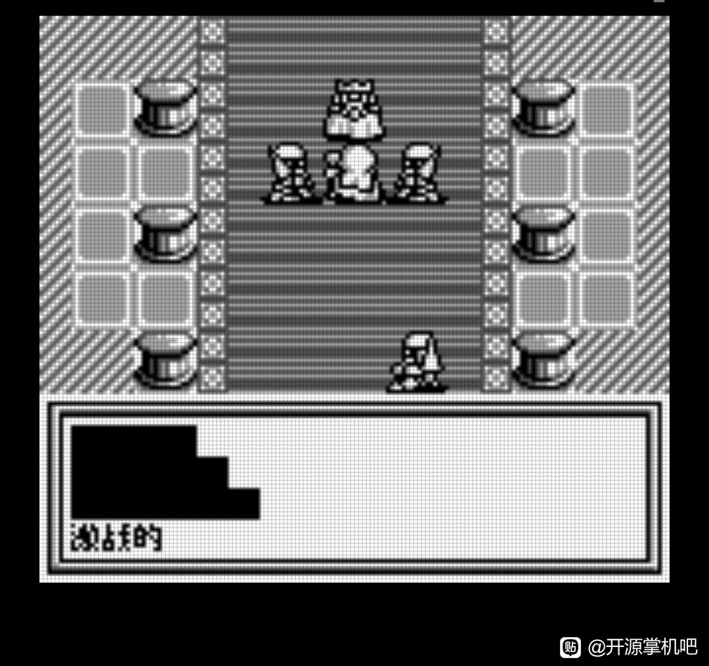
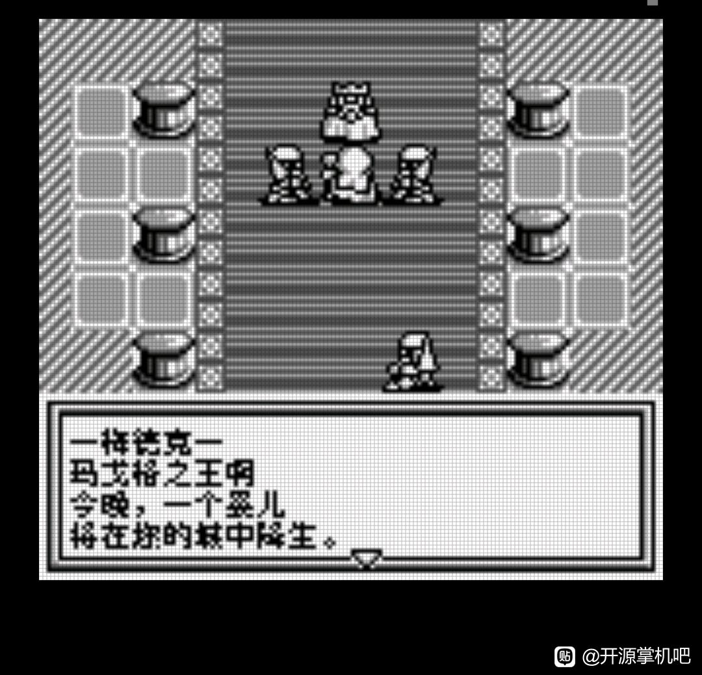

# 女神转生外传：最后的圣经Ⅱ（黑白GB版）：公开反馈

[报告BUG](https://github.com/shiyi1133/youxi-hanhua-releases/issues/new?template=bug_report.md)。请说明实际版本、字号、必要触发步骤和已有截图，不上传ROM、存档、即时状态或私人资料。

此前公开索引尚未登记本作反馈；本轮新增的黑白GB版拖慢、黑块反馈与登记答复见下文，实际版本和字号仍待补充。开放问题不等于正在修复，也不表示已全通或实机验收。

[贴吧原需求](https://tieba.baidu.com/p/11092365551?pid=154052582417#154052582417)。

## 维护者交付通知：v0.1.0（限定测试版）

[贴吧实际答复](https://tieba.baidu.com/p/11092365551?pid=154064618762#p154064618762)（177楼，PID 154064618762；原关联楼层回复）。

以下为去除下载信息后的维护者通知摘要，不是玩家测试结论，也不是原文全文。

> 《女神转生外传：最后的圣经Ⅱ（黑白GB版）》v0.1.0限定测试版已发布。
> 字号：黑白GB二代8px，无10px/原生SGB彩色；独立于GBC版last-bible-ii。
> 范围：1307主记录（1290中文、8原署名、3标点、6控制）与582固定块、1470字形；已识别全量实装，非自然全通
> 原答复中的ROM下载链接、提取码、网盘目录及下载指示已省略；私库保留完整原文证据。

原答复全文UTF-8 SHA-256：`ab479191faa227d343a41ac5a22d51ff1cbd7ba7edb82bd947faa24999815b81`（345字节）。

女神转生外传：最后的圣经Ⅱ（黑白GB版） v0.1.0 8px限定测试版；黑白GB二代8px，无10px/原生SGB彩色；独立于GBC版last-bible-ii 自然路径与诊断范围见测试说明，不代表全流程。

[贴吧该PID第1张实际公开图片](https://tiebapic.baidu.com/forum/pic/item/3dab33f33a87e950303e466b56385343fbf2b433.jpg?tbpicau=2026-11-04-05_941a6fd71a19d69828e270d6c0e5ab0e)。

原PNG SHA-256：`6d76f5bd7c3bf0b776d87eafa00469d757ab69df03f76e26ceb93eca3b35017d`；贴吧公开图片 SHA-256：`29c510d1a5b334afcda1f728613db94cfa96d019e06d22108619f7d78d0a8982`。

原答复全文与全部图片已按该PID公开核验；此镜像不新增通关、实机、独立QA、源码完整性或BUG全部修复结论。

## 20261024-0412 公开反馈补充

公开 BUG 入口：[提交反馈](https://github.com/shiyi1133/youxi-hanhua-releases/issues/new/choose)。

177楼 · 炽天火3 · [原回帖](https://tieba.baidu.com/p/11092365551?pid=154064717870#154064717870)

> 女神转生外传最后的圣经2进入游戏正常，目前发现： 1.人物对话和菜单指令执行时候声音会有卡顿拖慢 2.已对话部分会有文字黑块出现 3.开局背景介绍有拖慢情况

- [BUG待核版本] 最后的圣经Ⅱ黑白GB版：对白黑块、声音及开场迟滞：已记录，开放待核。

[已公开登记答复](https://tieba.baidu.com/p/11092365551?pid=154064809247#154064809247)：@炽天火3 黑白GB版《最后的圣经Ⅱ》的声音/开场拖慢和对白黑块已记录。请补ROM完整文件名或实际版本、字号，方便核对。

除另注已实收核验的译版 ROM 外，玩家实际输入/输出 SHA 未核定。图片与通关描述仅为玩家反馈；本次没有新增维护运行复现、修复或完整流程验收。

## 已发布版本的限定修复进展（2026-10-24）

- `problem-7c6eed6fdcb6f19c`：部分修复，问题保持开放。对应 v0.1.1 / 8px 限定测试版；[公开版本](https://github.com/shiyi1133/youxi-hanhua-releases/releases/tag/last-bible-ii-gb-v0.1.1)。
  已核对：精确旧v0.1.0目标自测复现同类滚屏黑块，v0.1.1修正文字符号影子捕获及满缓存回收；最终ROM自然窗口与诊断时序证据已核。
  保留：玩家实际ROM文件名、版本、字号和完整SHA仍未知，不能将同类修复等同玩家原用例全部验收，继续open。；所测窗口IRQ次数恢复原版量级，仍有额外CPU与抖动；未做主观音频、全场景、实机或全通。
  测试边界：提供者报告：各自新游戏自然输入三个角色名杨咩咩（重复/删除重输、原假名页）、开场滚屏/连续对白/原生菜单、记录及新OS进程仅电池继续，战斗攻击/败北复归和自然逃跑。维护未运行ROM。 提供者定量分析：原版/旧v0.1.0/本v0.1.1分别冷启自然路线，同对白检查点每窗300帧，mGBA0.10.5 DMG指令时序及非零PCM；不是主观听音或实机音频验收。源码静态与旧历史场景不替代本版自然验证。

同一实现者自测与维护字节/补丁/原帧核对分别记录；没有新增维护运行、玩家复测、实机或完整通关声明。开放不表示正在修复；原玩家报告版本、未知ROM字节和既有原话/图片/收件答复均保留。

## 版本更新答复（v0.1.1）

[已公开版本答复](https://tieba.baidu.com/p/11092365551?pid=154066304798#p154066304798) · [对应公开版本](https://github.com/shiyi1133/youxi-hanhua-releases/releases/tag/last-bible-ii-gb-v0.1.1) · [版本答复索引](../../feedback/version-replies.md)

> @炽天火3 《女神转生外传：最后的圣经Ⅱ（黑白GB版）》v0.1.1黑白GB普通8px限定修复版已更新：修正已复现的滚屏黑块，并优化所测对白、菜单的迟滞。音频与其他场景仍待测试。附本版真实九宫格，欢迎继续反馈。

此前反馈、确认和问题状态均按原文保留；本次版本答复仅代表明确列出的交付范围。

本条是已有游戏的版本更新完成通知；原BUG确认、原反馈和当前问题状态各自保留，不代表整单、全流程、实机或玩家复测全部通过。

## 20261024-1615 公开反馈补充

公开 BUG 入口：[提交反馈](https://github.com/shiyi1133/youxi-hanhua-releases/issues/new/choose)。

177楼 · 炽天火3 · [原回帖](https://tieba.baidu.com/p/11092365551?pid=154064883516#154064883516)

> 是女神转生二代0.1.0的8px版

- 最后的圣经Ⅱ黑白GB版：旧报告明确v0.1.0普通8px：已记录，开放待核。

玩家已明确原反馈为黑白GB版v0.1.0普通8px；实际ROM文件名与完整SHA未知。当前v0.1.1已交付的答复保留，不重复交付，也不称旧症状已全部修复。

玩家实际ROM完整SHA未知仍保留未知。原图为玩家反馈，不等同维护复现、修复、全流程或实机验收。
