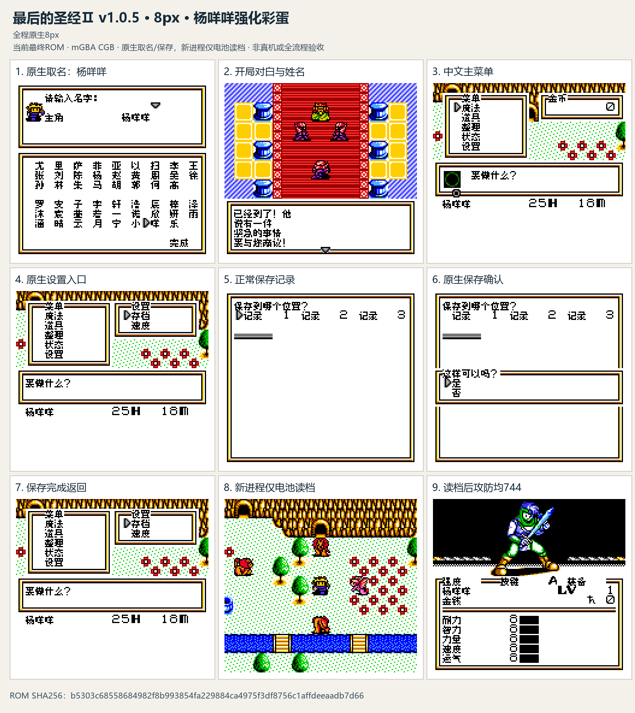
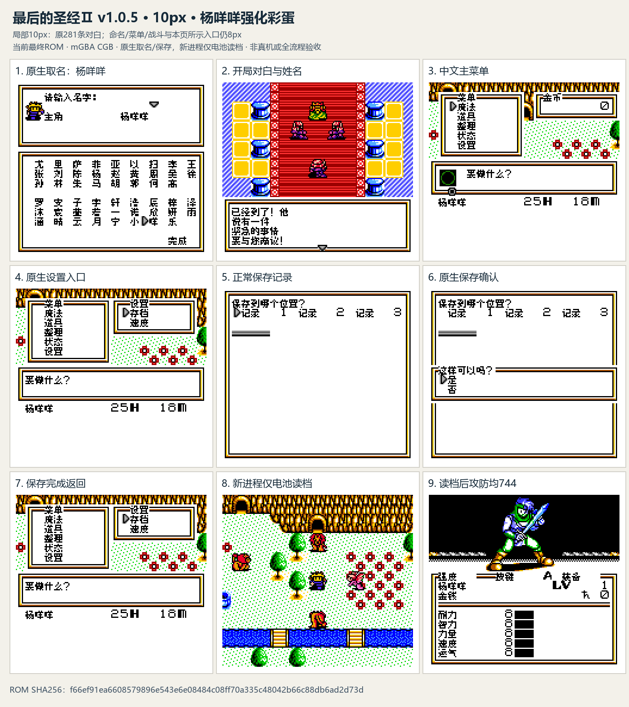

# 最后的圣经2

原输入：Megami Tensei Gaiden - Last Bible II (Japan) (SGB Enhanced) (GB Compatible)

原输入完整SHA256：`70768b99f7ad8878da5051785fc464578d4321ef21249e5602a4db836e3e5199`。此处“原输入”保留改版、既有汉化或地区修订身份，不一律称干净零售ROM。

| 字号 | 当前版本 | 音频 | 输出完整SHA256 |
| --- | --- | --- | --- |
| 8px | v1.0.5 | unchanged | `b5303c68558684982f8b993854fa229884ca4975f3df8756c1affdeeaadb7d66` |
| 10px | v1.0.5 | unchanged | `f66ef91ea6608579896e543e6e08484c08ff70a335c48042b66c88db6ad2d73d` |

## 源码与补丁

- 8px／v1.0.5／unchanged：已知局部修改源码：[下载](https://github.com/shiyi1133/youxi-hanhua-releases/releases/download/source-migration-20261022/last-bible-ii-current-source-e76a1e6724b8-public-r02.zip)（ZIP SHA256 `5eab3326eb9d9c8114690da8a441299d85ec42960f17b73dc8fa946e5ddf11a8`）；补丁：[下载](https://github.com/shiyi1133/youxi-hanhua-releases/releases/download/patch-migration-20261022/last-bible-ii-current-patches.zip)（ZIP SHA256 `91081f0ffb7ad5ee76caba6abe292b9a4b810b16058200acf91bef707a972581`）。
  已知源码缺项：Matching English technical engine/custom tools semantic source and explicit source-reuse license are still missing.。
- 10px／v1.0.5／unchanged：已知局部修改源码：[下载](https://github.com/shiyi1133/youxi-hanhua-releases/releases/download/source-migration-20261022/last-bible-ii-current-source-e76a1e6724b8-public-r02.zip)（ZIP SHA256 `5eab3326eb9d9c8114690da8a441299d85ec42960f17b73dc8fa946e5ddf11a8`）；补丁：[下载](https://github.com/shiyi1133/youxi-hanhua-releases/releases/download/patch-migration-20261022/last-bible-ii-current-patches.zip)（ZIP SHA256 `91081f0ffb7ad5ee76caba6abe292b9a4b810b16058200acf91bef707a972581`）。
  已知源码缺项：Matching English technical engine/custom tools semantic source and explicit source-reuse license are still missing.。

补丁须直接应用于完整SHA一致的实际原输入；普通字、大字和音乐变体分别核对。公开源码归档不表示本轮重新构建或通过新的运行验收。原作、字体、已有翻译及工具依赖的权利与许可，依各包对应许可保留。

## 范围与验证边界

- 8px／v1.0.5：字号覆盖范围待对应版本说明核对。
- 10px／v1.0.5：字号覆盖范围待对应版本说明核对。

本次资料搬运未新增模拟器、实机或全通验收；未记录或未测试的范围不写成通过。问题单开放只表示尚未关闭，已关闭也不单独证明全部场景都修复。

[公开反馈及问题状态](feedback.md) · [报告BUG](https://github.com/shiyi1133/youxi-hanhua-releases/issues/new?template=bug_report.md)

## 对应版本截图

v1.0.5 8px；原生杨咩咩取名、保存、新进程仅电池冷读、状态页攻防744；CGB模拟器。10px仅原281条，其余8px。

图像SHA256：`eb552494ca1ba6d4e59020e7da687f053c72971058b3c3c54e9e1c341ab417a5`；绑定ROM SHA256：`b5303c68558684982f8b993854fa229884ca4975f3df8756c1affdeeaadb7d66`。

v1.0.5 10px；原生杨咩咩取名、保存、新进程仅电池冷读、状态页攻防744；CGB模拟器。10px仅原281条，其余8px。

图像SHA256：`973c085d4a8645f2c00cc0f1f34d342e4fd2f0d27beae93b14dd9136c24e320d`；绑定ROM SHA256：`f66ef91ea6608579896e543e6e08484c08ff70a335c48042b66c88db6ad2d73d`。

