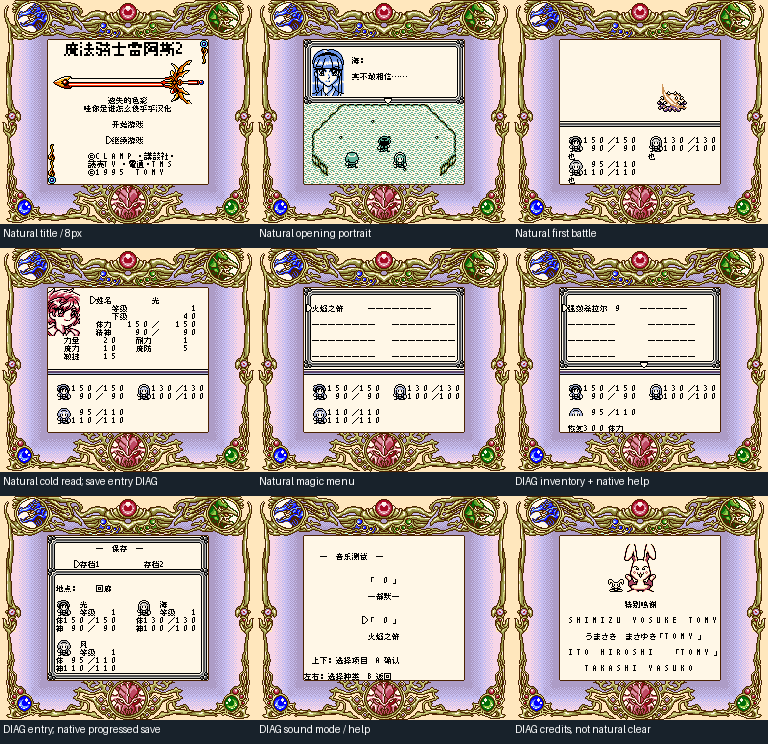
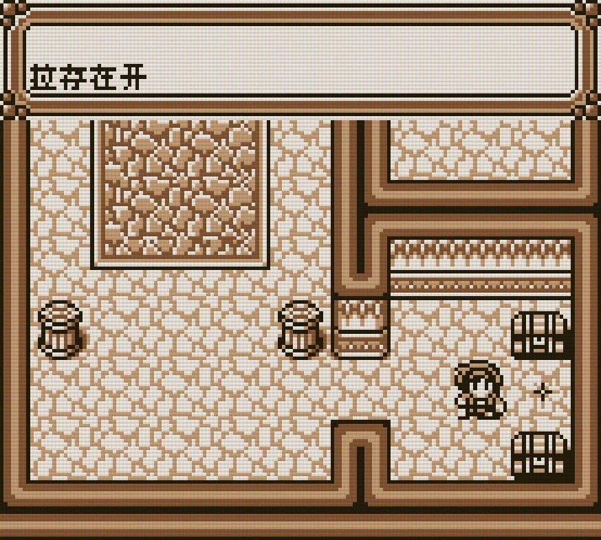
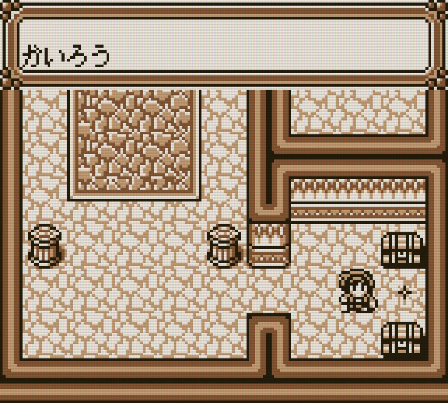
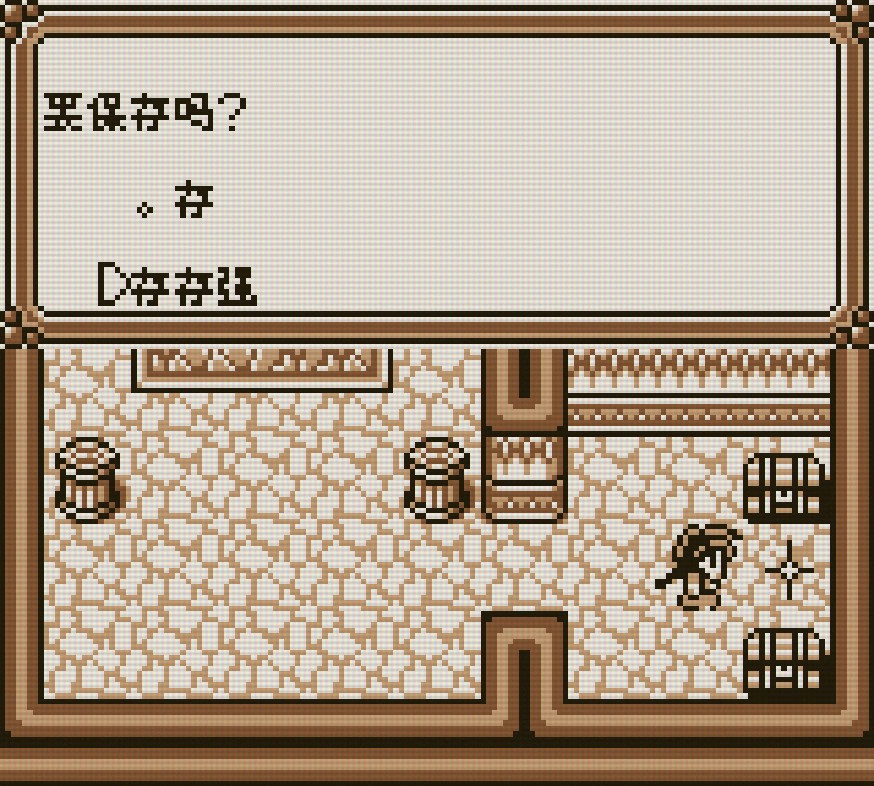
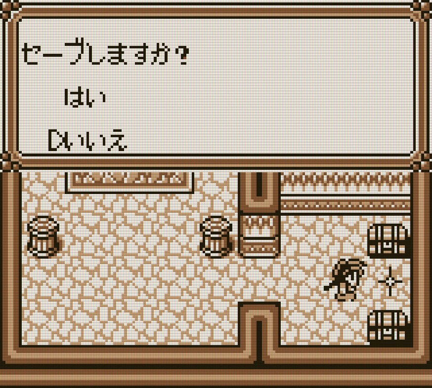
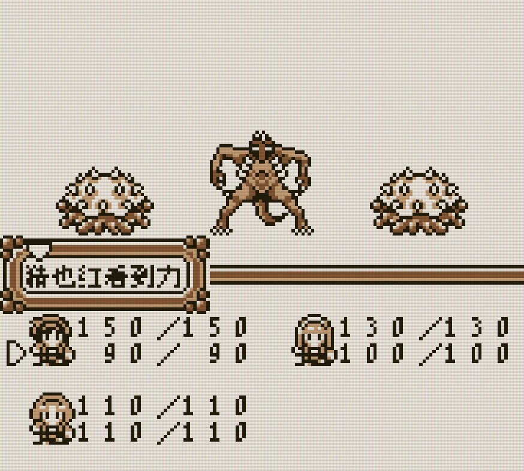
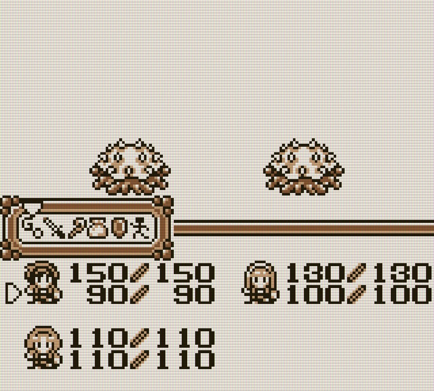

# 魔法骑士雷阿斯2：遗失的色彩：公开反馈

[报告BUG](https://github.com/shiyi1133/youxi-hanhua-releases/issues/new?template=bug_report.md)。请说明实际版本、字号、必要触发步骤和已有截图，不上传ROM、存档、即时状态或私人资料。

当前公开索引尚未登记本作BUG反馈；这不代表没有BUG、已全通或已实机验收。开放问题不等于正在修复。

[贴吧原需求](https://tieba.baidu.com/p/11092365551?pid=154054777028#154054777028)。

## 维护者交付通知：v0.1.0（限定测试版）

[贴吧实际答复](https://tieba.baidu.com/p/11092365551?pid=154064621013#p154064621013)（184楼，PID 154064621013；原关联楼层回复）。

以下为去除下载信息后的维护者通知摘要，不是玩家测试结论，也不是原文全文。

> 《魔法骑士雷阿斯2：遗失的色彩》v0.1.0限定测试版已发布。
> 字号：普通8px；标题位图，无10px，保256KiB/MBC2与原SGB标记。
> 范围：347剧情/349UI字段、固定人物/物品魔法敌名/保存/声音/credits职务/标题；未知深入口不冒全可达
> 原答复中的ROM下载链接、提取码、网盘目录及下载指示已省略；私库保留完整原文证据。

原答复全文UTF-8 SHA-256：`dbd2daaae0c2042203dd68a3de83562dbd517b539a6f966f0c16e25d2899976d`（313字节）。

魔法骑士雷阿斯2：遗失的色彩 v0.1.0 8px限定测试版；普通8px；标题位图，无10px，保256KiB/MBC2与原SGB标记 自然路径与诊断范围见测试说明，不代表全流程。

[贴吧该PID第1张实际公开图片](https://tiebapic.baidu.com/forum/pic/item/5f812134349b033ba7a049dd53ce36d3d539bd3d.jpg?tbpicau=2026-11-04-05_e9536ae7204cd7c95c3bf75102dd88d4)。

原PNG SHA-256：`b7c9996b483e0272d46be748227c8d95a3af52e28a8dc2915eb6c4c2d9b75bf3`；贴吧公开图片 SHA-256：`ddfcaa28a4bd2dfa401b376e54ea9a4fb42a3f6fefa575e406b11e6d8f325250`。

原答复全文与全部图片已按该PID公开核验；此镜像不新增通关、实机、独立QA、源码完整性或BUG全部修复结论。

## 20261102-1113 增量反馈

玩家报告2代部分文字不通顺或疑似乱码；中日版对照图1—4可见对白、保存提示及选项的异常汉字组合。玩家未说明完整触发路线或ROM文件名、版本、字号及完整哈希。已分别登记，不把当前发布参考身份当作玩家ROM，也未运行复现或确认根因。

同一反馈的图5—6对照显示中文版战斗命令栏为连续汉字，日版为小图标。此项与对白和保存选项异常分别登记；玩家实际ROM身份未知，未运行复现或确认具体图块、字库根因。

[原反馈](https://tieba.baidu.com/p/11092365551?pid=154095031992#154095031992)

> （附日版对比）楼主这版2代有些地方……不太通顺？不知道算不算乱码。然后就是战斗菜单原本的小图标也变成了一串汉字      

原字节SHA256 30a555063c399ae2d619a2ff52a82a103f17853493ae143fc798489675a14a21，296320字节。

原字节SHA256 bae8384831d1399de845b50a39de4c940f334879c043623e2d0b107ded71a43b，295852字节。

原字节SHA256 956ea40d796888aec6c9de56cdda4278b79b5c8db1d22c675f4f86c97440f794，270813字节。

原字节SHA256 f0569d5d69de5643f07bb06b8bf31bf596d7ff787152c5a274fbe9d863cf70a7，271554字节。

原字节SHA256 08ce92fb8508ab5376866754b452f5942e079b97e39b2d46705017e59486b6d5，221017字节。

原字节SHA256 dfa569bdcbfd23157f75284fa0c5b3b88eaec80d1c609f3a717cf1a1904e4022，217885字节。

[已核公开答复](https://tieba.baidu.com/p/11092365551?pid=154097628619#154097628619)：《魔法骑士雷阿斯》1代的NPC台词，以及2代的台词和战斗菜单图标问题已记录。请补一下两份ROM的文件名或版本号，方便对应排查。

