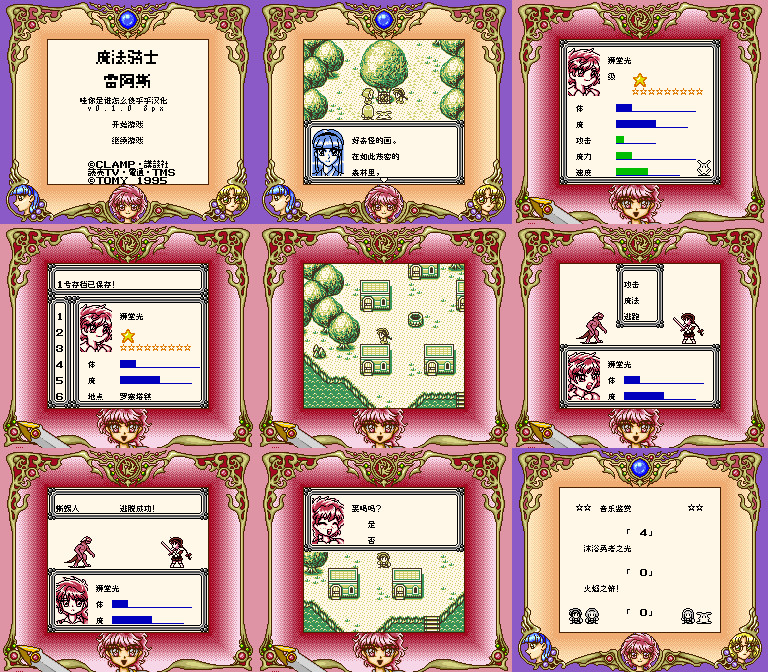

# 魔法骑士雷阿斯：公开反馈

[报告BUG](https://github.com/shiyi1133/youxi-hanhua-releases/issues/new?template=bug_report.md)。请说明实际版本、字号、必要触发步骤和已有截图，不上传ROM、存档、即时状态或私人资料。

当前公开索引尚未登记本作BUG反馈；这不代表没有BUG、已全通或已实机验收。开放问题不等于正在修复。

[贴吧原需求](https://tieba.baidu.com/p/11092365551?pid=154054777028#154054777028)。

## 维护者交付通知：v0.1.0（限定测试版）

[贴吧实际答复](https://tieba.baidu.com/p/11092365551?pid=154064620280#p154064620280)（184楼，PID 154064620280；原关联楼层回复）。

以下为去除下载信息后的维护者通知摘要，不是玩家测试结论，也不是原文全文。

> 《魔法骑士雷阿斯》v0.1.0限定测试版已发布。
> 字号：普通8px；标题两倍图字，不是10px；原生SGB图案/调色并非GBC或后期上色。
> 范围：633剧情/37内联UI/113动态字段含36敌名20地点43音乐语音条目与标题图；保版权/工作人员原文名，固定角色无自由命名
> 原答复中的ROM下载链接、提取码、网盘目录及下载指示已省略；私库保留完整原文证据。

原答复全文UTF-8 SHA-256：`3d6cd89d5bf1021bcc65f77403b04bcd7d6b355c0849575a2694bdc6c992f12a`（275字节）。

魔法骑士雷阿斯 v0.1.0 8px限定测试版；普通8px；标题两倍图字，不是10px；原生SGB图案/调色并非GBC或后期上色 自然路径与诊断范围见测试说明，不代表全流程。

[贴吧该PID第1张实际公开图片](https://tiebapic.baidu.com/forum/pic/item/bf0357df8db1cb130f4189149b54564e92584b3c.jpg?tbpicau=2026-11-04-05_b7124999c7cfa72424f01ea824732bcb)。

原PNG SHA-256：`62bca3e9d7fbe476e3feffecb42e11ee1a88b666870b7b5b2168d4cc0cdfc1c3`；贴吧公开图片 SHA-256：`73788ae8040d68e60346d710555ff90b84673d84f8db0fb30bda784491c7c56b`。

原答复全文与全部图片已按该PID公开核验；此镜像不新增通关、实机、独立QA、源码完整性或BUG全部修复结论。
