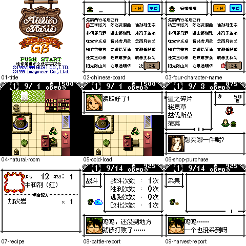

# 玛丽的炼金工坊GB

原输入：Marie no Atelier GB

原输入完整SHA256：`12c844ad512d2b210fb61847161606ba0e8a7349c27a2b0f896d687f4d6fba8e`。此处“原输入”保留改版、既有汉化或地区修订身份，不一律称干净零售ROM。

| 字号 | 当前版本 | 音频 | 输出完整SHA256 |
| --- | --- | --- | --- |
| native12px-names8px | v0.1.0 | unchanged | `3a3614424bca5f9f311d5319029107c157ca868c20376638f5e721b974bd86e7` |

## 源码与补丁

- native12px-names8px／v0.1.0／unchanged：源码包（完整性未独立确认）：[下载](https://github.com/shiyi1133/youxi-hanhua-releases/releases/download/source-migration-20261022-02a/marie-no-atelier-gb-current-source-a380b6fe38d1-public-r01.zip)（ZIP SHA256 `0fedcbc374e6de9750e848fe38ea22d61d28dc4a8f91a163ea1c041a19429b22`）；补丁：[下载](https://github.com/shiyi1133/youxi-hanhua-releases/releases/download/patch-migration-20261022/marie-no-atelier-gb-current-patches.zip)（ZIP SHA256 `83b109fff21a5c7651f5a59c2decf0807873348b2342502af19ccdb45dfe41b3`）。
  该包已核对对应版本与字节安全；完整修改源码覆盖范围未独立确认。

补丁须直接应用于完整SHA一致的实际原输入；普通字、大字和音乐变体分别核对。公开源码归档不表示本轮重新构建或通过新的运行验收。原作、字体、已有翻译及工具依赖的权利与许可，依各包对应许可保留。

## 范围与验证边界

- native12px-names8px／v0.1.0：原生正文/全角菜单12px，姓名/半角及小图像标签8px；一份混合原生字号普通版，无单独10px或大字版。。
  9903文本ID/6745唯一原文已识别译文；提供者CGB/DMG中文取名、普通保存/新进程电池冷读、学院购买与菜单/配方/失败出征统计样本。
  成功调合、深层成功出征、全结局/全流程、通信与真实硬件未验；失败出征不当成功战斗。
  09采集统计页及08战斗统计页不是成功通关；配方列表不当实际成功调合。
  深层文字主要静态；最长动态变量组合未全部运行验证。
  仅有限旧日文/有进度中文原生存档样本；不是全部旧档兼容保证。
  SGB模式原版/候选游戏区均黑屏，未通过；CGB图不能当SGB画面。

本次资料搬运未新增模拟器、实机或全通验收；未记录或未测试的范围不写成通过。问题单开放只表示尚未关闭，已关闭也不单独证明全部场景都修复。

[公开反馈及问题状态](feedback.md) · [报告BUG](https://github.com/shiyi1133/youxi-hanhua-releases/issues/new?template=bug_report.md)

## 对应版本截图

玛丽的炼金工坊GB v0.1.0 native12px-names8px；原生正文/全角菜单12px，姓名/半角及小图像标签8px；一份混合原生字号普通版，无单独10px或大字版。；最终ROM真实九宫格（自然/诊断/续行边界按本说明）

图像SHA256：`eb658e4662de91aa83b243c53baea9a8386e8ffbccdfc495a10c019a0cc550d2`；绑定ROM SHA256：`3a3614424bca5f9f311d5319029107c157ca868c20376638f5e721b974bd86e7`。

