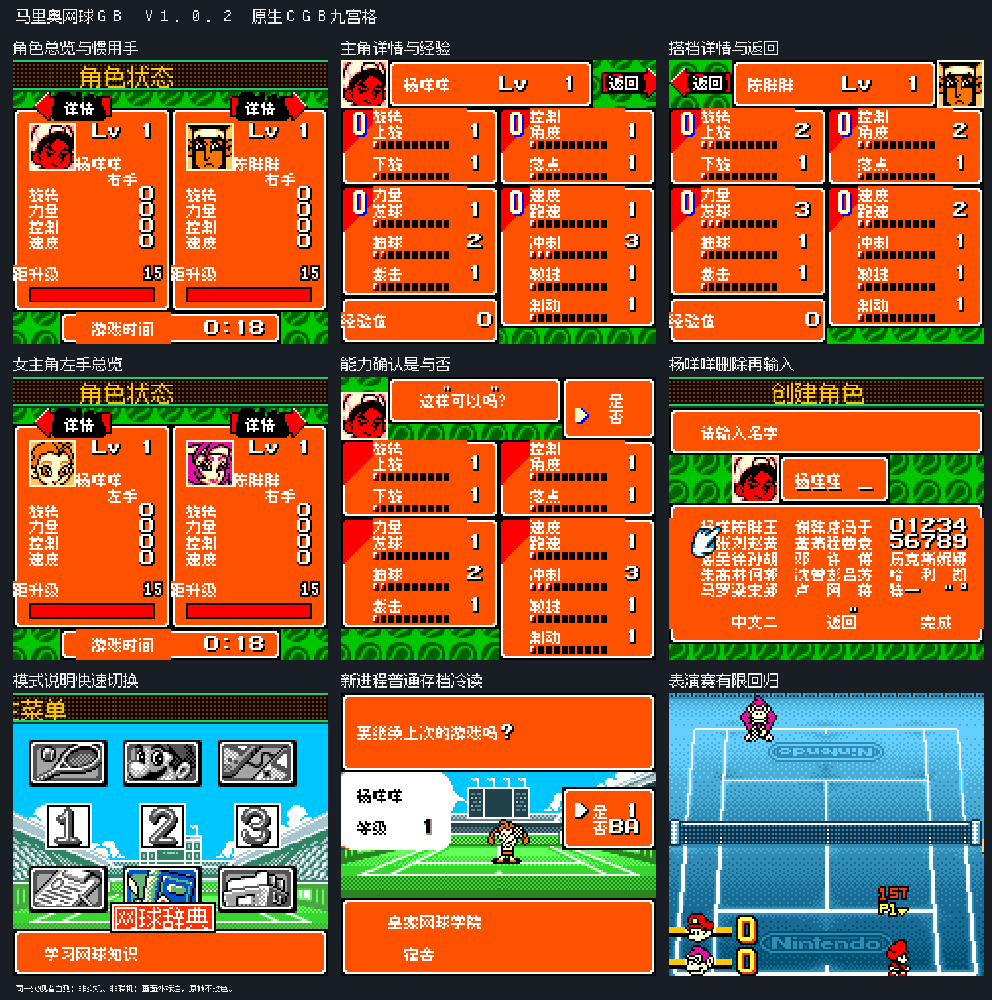
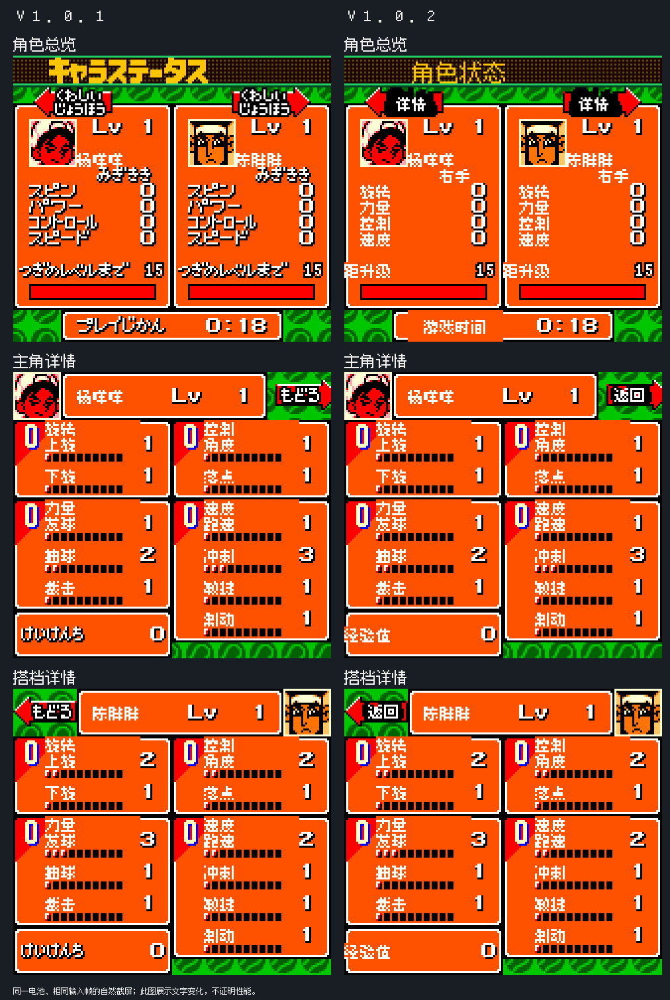

# 马里奥网球GB

原输入：Mario Tennis GB (Japan; requester filename and MOBILETENS/BM8J header identity)

原输入完整SHA256：`bc9d363cd702693a3af5c3e089e6881fbdbe2d9162995fe601243d2029fd26d7`。此处“原输入”保留改版、既有汉化或地区修订身份，不一律称干净零售ROM。

| 字号 | 当前版本 | 音频 | 输出完整SHA256 |
| --- | --- | --- | --- |
| 8px | v1.0.2限定修复测试版 | unchanged | `fff3c4a157a544ea1286a58599b42bd83cfac2da1c26ca84fc8d25ca6aff3745` |

## 源码与补丁

- 8px／v1.0.2限定修复测试版／unchanged：源码包（完整性未独立确认）：[下载](https://github.com/shiyi1133/youxi-hanhua-releases/releases/download/source-migration-20261022-04/mario-tennis-gb-current-scope-source-public-r01.zip)（ZIP SHA256 `cac5656b74aa0e0ea3ed1e548c41e57a0c3c91c7cd6662563aac9aa4da1d7b7c`）；补丁：[下载](https://github.com/shiyi1133/youxi-hanhua-releases/releases/download/patch-migration-20261022/mario-tennis-gb-current-patches.zip)（ZIP SHA256 `51f2d657291d01f5bce6bd9b514c81f0f9d23f15ced78d9fab476857bf18eb30`）。
  该包已核对对应版本与字节安全；完整修改源码覆盖范围未独立确认。

补丁须直接应用于完整SHA一致的实际原输入；普通字、大字和音乐变体分别核对。公开源码归档不表示本轮重新构建或通过新的运行验收。原作、字体、已有翻译及工具依赖的权利与许可，依各包对应许可保留。

## 范围与验证边界

- 8px／v1.0.2限定修复测试版：普通Fusion Pixel8px既有范围；无大字；原生紧凑UI/图像范围按说明。
  补译RPG角色总览/主角与搭档详情图片文字：标题、左右手、四属性、距升级、游戏时间、返回与经验值；保留v1.0.1模式刷新与能力确认。
  RPG图片是本版新修范围，比赛深层日文仍未全面覆盖；既有反馈复合剩余范围保持open。
  标题底色/球拍美术和Logo偏好未改；新报告能力确认框上方半引号白点本版仍可见，不把18个标签框BDF零差异冒称框外噪点已修。
  未自然全通、后期数值/条形穷举、全部剧情换行、实机、联机或N64连接；同版自然状态续接与电池冷读分别记录，不当独立人员QA。
  静态4045条控制/1433字形/110姓名槽审计及144注入VRAM向量是静态/诊断，不能冒称自然全场景。
  维护本次仅独立核ZIP/CRC/全SHA、原输入、BPS严格回补与截图逐像素绑定，未执行附包源码/依赖/模拟器或开展汉化。
  按用户AGENTS本轮Source上传0；完整源码、存档/即时状态/依赖二进制仅本地，不装入玩家ROM/补丁ZIP；原输入复用统一单ROM ZIP不重复上传。
  换版先备份原生电池存档；不保证任意历史即时状态跨版兼容。

本次资料搬运未新增模拟器、实机或全通验收；未记录或未测试的范围不写成通过。问题单开放只表示尚未关闭，已关闭也不单独证明全部场景都修复。

[公开反馈及问题状态](feedback.md) · [报告BUG](https://github.com/shiyi1133/youxi-hanhua-releases/issues/new?template=bug_report.md)

## 对应版本截图

马里奥网球GB v1.0.2限定修复测试版 普通8px；提供方最终ROM画面，诊断/自然范围按图及证据明确标注，未新增维护运行。

图像SHA256：`3c9ae04d58a5b69d765d547d0536148cead57a54635b80ab78ec62b549a0a5c7`；绑定ROM SHA256：`fff3c4a157a544ea1286a58599b42bd83cfac2da1c26ca84fc8d25ca6aff3745`。

旧版本与当前修复测试版的真实对比，按图内原版本标签区分。

图像SHA256：`5288c5ac24961ed860c97b5c5acb9d6e7552e1c98925a0d3c9f90b941d1b0008`；绑定ROM SHA256：`fff3c4a157a544ea1286a58599b42bd83cfac2da1c26ca84fc8d25ca6aff3745`。

