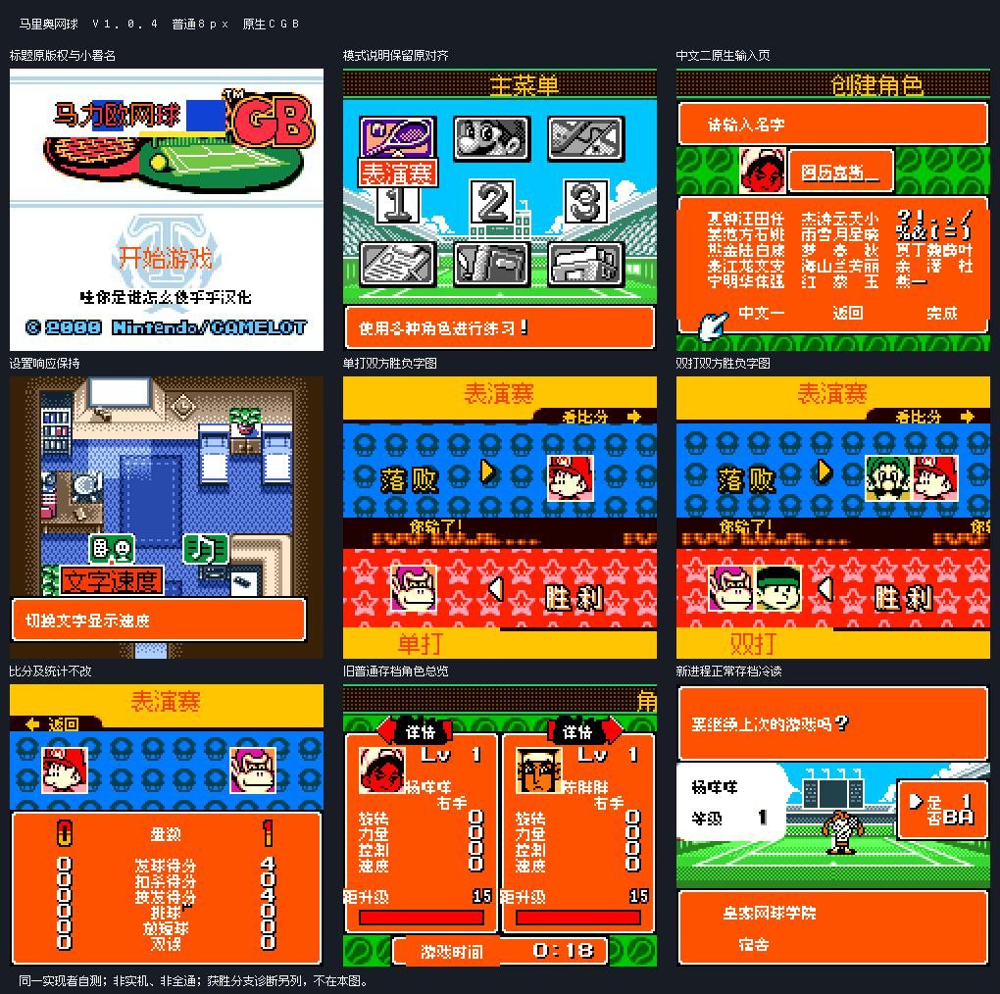

# 马里奥网球GB v1.0.4（限定测试版）

[源码与补丁Release](https://github.com/shiyi1133/youxi-hanhua-releases/releases/tag/mario-tennis-gb-v1.0.4) · [公开反馈](feedback.md) · [报告BUG](https://github.com/shiyi1133/youxi-hanhua-releases/issues/new?template=bug_report.md)

原游戏／实际输入：Mario Tennis GB (Japan; requester filename and MOBILETENS/BM8J header identity)

原输入完整 SHA-256：`bc9d363cd702693a3af5c3e089e6881fbdbe2d9162995fe601243d2029fd26d7`（2097152字节）。

范围：原生普通8px独立胜负结果字图及滚动胜负背景文字；12px仅原尺寸结果图片区，非大字版。

## 8px v1.0.4 / unchanged

字号范围：原生普通8px独立胜负结果字图及滚动胜负背景文字；12px仅原尺寸结果图片区，非大字版。

目标完整 SHA-256：`015f59f383576bd808fd82621b325c6901cb80fda23ddfc5fe85eb94bbd060ee`（4194304字节）。

补丁：`MarioTennisGB_v1.0.4.bps`，SHA-256 `bb99904f59cf89a20d62e7e3e07bae2646f1cfe0257fc3abdfc064debd81202e`。

[源码（完整性未独立确认）](https://github.com/shiyi1133/youxi-hanhua-releases/releases/download/mario-tennis-gb-v1.0.4/mario-tennis-gb-v1.0.4-complete-source.zip) · [补丁包](https://github.com/shiyi1133/youxi-hanhua-releases/releases/download/mario-tennis-gb-v1.0.4/mario-tennis-gb-v1.0.4-patches.zip)

原生普通8px独立胜负结果字图及滚动胜负背景文字；12px仅原尺寸结果图片区，非大字版。；提供方对应最终ROM图证，具体自然/诊断类别见原图标签及材料；非维护运行、全通或实机验收。

## 测试及限制

提供方自然范围：提供方报告的自然/正常按键流程，维护未重跑。

提供方诊断范围：提供方明确标注的受控消费者、解锁或边界测试，不能冒充自然到达。

保存边界：仅按具体版本材料，不推定所有旧存档兼容。

维护本轮独立核原输入、补丁逐字节还原、ZIP/CRC、Source安全与原图字节；未执行提供方源码、未重建或运行ROM，未宣称独立人员QA、实机或全流程验收。

- 未验证：维护仅独立核用户输入ZIP/ROM完整SHA、补丁逐字节还原、ZIP成员/CRC与源包静态材料；未执行提供者源码、重建工程或运行ROM。
- 未验证：运行、自然按键、受控诊断、保存/新进程冷读等范围以所附提供方报告分别为据，不冒充维护重跑、独立人员QA、玩家验收、实机或全流程通关。
- 未验证：使用前备份普通存档；不跨ROM版本/字号套用即时状态，旧电池兼容仅按提供方实际样本说明。
