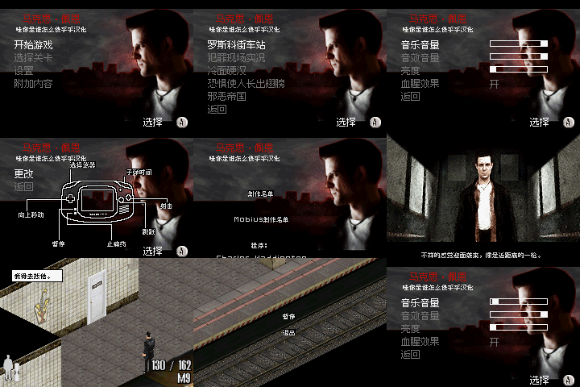

# 马克思·佩恩

原输入：MAX PAYNE（提供原件头部标题）

原输入完整SHA256：`f40118daf0fa2a80169edcfe82b030e4c01aa9d7397f7a462ea25ac3c155b3e8`。此处“原输入”保留改版、既有汉化或地区修订身份，不一律称干净零售ROM。

| 字号 | 当前版本 | 音频 | 输出完整SHA256 |
| --- | --- | --- | --- |
| 8px+12px-native | v0.1.0 | unchanged | `5726f8ab312b188279c596b9ccd93e1bf9fec42222df695ace310441aa45be91` |

## 源码与补丁

- 8px+12px-native／v0.1.0／unchanged：源码包（完整性未独立确认）：[下载](https://github.com/shiyi1133/youxi-hanhua-releases/releases/download/source-migration-20261022-02a/max-payne-gba-current-source-18b78e52cc92-public-r01.zip)（ZIP SHA256 `ad6a6c609be462444ff5eb5591ae1400310c8d68a3d68cca70b2bd9820642fb0`）；补丁：[下载](https://github.com/shiyi1133/youxi-hanhua-releases/releases/download/patch-migration-20261022/max-payne-gba-current-patches.zip)（ZIP SHA256 `9946651939e308894cf4ea8c37570155794ddba12a764806218123605efafa6a`）。
  该包已核对对应版本与字节安全；完整修改源码覆盖范围未独立确认。

补丁须直接应用于完整SHA一致的实际原输入；普通字、大字和音乐变体分别核对。公开源码归档不表示本轮重新构建或通过新的运行验收。原作、字体、已有翻译及工具依赖的权利与许可，依各包对应许可保留。

## 范围与验证边界

- 8px+12px-native／v0.1.0：普通原生字号：两套8px及一套原生12px字体消费者，16像素高分上下条带；无独立10px或大字版。。
  普通原生字号：两套8px及一套原生12px字体消费者，16像素高分上下条带；无独立10px或大字版。
  未自然全通、后段事件/全部武器/全部结局/死亡续关、实机、长时或不同模拟器兼容性验收。
  仅音量设置EEPROM冷读通过；有进度过关存档冷读与旧版进度存档兼容未验证。
  装饰性场景/漫画英文、品牌/版权/人名及其它语言槽保留；原作无玩家命名入口；调试字符串保留不等于证明不可达。

本次资料搬运未新增模拟器、实机或全通验收；未记录或未测试的范围不写成通过。问题单开放只表示尚未关闭，已关闭也不单独证明全部场景都修复。

[公开反馈及问题状态](feedback.md) · [报告BUG](https://github.com/shiyi1133/youxi-hanhua-releases/issues/new?template=bug_report.md)

## 对应版本截图

九格为同一最终ROM帧；前2格冷启动，第3–8格从同ROM菜单即时状态继续，第9格设置电池冷读，见测试边界。本次独立逐格核对240×160原生PNG、同目标SHA侧证与720×480拼图像素完全一致。未重跑模拟器，不作为独立人员QA或全流程验收。

图像SHA256：`21aee5f10be5ee8d57c0b683e601568bacb73405861d06ad2358bc1a25eb347b`；绑定ROM SHA256：`5726f8ab312b188279c596b9ccd93e1bf9fec42222df695ace310441aa45be91`。

