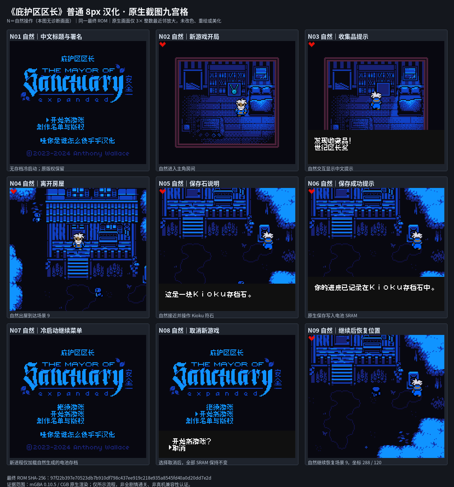

# 庇护区区长

原输入：The Mayor of Sanctuary

原输入完整SHA256：`596915f0765f6b44fff680ce4b9fe0396696fdf4e7e46836a0c392af671bbd02`。此处“原输入”保留改版、既有汉化或地区修订身份，不一律称干净零售ROM。

| 字号 | 当前版本 | 音频 | 输出完整SHA256 |
| --- | --- | --- | --- |
| 8px | v1.0.0 | unchanged | `97f22b397e70523db7b910df798c437ee919c218e935a8545fd40a0d20dd7e2d` |

## 源码与补丁

- 8px／v1.0.0／unchanged：源码包（完整性未独立确认）：[下载](https://github.com/shiyi1133/youxi-hanhua-releases/releases/download/source-migration-20261022-04/mayor-of-sanctuary-current-scope-source-public-r01.zip)（ZIP SHA256 `259a1375ee661e66b4213663bb93014bacec6b6b5d3621c09991e5d1482288cf`）；补丁：[下载](https://github.com/shiyi1133/youxi-hanhua-releases/releases/download/patch-migration-20261022/mayor-of-sanctuary-current-patches.zip)（ZIP SHA256 `18573fadce08e1320f7fb06a4c1c8bccb0d75a19cab2288b40c4d03f217be408`）。
  该包已核对对应版本与字节安全；完整修改源码覆盖范围未独立确认。

补丁须直接应用于完整SHA一致的实际原输入；普通字、大字和音乐变体分别核对。公开源码归档不表示本轮重新构建或通过新的运行验收。原作、字体、已有翻译及工具依赖的权利与许可，依各包对应许可保留。

## 范围与验证边界

- 8px／v1.0.0：普通原生8px，按实际CGB-only头保留；不认证DMG/SGB可玩。。
  普通原生8px，按实际CGB-only头保留；不认证DMG/SGB可玩。
  未完整通关、全部支线/结局自然推进、实机或闪卡；诊断消费者通过不等于全部剧情可达。

本次资料搬运未新增模拟器、实机或全通验收；未记录或未测试的范围不写成通过。问题单开放只表示尚未关闭，已关闭也不单独证明全部场景都修复。

[公开反馈及问题状态](feedback.md) · [报告BUG](https://github.com/shiyi1133/youxi-hanhua-releases/issues/new?template=bug_report.md)

## 对应版本截图

九格均为提供方同目标自然操作及电池冷读路线，无诊断画面。；对应 v1.0.0 8px 最终ROM。

图像SHA256：`66b894d53c90133cda7bbeaed0784fe73e1870086408746bd49a7f426b03a0b2`；绑定ROM SHA256：`97f22b397e70523db7b910df798c437ee919c218e935a8545fd40a0d20dd7e2d`。

