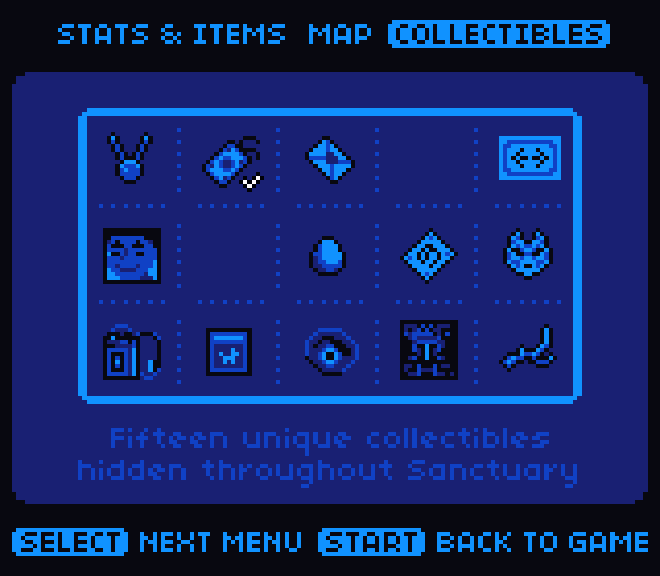

# 庇护区区长：公开反馈

以下为已公开证据摘录，不能自动当成已经复现或修复。下载／存档分享地址、本机路径或项目署名文字省略时逐条标记。

## 问题状态

此前导出时尚无可关联的镜像问题记录；本轮已补充收藏品页英文反馈、实收译版身份及登记答复，见下文。本仓库未另建公开 Issue，这不表示完成全面测试。

问题单开放不等于正在修复；关闭不自动代表所有报告症状全部验收。玩家实际ROM SHA未知时仍保留未知，当前版本的参考SHA见[游戏页面](README.md)。

## 20261024-0412 公开反馈补充

公开 BUG 入口：[提交反馈](https://github.com/shiyi1133/youxi-hanhua-releases/issues/new/choose)。

117楼 · 可可洛图书馆 · [原回帖](https://tieba.baidu.com/p/11092365551?pid=154063415679#154063415679)

> 已测试可以正常通关，只有按start菜单再按select键切换到收藏品界面后整个节目会变回未汉化的英文界面。

已省略原件/ROM/即时状态下载链接、提取码、客户端附文及本机路径；保留反馈原话，其余全文可回原楼查阅。

- [覆盖反馈] 庇护区区长：START后SELECT收藏品界面恢复英文：已记录，开放待核。

玩家实收 ROM 已核为 v1.0.0 普通8px，4194304字节，完整 SHA256 与对应已发布目标一致；原输入字节仍未知。新增图片为玩家另附的网盘截图原件，维护未运行复现或修复。

[已公开登记答复](https://tieba.baidu.com/p/11092365551?pid=154064806892#154064806892)：@可可洛图书馆 v1.0.0普通8px收藏品界面切回英文已记录，后续排查。感谢通关反馈。

除另注已实收核验的译版 ROM 外，玩家实际输入/输出 SHA 未核定。图片与通关描述仅为玩家反馈；本次没有新增维护运行复现、修复或完整流程验收。

## 20261025-1619 公开反馈更新

按当前实际未关闭问题去重：纯BUG 0 项，建议/覆盖等 0 项，分类待核 0 项。开放不代表正在修复。

- START后SELECT收藏页英文恢复（记录版本：v1.0.1）：限定证据已核验；原报告范围关闭；该证据不代表当前最新版或整作全通。

玩家实际完整ROM字节未知时仍保留未知；自然流程、原生消费者诊断及静态证据分别记录，不外推实机或全流程。
