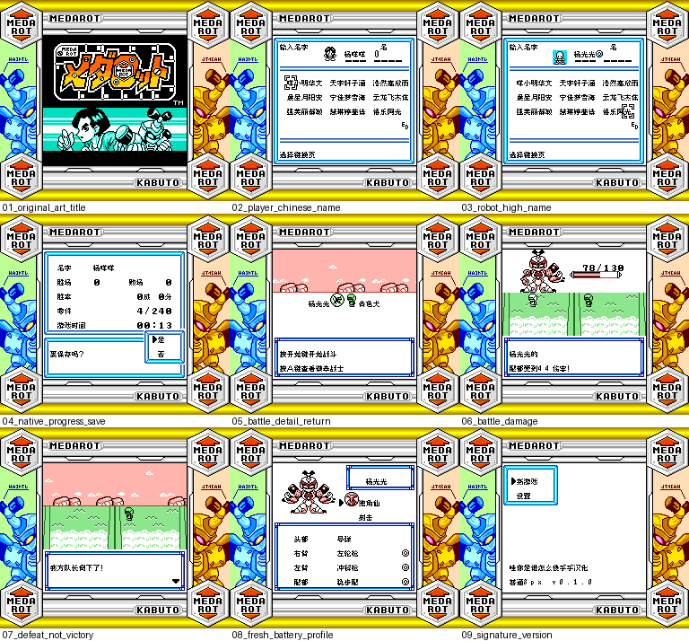

# 徽章战士 初代独角仙版

原输入：Medarot - Kabuto Version (Rev 1)

原输入完整SHA256：`3ee50992a8cde0c1e7bb2bf1d812bf3d9577cd1f0c3da0c072d52806b5a774ec`。此处“原输入”保留改版、既有汉化或地区修订身份，不一律称干净零售ROM。

| 字号 | 当前版本 | 音频 | 输出完整SHA256 |
| --- | --- | --- | --- |
| 8px | v0.1.0 | unchanged | `face4be35d94feae401ad3112d41454d6d1110474711221fb0d6cd7446a32d54` |

## 源码与补丁

- 8px／v0.1.0／unchanged：源码包（完整性未独立确认）：[下载](https://github.com/shiyi1133/youxi-hanhua-releases/releases/download/source-migration-20261022-04/medarot-1-kabuto-current-scope-source-public-r01.zip)（ZIP SHA256 `4effc3631eac167e541be297c5c4dec38b1fb06e8f2654651aa76f2b35d04938`）；补丁：[下载](https://github.com/shiyi1133/youxi-hanhua-releases/releases/download/patch-migration-20261022/medarot-1-kabuto-current-patches.zip)（ZIP SHA256 `8d7b6380b7fa960dd6d490e2af6dc6a83212d5b1b2cf01ad8935d62a4b948d9b`）。
  该包已核对对应版本与字节安全；完整修改源码覆盖范围未独立确认。

补丁须直接应用于完整SHA一致的实际原输入；普通字、大字和音乐变体分别核对。公开源码归档不表示本轮重新构建或通过新的运行验收。原作、字体、已有翻译及工具依赖的权利与许可，依各包对应许可保留。

## 范围与验证边界

- 8px／v0.1.0：原生8px普通字；无大字版。。
  Japan Rev1 GB/SGB，普通原生8px；1632对白指针、560列表、102文字图块中文实现；18格行宽，控制/变量/选项顺序保留；原艺术标题与SGB色彩边框保留。有限44姓/44名字表及原假名页，无10px。
  实际商店购买
  首战胜利
  全部最长变量/头像/分页组合自然路径
  完整通关
  联机
  实机

本次资料搬运未新增模拟器、实机或全通验收；未记录或未测试的范围不写成通过。问题单开放只表示尚未关闭，已关闭也不单独证明全部场景都修复。

[公开反馈及问题状态](feedback.md) · [报告BUG](https://github.com/shiyi1133/youxi-hanhua-releases/issues/new?template=bug_report.md)

## 对应版本截图

徽章战士 初代独角仙版 v0.1.0 8px；原生8px普通字；无大字版。；最终ROM真实九宫格（自然/诊断/续行边界按本说明）

图像SHA256：`402fe2ad668403c1c11f28cec9bdcef1bacee6ffdcb35bebc73659c20a59b23e`；绑定ROM SHA256：`face4be35d94feae401ad3112d41454d6d1110474711221fb0d6cd7446a32d54`。

